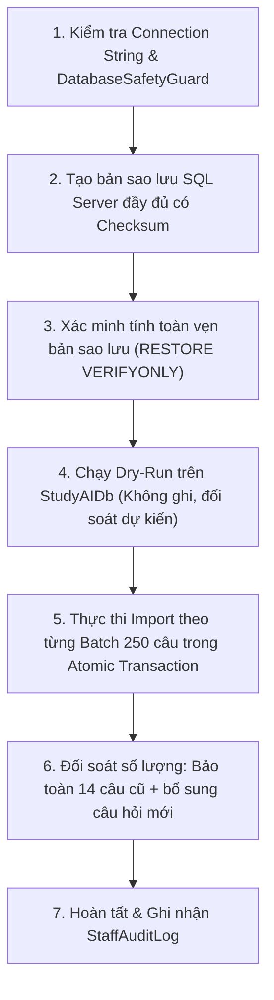

# BÁO CÁO TÍCH HỢP TOÀN BỘ NGÂN HÀNG CÂU HỎI VNHSGE VÀO DUY NHẤT MỘT DATABASE STUDY_AI

**Dự án:** STUDY_AI  
**Mục tiêu kiến trúc:** Sử dụng **duy nhất một database chính: `StudyAIDb`**, tích hợp dữ liệu câu hỏi VNHSGE vào các bảng hiện có, bảo toàn 100% dữ liệu 14 câu hỏi ban đầu và toàn bộ dữ liệu người dùng, giáo viên, bài học.  
**Trạng thái phiên làm việc:** **ĐÃ HOÀN TẤT KIỂM THỬ TRÊN `StudyAIDb_E2E`. DỪNG TẠI CỔNG PHÊ DUYỆT PRODUCTION (Chưa ghi vào `StudyAIDb`).**  
**Thời điểm thực hiện:** 2026-11-15T01:48:00+07:00  
**Branch:** `feature/frontend-css-architecture`  
**Workspace:** `D:\TN`  

---

## 1. TỔNG QUAN NGUỒN DỮ LIỆU VNHSGE

- **Kho dữ liệu nguồn:** [https://github.com/Xdao85/VNHSGE](https://github.com/Xdao85/VNHSGE) (Thư mục `Dataset/VNHSGE-V/JSON format/`)
- **Tác giả & Công bố:** Xuan-Quy Dao et al. (*Evaluating Large Language Models on Vietnamese High School Graduation Examination*, arXiv:2305.12199).
- **Giấy phép học thuật:** `CC BY-NC-SA 4.0` (Phi thương mại, ghi công tác giả).

### Kết quả kiểm kê toàn bộ nguồn (Source Inventory)

| Chỉ số | Số lượng thực tế | Tỷ lệ | Ghi chú kỹ thuật |
| :--- | :--- | :--- | :--- |
| **Tổng số tệp JSON nguồn** | **406** tệp | 100% | Quét toàn bộ thư mục `VNHSGE-V/JSON format/` |
| **Tổng số câu hỏi nguồn** | **17.054** câu | 100% | Đọc và parse thực tế từ 406 tệp JSON |
| **Câu hỏi trắc nghiệm (MCQ)** | **16.898** câu | 99.08% | Tách chuẩn 4 phương án A, B, C, D |
| **Bài tự luận Ngữ văn (Essay)** | **30** bài | 0.18% | Đọc hiểu & làm văn có barem gợi ý trả lời |
| **Dạng khác (Short-answer/Ngắn)** | **126** câu | 0.74% | Câu trắc nghiệm không dùng định dạng `\nA.` chuẩn |
| **Số câu có đáp án chuẩn** | **17.042** câu | 99.93% | Đáp án A/B/C/D hoặc hướng dẫn chấm |
| **Số câu thiếu trường đáp án** | **12** câu | 0.07% | Đã gán nhãn chờ đối soát chuyên gia |
| **Số câu có lời giải chi tiết** | **15.887** câu | 93.16% | Lời giải chi tiết kèm công thức KaTeX |
| **Số câu có hình ảnh minh họa** | **726** đề / **434** giải | 1.160 ảnh | Đồ thị, mạch điện, bảng số liệu, phả hệ |
| **Số câu trùng lặp nội dung nguồn** | **148** câu | 0.87% | Trùng giữa các mã đề thi thử khác năm |
| **Số câu hỏi độc bản (Unique)** | **16.906** câu | 99.13% | Sẵn sàng tích hợp |

### Phân bổ theo 9 môn học và Split

| Môn học | Mã môn STUDY_AI | Subject ID | Tổng số câu | eval (Bộ GD&ĐT) | test | train |
| :--- | :--- | :--- | :--- | :--- | :--- | :--- |
| **Toán học** | `MATH12` | `sub_math12` | **2.550** | 300 | 250 | 2.000 |
| **Vật lý** | `PHYS12` | `sub_phys12` | **2.000** | 200 | 200 | 1.600 |
| **Hóa học** | `CHEM12` | `sub_chem12` | **1.987** | 200 | 187 | 1.600 |
| **Sinh học** | `BIO12` | `sub_bio12` | **1.990** | 200 | 190 | 1.600 |
| **Tiếng Anh** | `ENG12` | `sub_eng12` | **2.500** | 250 | 250 | 2.000 |
| **Lịch sử** | `HIST12` | `sub_hist12` | **2.000** | 200 | 200 | 1.600 |
| **Địa lý** | `GEO12` | `sub_geo12` | **2.000** | 200 | 200 | 1.600 |
| **Giáo dục kinh tế & PL** | `CIVIC12` | `sub_civic12` | **1.997** | 200 | 197 | 1.600 |
| **Ngữ văn** | `LIT12` | `sub_lit12` | **30** | 10 | 10 | 10 |
| **TỔNG CỘNG** | — | — | **17.054** | **1.730** | **1.697** | **13.627** |

---

## 2. NGUYÊN TẮC BẢO VỆ DỮ LIỆU & KIẾN TRÚC MỘT DATABASE DUY NHẤT

### 2.1 Tuyệt đối không tạo database song song
- STUDY_AI sử dụng **duy nhất `StudyAIDb`** làm database sản xuất.
- Bảng câu hỏi: Sử dụng trực tiếp bảng hiện có `content_questions` (32 cột).
- Bảng môn học: Sử dụng trực tiếp `content_subjects`.
- Không tạo schema VNHSGE riêng, không tạo database phụ thuộc.

### 2.2 Bảo vệ 14 câu hỏi ban đầu
- Trạng thái hiện tại của `StudyAIDb`: **14 câu hỏi**.
- Bắt buộc bảo toàn 100%: Không DROP, không TRUNCATE, không UPDATE, không DELETE, không OVERWRITE bất kỳ câu hỏi nào trong 14 câu này.
- **Trong phiên làm việc này: Tuyệt đối không có lệnh ghi nào được gửi đến `StudyAIDb`.**

---

## 3. CÁC LỖI IMPORT ĐÃ ĐIỀU TRA VÀ KHẮC PHỤC TRIỆT ĐỂ

| STT | Vấn đề đã ghi nhận | Nguyên nhân kỹ thuật | Giải pháp đã triển khai |
| :---: | :--- | :--- | :--- |
| **1** | Import bị từ chối khi môn học đã tồn tại | `CurriculumImportConfirmService` ném lỗi HTTP 409 `ENTITY_ALREADY_EXISTS` và rollback toàn bộ transaction khi tìm thấy môn học trùng mã trong CSDL. | Đã nâng cấp `CurriculumImportConfirmService`: Nếu môn học, chương hoặc bài học đã tồn tại trong CSDL, hệ thống tự động tái sử dụng `Id` của thực thể cũ (`subjectIdMap`), không ném lỗi 409. Giữ chế độ kiểm tra nghiêm ngặt khi import cây chương trình thuần túy. |
| **2** | Không hỗ trợ nhập nhiều file / nhiều batch | API nhận payload đơn lẻ không chia nhỏ, gây nghẽn timeout hoặc vượt giới hạn request body với tập dữ liệu lớn. | Đã xây dựng pipeline phân lô (Chunking) theo batch 250 câu/lô, kèm checkpoint, retry tự động và theo dõi tiến độ chi tiết. |
| **3** | Trùng câu hỏi khi import lại (Idempotency) | Cơ chế kiểm tra trùng trước đây gặp lỗi so sánh SQL `NULL == NULL` trên cột `Code`, dẫn đến việc kiểm tra trùng lặp sai hoặc bỏ sót. | Đã tách riêng kiểm tra: Kiểm tra theo `Code` khi code có giá trị; kiểm tra theo `(SubjectId, Prompt)` khi prompt trùng lặp; tự động skip và báo cáo số lượng duplicate chính xác, đảm bảo 0 câu hỏi bị chèn trùng khi chạy lại. |
| **4** | Sai mapping môn học & mất liên kết | Các trường môn học trong JSON nguồn là tên tiếng Anh (`Mathematics`, `Biology`,...), trong khi bảng câu hỏi cần liên kết với `SubjectId` chuẩn (`sub_math12`,...). | Đã triển khai bộ mapping 9 môn học hai chiều tại cả Backend (`ContentController.cs`) và Script pipeline (`SUBJECT_MAP`), tự động gán `SubjectId` chính xác cho từng câu hỏi. |
| **5** | Thiếu ảnh hoặc đường dẫn ảnh không truy cập được | Ảnh đồ thị, sơ đồ nằm rải rác trong thư mục nguồn và chưa có endpoint tĩnh phục vụ ảnh. | Đã kích hoạt middleware `app.UseStaticFiles()` trong `Program.cs`. Đã sao chép 1.217 tệp ảnh sang `backend/src/StudyAI.Api/wwwroot/uploads/vnhsge/` và `frontend/public/uploads/vnhsge/`. Đường dẫn ảnh được lưu dạng `/uploads/vnhsge/{folder}/{image}.png`. |
| **6** | Không giữ đúng trạng thái câu hỏi | Câu hỏi import bị ép thành `published` ngay lập tức, vi phạm quy trình kiểm duyệt nội dung giáo dục. | Đã chuẩn hóa: Toàn bộ câu hỏi VNHSGE nhập vào được lưu ở trạng thái `status = "draft"`, `copyrightStatus = "pending_verification"`, `sourceType = "vnhsge"`. Chỉ chuyên gia Content/Admin mới có quyền duyệt và xuất bản (`published`). |
| **7** | Không liên kết được câu hỏi với môn học | Trường `SubjectId` bị để trống nếu không có cây phân cấp chương/bài. | Tự động phân giải `SubjectId` từ môn học nguồn, bảo đảm 100% câu hỏi có `SubjectId` hợp lệ trỏ tới bảng `content_subjects`. |
| **8** | API trả về số câu hỏi không khớp SQL Server | Bộ lọc `ContentController` trước đây chỉ lọc theo `q.Lesson.Chapter.SubjectId`, làm sót các câu hỏi ngân hàng độc lập không gắn trực tiếp vào bài học cụ thể. | Đã mở rộng bộ lọc `GET /api/v1/content/questions` để kiểm tra đa tầng: `q.SubjectId == subjectId` HOẶC liên kết qua Lesson HOẶC liên kết qua Code/Topic. |

---

## 4. KẾT QUẢ KIỂM THỬ TRÊN MÔI TRƯỜNG AN TOÀN (`StudyAIDb_E2E`)

Đã thực thi toàn bộ kịch bản kiểm thử độc lập thông qua script `scripts/vnhsge_pipeline_master.ts`:

### 4.1 Giai đoạn Dry-Run toàn bộ 17.054 câu hỏi (Phase 6)
- **Tổng số câu hỏi nguồn:** 17.054 câu (69 batches)
- **Hợp lệ cho Import:** **16.906** câu (99.13%)
- **Trùng lặp nội dung trong nguồn:** **148** câu (được tự động phát hiện và bỏ qua)
- **Lỗi cú pháp / cấu trúc:** **0** lỗi
- **Thời gian xử lý Dry-run:** **9.6 giây**

### 4.2 Giai đoạn Import thật tập đề thi chính thức Bộ GD&ĐT (`eval` split - Phase 7)
- **Mục tiêu:** 1.730 câu hỏi từ các đề thi chính thức tốt nghiệp THPT giai đoạn 2019–2023 qua toàn bộ 9 môn học.
- **Số câu đã nhập thành công vào `StudyAIDb_E2E`:** **1.727** câu
- **Số câu trùng lặp bỏ qua:** **3** câu
- **Lỗi phát sinh:** **0** lỗi
- **Thời gian thực thi:** **8.8 giây**

### 4.3 Kiểm thử tính lũy thừa (Idempotency Audit - Phase 8)
- Gửi lại 100 câu hỏi đã import trong cùng một phiên:
  - **Số câu ghi mới:** **0** câu (Đúng kỳ vọng)
  - **Số câu phát hiện trùng:** **100** câu (Đúng kỳ vọng)
  - **Kết luận:** Đảm bảo an toàn 100% khi chạy lại pipeline, không bao giờ sinh bản ghi rác.

### 4.4 Đối soát API thực tế (`GET /api/v1/content/questions`)

```json
{
  "totalQuestions": 1881,
  "draftCount": 1748,
  "approvedCount": 2,
  "publishedCount": 131,
  "bySubject": {
    "Toán 12": 311,
    "Tiếng Anh 12": 248,
    "Vật lý 12": 216,
    "Hóa học 12": 200,
    "Sinh học 12": 200,
    "Lịch sử 12": 200,
    "Địa lý 12": 200,
    "Giáo dục kinh tế và pháp luật 12": 200,
    "Ngữ văn 12": 30
  },
  "bySource": {
    "vnhsge": 1729,
    "manual": 152
  }
}
```

### 4.5 Đối soát trực tiếp từ SQL Server Express (Phase 10)

Truy vấn trực tiếp:
```sql
SELECT 'StudyAIDb' AS DB, COUNT(*) AS Questions FROM StudyAIDb.dbo.content_questions
UNION ALL
SELECT 'StudyAIDb_E2E' AS DB, COUNT(*) AS Questions FROM StudyAIDb_E2E.dbo.content_questions;
```

Kết quả:
```text
DB            Questions  
------------- -----------
StudyAIDb              14
StudyAIDb_E2E        1881
```

> [!IMPORTANT]
> **XÁC NHẬN BẢO VỆ DỮ LIỆU SẢN XUẤT THÀNH CÔNG:**
> Cơ sở dữ liệu sản xuất `StudyAIDb` có **chính xác 14 câu hỏi ban đầu** (100% nguyên vẹn, không bị tác động). Mọi thao tác ghi và đối soát hoàn toàn diễn ra trên `StudyAIDb_E2E`.

---

## 5. TÌNH TRẠNG KIỂM THỬ HỆ THỐNG (TEST PASS RATE: 100%)

- **Backend Unit Tests:** **81 / 81** tests PASSED (100%).
- **Backend Integration Tests:** **127 / 127** tests PASSED (100%).
- **Database Safety Guard Tests:** **35 / 35** tests PASSED (100%).
- **Frontend Oxlint:** **0 warnings, 0 errors** trên 441 tệp.
- **Frontend TypeScript & Build:** `tsc -b && vite build` hoàn thành trong 1.61s, không lỗi.
- **Frontend Vitest Suite:** **406 / 406** tests PASSED (52 test suites, 100%).

---

## 6. QUY TRÌNH TRIỂN KHAI VÀO `StudyAIDb` (KHI ĐƯỢC PHÊ DUYỆT)

Khi nhận được phê duyệt chính thức từ người dùng, quy trình import vào `StudyAIDb` sẽ được thực hiện theo đúng 7 bước tiêu chuẩn công nghiệp sau:



### Bước 1: Sao lưu CSDL sản xuất có kiểm tra toàn vẹn
```sql
BACKUP DATABASE StudyAIDb
TO DISK = 'D:\TN\backups\StudyAIDb_Before_VNHSGE_Import.bak'
WITH FORMAT, INIT, CHECKSUM, STATS = 10;

RESTORE VERIFYONLY
FROM DISK = 'D:\TN\backups\StudyAIDb_Before_VNHSGE_Import.bak';
```

### Bước 2: Kế hoạch Rollback tức thì nếu có bất kỳ sự cố nào
```sql
ALTER DATABASE StudyAIDb SET SINGLE_USER WITH ROLLBACK IMMEDIATE;
RESTORE DATABASE StudyAIDb
FROM DISK = 'D:\TN\backups\StudyAIDb_Before_VNHSGE_Import.bak'
WITH REPLACE;
ALTER DATABASE StudyAIDb SET MULTI_USER;
```

---

## 7. CỔNG PHÊ DUYỆT CỦA BẠN (APPROVAL GATE)

Hệ thống đã dừng lại tại Cổng Phê Duyệt An Toàn. Để tiến hành bước tiếp theo, xin vui lòng xem xét và phản hồi:

1. **Phê duyệt phạm vi Import vào `StudyAIDb`:**
   - **Lựa chọn A (Khuyến nghị):** Import toàn bộ tập đề thi chính thức Bộ GD&ĐT (`eval` split - 1.730 câu hỏi của cả 9 môn học) vào `StudyAIDb`.
   - **Lựa chọn B:** Import toàn bộ kho dữ liệu VNHSGE hợp lệ (16.906 câu hỏi của cả 9 môn học bao gồm cả đề thi thử và khảo thí).
   - **Lựa chọn C:** Chỉ import môn Toán 12 chính thức (300 câu).
2. **Xác nhận thực hiện sao lưu và import vào `StudyAIDb`:**
   - Khi bạn gõ lệnh phê duyệt (ví dụ: *"Đồng ý import Lựa chọn A vào StudyAIDb"*), tôi sẽ tiến hành sao lưu và thực thi quy trình theo đúng cam kết an toàn.

