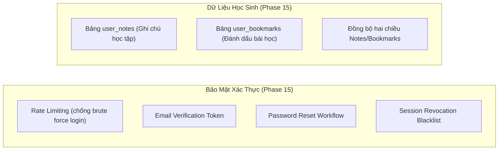
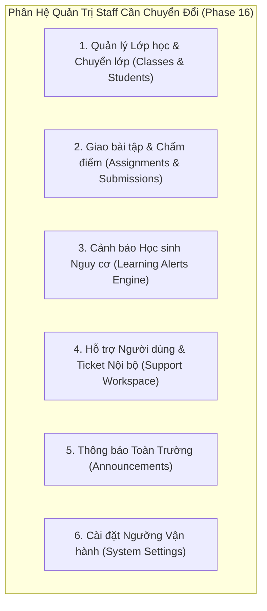

# STUDY_AI — AUTH & ADMIN ARCHITECTURE ROADMAP
## Kiến Trúc Xác Thực, Phân Quyền & Lộ Trình Triển Khai Backend Staff Operations

Tài liệu này đánh giá chi tiết nền tảng Auth & Admin hiện có của STUDY_AI và xác định lộ trình cụ thể cho Phase 15 (Auth Hardening & Learner Persistence) và Phase 16 (Admin & Staff Real Backend Persistence).

---

## 1. ĐÁNH GIÁ NỀN TẢNG AUTH & ADMIN HIỆN TẠI (PHASE 14 AUDIT)

Hệ thống hiện tại đã sở hữu nền tảng xác thực và kiểm soát quản trị chuẩn công nghiệp tại `backend/app/api/auth.py`, `backend/app/api/admin.py`, và `backend/app/api/deps.py`:

### 1.1. 5 Endpoints Xác Thực Cốt Lõi:
1. `POST /api/v1/auth/register`:
   - Tiếp nhận email, password, display_name.
   - Băm mật khẩu an toàn bằng `pwd_context` (bcrypt với salt ngẫu nhiên).
   - Kiểm tra email duy nhất (`unique constraint`), gán vai trò mặc định là `student`.
2. `POST /api/v1/auth/login`:
   - Xác thực email và mật khẩu bằng `pwd_context.verify`.
   - Sinh Access Token (JWT thời hạn ngắn 15-30 phút).
   - Sinh Refresh Token ngẫu nhiên (UUID hoặc cryptographically secure hex), lưu hash vào cột `refresh_token` trong bảng `users`, đồng thời set cookie `refresh_token` với cờ `HttpOnly`, `SameSite=Lax`, `Secure` (trong môi trường production).
   - Trả về JSON `{ "accessToken": "...", "tokenType": "bearer", "user": {...} }`.
3. `POST /api/v1/auth/refresh`:
   - Đọc refresh token từ HttpOnly cookie.
   - Xác thực token khớp với hash trong cơ sở dữ liệu và kiểm tra thời hạn sống.
   - **Cơ chế Refresh Token Rotation**: Hủy token cũ, sinh refresh token mới, cập nhật DB và set cookie mới.
   - Cấp access token mới vào bộ nhớ client.
4. `POST /api/v1/auth/logout`:
   - Xóa hash refresh token trong cơ sở dữ liệu (`user.refresh_token = None`).
   - Xóa HttpOnly cookie bằng cách set thời hạn hết hạn ngay lập tức (`max_age=0`).
5. `GET /api/v1/me`:
   - Trả về thông tin hồ sơ của người dùng hiện tại dựa trên JWT Bearer token được xác minh.

### 1.2. Phân Quyền & Bảo Vệ Quản Trị Hệ Thống:
- **RBAC Guard (`require_role`)**:
  - Hỗ trợ 5 vai trò hệ thống: `student`, `teacher`, `content`, `support`, `admin`.
  - Router được bảo vệ nghiêm ngặt bằng dependency injection của FastAPI.
- **Bảo vệ Quản Trị Viên Cuối Cùng (Last Active Admin Protection)**:
  - Khi thực hiện thay đổi vai trò hoặc khóa tài khoản tại `backend/app/api/admin.py`:
  - Hệ thống đếm số lượng admin đang hoạt động (`role == 'admin'` và `status == 'active'`).
  - Nếu số lượng bằng 1 và tài khoản đó bị hạ quyền hoặc vô hiệu hóa, hệ thống chặn hành động và ném HTTP 400 Bad Request: *"Không thể vô hiệu hóa hoặc đổi vai trò của Quản trị viên cuối cùng đang hoạt động."*
- **Ghi Vết Kiểm Toán Nhân Viên (Staff Audit Log)**:
  - Mọi thao tác quản trị (tạo tài khoản, đổi vai trò, khóa người dùng) đều tự động ghi vết vào bảng `staff_audit_logs` với actor_id, target_id, action, chi tiết JSON và thời điểm timestamp.

---

## 2. KHOẢNG TRỐNG VÀ LỘ TRÌNH PHASE 15 (AUTH HARDENING & LEARNER DATA PERSISTENCE)

Mục tiêu Phase 15: Nâng cấp bảo mật xác thực cấp doanh nghiệp và chuyển đổi các tính năng học sinh còn lưu cục bộ sang cơ sở dữ liệu.

### Danh sách Endpoints cần xây dựng trong Phase 15:
1. `POST /api/v1/auth/forgot-password`: Gửi email mã token đặt lại mật khẩu với thời hạn 15 phút.
2. `POST /api/v1/auth/reset-password`: Tiếp nhận token và mật khẩu mới, cập nhật mật khẩu và thu hồi toàn bộ phiên đăng nhập cũ.
3. `POST /api/v1/auth/verify-email`: Xác nhận địa chỉ email qua liên kết an toàn.
4. `POST /api/v1/auth/revoke-all-sessions`: Thu hồi toàn bộ refresh token của tài khoản trên tất cả thiết bị khi phát hiện nguy cơ bảo mật.
5. `GET /api/v1/notes` & `POST /api/v1/notes`: Lưu trữ và đồng bộ ghi chú học sinh vào bảng cơ sở dữ liệu `user_notes`.
6. `GET /api/v1/bookmarks` & `POST /api/v1/bookmarks`: Lưu trữ và đồng bộ mục đánh dấu bài học vào bảng `user_bookmarks`.

---

## 3. KHOẢNG TRỐNG VÀ LỘ TRÌNG PHASE 16 (ADMIN & STAFF REAL BACKEND PERSISTENCE)

Mục tiêu Phase 16: Thay thế hoàn toàn 9 file `.mock.ts` trong các phân hệ quản lý trường học bằng API và Database thật.

### Danh mục Bảng Cơ Sở Dữ Liệu & Router cần triển khai trong Phase 16:
1. **Quản lý Lớp học (`classes`, `class_members`)**:
   - Router: `/api/v1/teacher/classes`
   - Chức năng: Tạo lớp, mã lớp độc nhất, sĩ số, thêm học sinh vào lớp, chuyển lớp.
2. **Quản lý Bài tập (`assignments`, `assignment_submissions`)**:
   - Router: `/api/v1/teacher/assignments`
   - Chức năng: Giao bài tập theo hạn nộp, chấm bài, phản hồi nhận xét và trả kết quả.
3. **Cảnh báo Học tập (`learning_alerts`)**:
   - Router: `/api/v1/teacher/alerts`
   - Chức năng: Tự động phát hiện học sinh vắng học, điểm sụt giảm hoặc chưa hoàn thành bài tập, cho phép giáo viên giải quyết cảnh báo.
4. **Hỗ trợ Kỹ thuật (`support_tickets`, `ticket_messages`)**:
   - Router: `/api/v1/support/tickets`
   - Chức năng: Tiếp nhận khiếu nại từ học sinh, phân công nhân viên hỗ trợ, gửi phản hồi và ghi chú nội bộ bí mật.
5. **Thông báo Hệ thống (`announcements`)**:
   - Router: `/api/v1/admin/announcements`
   - Chức năng: Đăng thông báo ghim, chọn đối tượng nhận thông báo (tất cả, chỉ học sinh, chỉ giáo viên).
6. **Cài đặt Hệ thống (`system_settings`)**:
   - Router: `/api/v1/admin/settings`
   - Chức năng: Lưu trữ ngưỡng điểm đạt (passing threshold), thời hạn phiên làm việc, giới hạn kích thước file upload.
