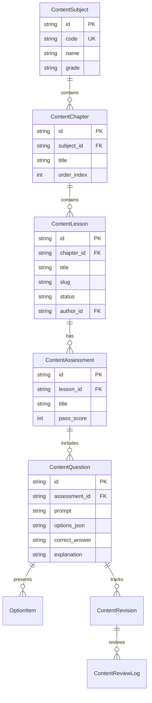
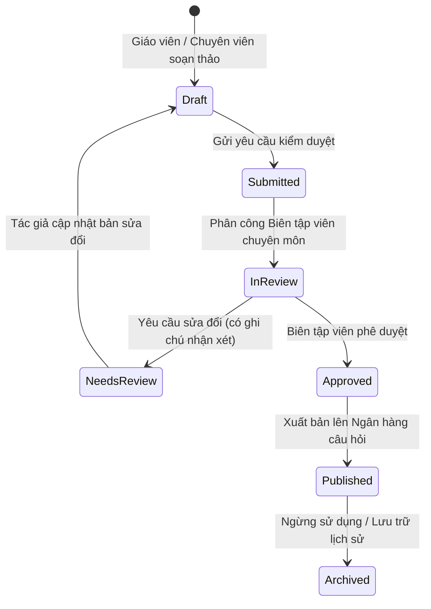
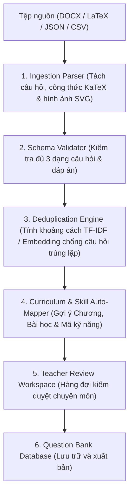

# STUDY_AI — CONTENT DEVELOPMENT & QUESTION PIPELINE ROADMAP
## Kiến Trúc Nội Dung GDPT 2018, Quy Trình Biên Tập Đa Cấp & Pipeline Nhập Liệu

Tài liệu này xác định kiến trúc nội dung tổng thể của STUDY_AI, quy trình kiểm duyệt chất lượng nghiêm ngặt và lộ trình triển khai chi tiết cho Phase 17 (Question Bank & Import Pipeline) và Phase 18 (Server-side Personalization & Learning Analytics).

---

## 1. MÔ HÌNH THỰC THỂ NỘI DUNG (CONTENT DOMAIN ENTITIES)

Kiến trúc nội dung của STUDY_AI phản ánh trung thực cấu trúc chương trình giáo dục phổ thông GDPT 2018:

### Các định dạng câu hỏi chuẩn GDPT 2018 được hỗ trợ:
1. **Multiple Choice (`multiple_choice`)**: Trắc nghiệm 4 lựa chọn (A, B, C, D) với đúng 1 đáp án chính xác.
2. **True / False Group (`true_false_group`)**: Trắc nghiệm đúng/sai theo nhóm 4 ý a), b), c), d) với thang điểm lũy tiến bộ GD&ĐT (1 ý: 0.1đ, 2 ý: 0.25đ, 3 ý: 0.5đ, 4 ý: 1.0đ).
3. **Short Answer (`short_answer`)**: Trắc nghiệm trả lời ngắn (số thực, phân số, tọa độ, khoảng biến thiên) không có gợi ý lựa chọn.

---

## 2. QUY TRÌNH BIÊN TẬP VÀ KIỂM DUYỆT NỘI DUNG (EDITORIAL WORKFLOW)

Quy trình bảo đảm chất lượng nội dung trải qua 6 trạng thái bắt buộc, ngăn chặn hoàn toàn câu hỏi sai sót hoặc chưa kiểm định lọt vào ngân hàng luyện tập của học sinh:

### Tiêu chí phê duyệt (Quality Gate Criteria):
- **Tính chính xác toán học**: Lời giải từng bước (step-by-step) đầy đủ, công thức KaTeX không lỗi cú pháp, đáp án không mâu thuẫn.
- **Tính sư phạm**: Phù hợp với chuẩn đầu ra GDPT 2018, gắn nhãn năng lực (Cognitive Level: Nhận biết, Thông hiểu, Vận dụng, Vận dụng cao) và mã kỹ năng (`skillIds`).
- **Nguồn gốc minh bạch**: Trích dẫn rõ ràng từ sách giáo khoa (Kết nối tri thức, Cánh diều, Chân trời sáng tạo) hoặc đề thi chính thức của Bộ Giáo dục & Đào tạo.

---

## 3. PIPELINE NHẬP LIỆU ĐỀ THI HÀNG LOẠT (PHASE 17 BATCH INGESTION)

Để mở rộng ngân hàng câu hỏi từ hàng trăm lên hàng chục ngàn câu hỏi, Phase 17 sẽ triển khai pipeline xử lý tài liệu tự động:

### Các giai đoạn của Pipeline:
1. **Parser Service**: Xử lý các định dạng phổ biến của giáo viên Việt Nam (Microsoft Word `.docx` chứa MathType / OMML, LaTeX `.tex`, JSON xuất từ các phần mềm trắc nghiệm).
2. **Validator**: Kiểm tra bắt buộc có lời giải chi tiết, không chấp nhận câu hỏi chỉ có đáp án trần không giải thích.
3. **Deduplicator**: So khớp nội dung câu hỏi mới với các câu hỏi đã có trong ngân hàng để loại trừ câu hỏi sao chép hoặc trùng đề thi.
4. **Auto-Mapper**: Sử dụng mô hình ngôn ngữ để phân tích câu hỏi và gán nhãn mã kỹ năng tương ứng (ví dụ: `math-12-sk-01`).

---

## 4. LỘ TRÌNH CÁ NHÂN HÓA PHÍA SERVER (PHASE 18 PERSONALIZATION & ANALYTICS SYNC)

Trong Phase 13 và 14, hệ thống cá nhân hóa và phát hiện lỗ hổng kiến thức đang hoạt động tại Frontend thông qua `evidenceAggregationEngine.ts` và `skillPerformanceEngine.ts`.

Lộ trình nâng cấp trong Phase 18:
1. **Server-side Aggregation Worker**:
   - Khi học sinh nộp bài thi (`POST /api/v1/attempts`), background worker sẽ tự động tổng hợp bằng chứng vào bảng `learner_skill_mastery`.
   - Lưu trữ lịch sử năng lực theo trục thời gian để hỗ trợ phân tích xu hướng dài hạn (Longitudinal Analytics).
2. **API Cá nhân hóa**:
   - `GET /api/v1/learner/analytics`: Cung cấp báo cáo tỷ lệ điểm quan sát được, mức độ đầy đủ của bằng chứng (Evidence Sufficiency) và xu hướng.
   - `GET /api/v1/learner/recommendations`: Cung cấp danh sách bài học và kỹ năng cần củng cố được sinh từ server.
   - `GET /api/v1/learner/adaptive-path`: Cung cấp lộ trình học tập cá nhân hóa được đồng bộ đa thiết bị.
