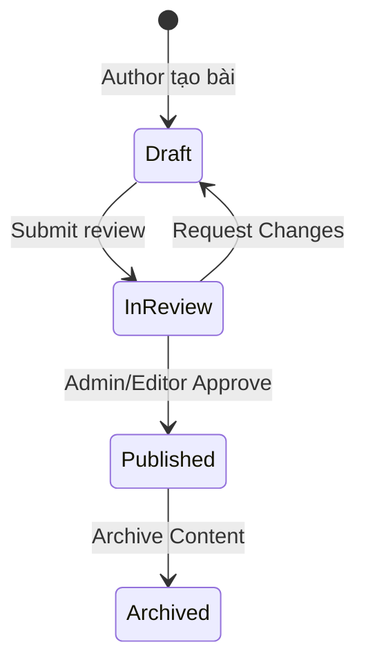

# Kiến trúc Quản lý Chường trình Học & Nội dung (Content Management Architecture)

## 1. Tổng quan

Hệ thống Content Management của **STUDY_AI** chịu trách nhiệm số hóa, quản trị, kiểm duyệt và phân phối toàn bộ học liệu (Toán lớp 12 và các môn THPT/THCS) trên cơ sở dữ liệu quan hệ Microsoft SQL Server.

Kiến trúc thiết lập ranh giới rõ rệt giữa:
1. **CMS Workspace (Staff/Admin)**: Quản lý Môn học (`ContentSubject`), Chương (`ContentChapter`), Bài học (`ContentLesson`) và Ngân hàng câu hỏi (`ContentQuestion`). Hỗ trợ quy trình kiểm duyệt (Moderation Workflow) và công thức toán học KaTeX/LaTeX.
2. **Learner Portal API (`/api/v1/curriculum/*`)**: Giao diện học tập dành cho học viên với nguyên tắc **Strict Zero-Leak Security**. Chỉ các học liệu ở trạng thái `published` thuộc về môn học và chương đang kích hoạt (`IsActive == true`) mới được truy cập. Bài học ở trạng thái `draft` hoặc `in-review` lập tức trả về HTTP 404.

---

## 2. Mô hình Dữ liệu Phân cấp (Hierarchical Hierarchy)

```
[ContentSubject] (Môn học: sub_math12, sub_phys12, ...)
       │
       ▼ (1:N)
[ContentChapter] (Chương học: chp_math12_c1, ...)
       │
       ▼ (1:N)
[ContentLesson] (Bài học: les_math12_c1_b1, ...)
       │
       ├─────────────────────────────────┐
       ▼ (1:N)                           ▼ (1:N)
[ContentQuestion] (Ngân hàng câu hỏi)    [ContentAssessment] (Đề đánh giá)
```

### Chi tiết Các Thực thể:
- **`ContentSubject`**: Mã môn (`Code`), tên (`Name`), khối lớp (`Grade`), thứ tự hiển thị (`OrderIndex`), trạng thái kích hoạt (`IsActive`).
- **`ContentChapter`**: Khóa ngoại `SubjectId`, tiêu đề (`Title`), mô tả (`Description`), thứ tự (`OrderIndex`), `IsActive`.
- **`ContentLesson`**: Khóa ngoại `ChapterId`, tiêu đề (`Title`), đường dẫn (`Slug`), trạng thái (`Status`: `draft` | `in-review` | `published`), tác giả (`AuthorId`), người duyệt (`ReviewedBy`), cùng các mảng JSON chuyên sâu:
  - `Introduction`: Dẫn nhập, mục tiêu bài học.
  - `DefinitionsJson`: Các định nghĩa, định lý cốt lõi.
  - `FormulasJson`: Công thức tính toán, dạng bài KaTeX.
  - `ExamplesJson`: Ví dụ minh họa kèm lời giải chi tiết.
  - `ImportantNotesJson`: Các lưu ý, bẫy đề thi.
  - `SummaryPointsJson`: Tóm tắt trọng tâm.
- **`ContentQuestion`**: Khóa ngoại `LessonId`, `ChapterId`, `SubjectId`, nội dung (`Prompt` hỗ trợ KaTeX), danh sách phương án (`OptionsJson`), đáp án đúng (`CorrectAnswer`), lời giải (`Explanation`), độ khó (`Difficulty`: `easy` | `medium` | `hard`), trạng thái (`Status`).

---

## 3. Ranh giới Bảo mật Zero-Leak (Zero-Leak Security Boundary)

### Nguy cơ:
Nếu API gửi danh sách câu hỏi kèm `CorrectAnswer` hoặc `Explanation` về phía client, học sinh có thể mở Network Tab / DevTools để đọc đáp án trước khi làm bài, làm sai lệch kết quả đánh giá năng lực của hệ thống AI.

### Giải pháp Bảo mật:
1. **Endpoint `GET /api/v1/curriculum/lessons/{lessonId}/questions`**:
   - DTO trả về chỉ gồm: `id`, `lessonId`, `prompt`, `options`, `topic`, `difficulty`, `type`, `orderIndex`.
   - Tuyệt đối **KHÔNG** chứa trường `CorrectAnswer` và `Explanation`.
2. **Endpoint `POST /api/v1/curriculum/lessons/{lessonId}/questions/{questionId}/check`**:
   - Học viên gửi lựa chọn `{ selectedOption: string }`.
   - Server-side thực hiện so khớp đáp án với database, tính điểm thưởng tương ứng với độ khó.
   - Chỉ khi học viên đã nợp câu trả lời, server mới phản hồi kết quả: `isCorrect`, `correctAnswer`, `explanation`, `scoreEarned`, `feedback`.

---

## 4. Quy trình Kiểm duyệt (Content Moderation State Machine)

Bài học tuân theo máy trạng thái nghiêm ngặt:



- **Draft**: Bài học đang biên soạn, chỉ nhìn thấy trong CMS bởi Content Staff và Admin.
- **In-Review**: Bài học đã khóa biên soạn và chuyển vào Hàng đợi xét duyệt của Hội đồng chuyên môn.
- **Published**: Bài học đã được phê duyệt chính thức, ngay lập tức hiển thị trên Cổng Học Viên (`/subjects`).
- **Audit Logging**: Mọi hành động tạo, sửa, duyệt, yêu cầu chỉnh sửa đều tự động ghi nhật ký vào bảng `staff_audit_logs`.
