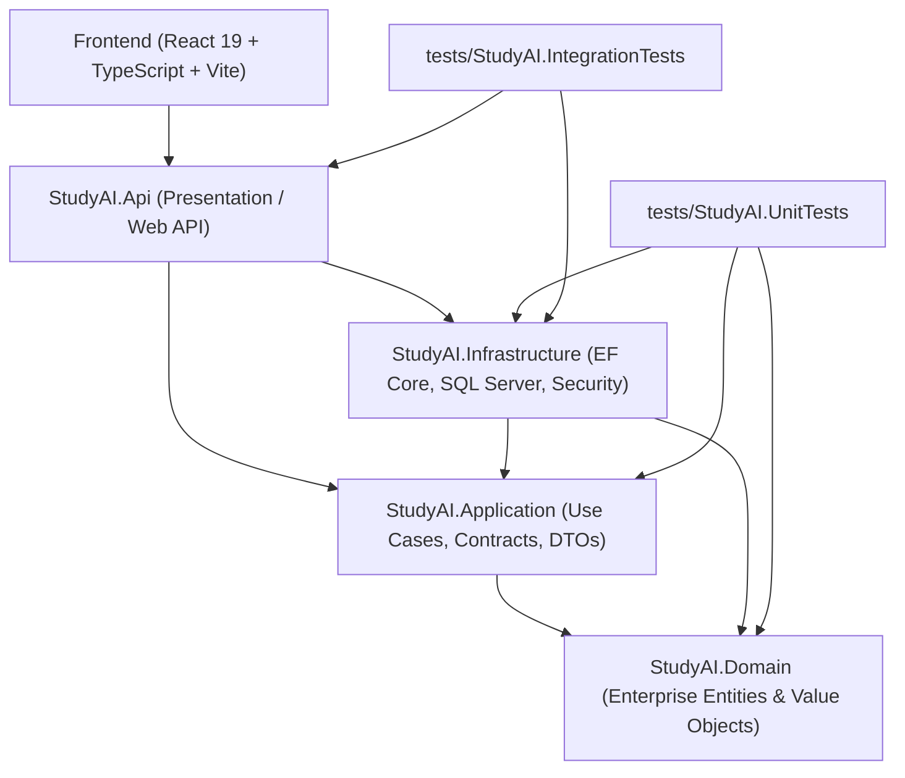

# STUDY_AI — .NET CLEAN ARCHITECTURE SPECIFICATION
## Phase 14A: ASP.NET Core & SQL Server Enterprise Backend

---

### 1. Kiến trúc tổng thể (Architecture Overview)

Backend của STUDY_AI được tái cấu trúc hoàn toàn từ Python/FastAPI sang **ASP.NET Core Web API (C#) trên nền tảng .NET LTS/10.0**, tổ chức chặt chẽ theo nguyên lý **Clean Architecture (Onion Architecture)** gồm 4 tầng phân tách độc lập và 2 dự án kiểm thử tự động.

---

### 2. Chi tiết các tầng trong Solution (`backend/StudyAI.sln`)

#### 2.1. `src/StudyAI.Domain`
- **Mục đích**: Chứa toàn bộ Enterprise Entities, Value Objects, Domain Enums và Logic nghiệp vụ cốt lõi độc lập hoàn toàn với framework và cơ sở dữ liệu.
- **Không phụ thuộc vào bất kỳ tầng nào khác** và không phụ thuộc vào Entity Framework Core hay Web API.
- **Entities chính**:
  - `User`: Quản trị định danh, mật khẩu Argon2id, vai trò RBAC (`admin`, `teacher`, `content`, `support`, `learner`), trạng thái tài khoản.
  - `RefreshSession`: Phiên làm việc làm mới bảo mật với SHA-256 token hash và cơ chế Rotation.
  - `StaffAuditLog`: Nhật ký kiểm toán mọi hành động quản trị, thay đổi vai trò, phê duyệt nội dung.
  - `LessonProgress`: Tiến độ học bài, section hoàn thành, điểm đánh giá.
  - `AssessmentAttempt` & `AssessmentResponse`: Lượt làm bài chi tiết theo từng câu hỏi, thời gian làm bài, điểm số thô và chuẩn hóa.
  - `LearningEvent`: Dữ liệu telemetry học tập dạng batch stream.
  - `ContentSubject`, `ContentChapter`, `ContentLesson`, `ContentAssessment`, `ContentQuestion`: Hệ thống phân phối nội dung GDPT 2018 (Toán 12).

#### 2.2. `src/StudyAI.Application`
- **Mục đích**: Đóng gói các quy tắc nghiệp vụ ứng dụng (Use Cases), DTOs (Data Transfer Objects), Contracts và Interfaces.
- **Chỉ phụ thuộc vào `StudyAI.Domain`** và `Microsoft.EntityFrameworkCore` abstractions.
- **Interfaces cốt lõi**:
  - `IApplicationDbContext`: Contract thống nhất để tầng Application truy vấn dữ liệu mà không bị ràng buộc bởi triển khai SQL Server cụ thể.
  - `IPasswordHasher`: Interface mã hóa và xác minh mật khẩu Argon2id.
  - `IJwtTokenService`: Interface tạo Access Token JWT và xoay vòng Refresh Token.
- **DTOs**:
  - `AuthDTOs`: `UserRegisterRequestDto`, `UserLoginRequestDto`, `UserResponseDto`, `AuthResponseDto`, `TokenRefreshResponseDto`.
  - `LessonProgressDTOs`: `LessonProgressCreateOrUpdateDto`, `LessonProgressResponseDto`.
  - `AssessmentDTOs`: `AssessmentAttemptCreateDto`, `AssessmentAttemptResponseDto`, `AssessmentResponseItemDto`.
  - `LearningEventDTOs`: `LearningEventItemDto`, `LearningEventBatchRequestDto`, `LearningEventBatchResponseDto`.
  - `SyncDTOs`: `BootstrapSyncRequestDto`, `BootstrapSyncResponseDto`.
  - `AdminDTOs`: `AdminDashboardDto`, `AdminUsersResponseDto`, `UpdateRoleRequestDto`, `UpdateStatusRequestDto`.
  - `ContentDTOs`: `ContentSubjectListResponseDto`, `ContentLessonDetailDto`, `CreateLessonRequestDto`, `UpdateLessonRequestDto`.

#### 2.3. `src/StudyAI.Infrastructure`
- **Mục đích**: Triển khai toàn bộ chi tiết kỹ thuật ngoại vi, tương tác I/O, lưu trữ SQL Server, EF Core DbContext, mã hóa bảo mật.
- **Phụ thuộc vào `StudyAI.Application` và `StudyAI.Domain`**.
- **Thành phần**:
  - `StudyAIDbContext`: Triển khai EF Core cho Microsoft SQL Server, thiết lập Fluent API, mapping khóa ngoại, quy tắc cascade delete, và chỉ mục (indexes).
  - `Argon2PasswordHasher`: Mã hóa mật khẩu đạt chuẩn RFC 9106 (`time_cost=2`, `memory_cost=19456`, `parallelism=1`) sử dụng `Konscious.Security.Cryptography.Argon2`.
  - `JwtTokenService`: Sinh JWT Access Token ký HMAC-SHA256 và chuỗi Refresh Token 48-byte URL-safe ngẫu nhiên với băm SHA-256.
  - `DbInitializer`: Tự động khởi tạo và gieo dữ liệu hạt giống (Seed Data) chuẩn mực: Quản trị viên (`admin@studyai.internal`), Học sinh (`learner@studyai.internal`), và môn Toán 12 Chương 1 Bài 1.

#### 2.4. `src/StudyAI.Api`
- **Mục đích**: Tầng giao diện REST Web API, cấu hình Middleware pipeline, Dependency Injection, CORS, JWT Authentication, Authorization Policies và Swagger/OpenAPI.
- **Controllers chính**:
  - `HealthController`: Endpoints `/health`, `/health/db` (kiểm tra sống còn và kết nối SQL Server thực tế), `/api/v1/health`.
  - `AuthController`: Đăng ký, đăng nhập, xoay vòng refresh token qua HttpOnly Cookie `study_ai_refresh_token`, đăng xuất, và truy vấn thông tin người dùng `/me`.
  - `MeController`: Quản lý tiến độ cá nhân, bài làm đánh giá, chuỗi sự kiện học tập telemetry, và đồng bộ bootstrap dữ liệu offline-first.
  - `LearningProgressController`: Tiến độ học bài theo mã định danh học sinh.
  - `AssessmentAttemptsController`: Lịch sử thi và kiểm tra chi tiết theo câu hỏi.
  - `LearningEventsController`: Ghi nhận sự kiện telemetry dạng mảng khối (batch).
  - `AdminController`: Dashboard thống kê, danh sách người dùng, cập nhật vai trò/trạng thái có cơ chế bảo vệ quản trị viên cuối cùng (*Last Active Admin Protection*), thu hồi phiên đăng nhập khẩn cấp.
  - `ContentController`: Quản lý môn học, chương mục, soạn thảo bài học, chu trình kiểm duyệt (*draft* $\to$ *in-review* $\to$ *published*).

#### 2.5. Dự án kiểm thử (`tests/`)
- `tests/StudyAI.UnitTests`: Kiểm thử độc lập từng thuật toán bảo mật (Argon2id, JWT claim generation, SHA-256 refresh hashing).
- `tests/StudyAI.IntegrationTests`: Kiểm thử tích hợp toàn diện thông qua `WebApplicationFactory<Program>`, kết nối trực tiếp đến cơ sở dữ liệu Microsoft SQL Server `StudyAIDb` trên `.\SQLEXPRESS`.
