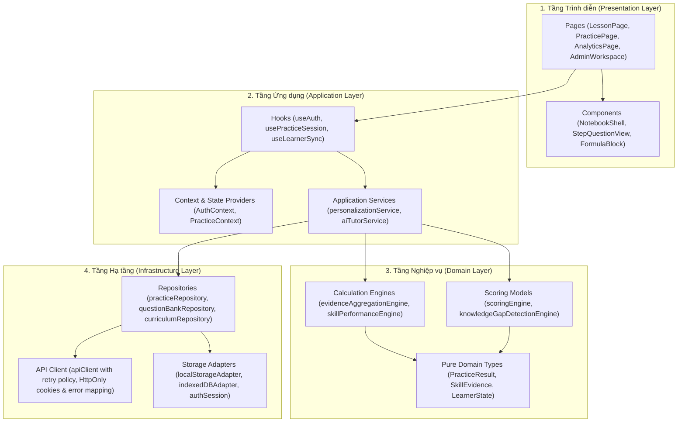
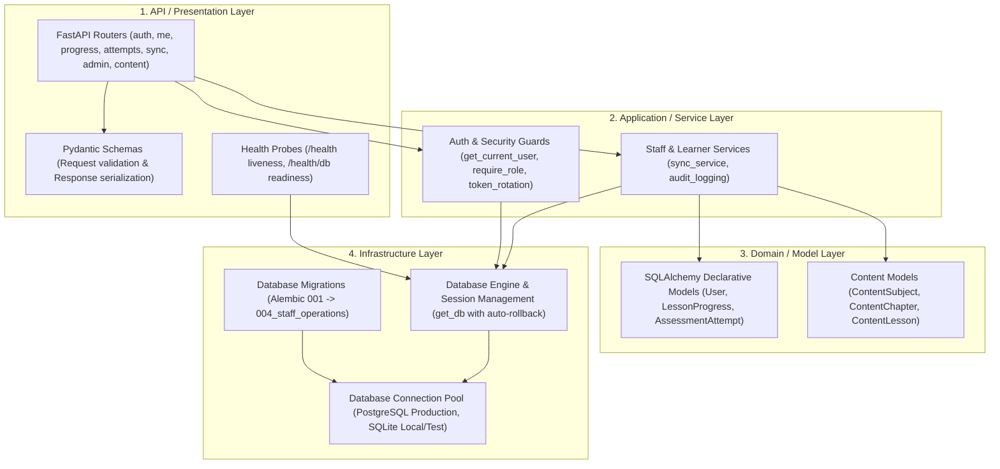
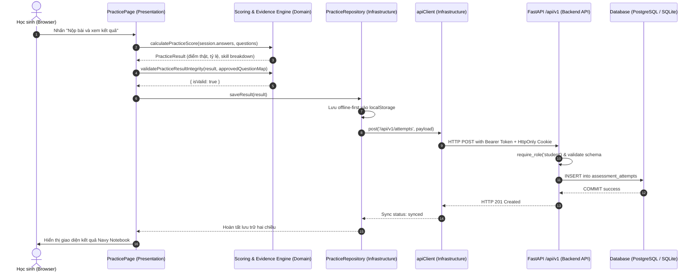

# STUDY_AI — LAYERED ARCHITECTURE SPECIFICATION
## Presentation, Application, Domain & Infrastructure Architecture

Tài liệu này xác định chuẩn kiến trúc phân tầng 4 lớp (Layered Architecture) cho toàn bộ hệ thống STUDY_AI, áp dụng đồng bộ trên cả Frontend (React 19 + TypeScript) và Backend (FastAPI + SQLAlchemy + Alembic).

---

## 1. NGUYÊN TẮC PHÂN TẦNG CỐT LÕI

Kiến trúc STUDY_AI tuân thủ nghiêm ngặt nguyên lý **Dependency Inversion** và **Separation of Concerns**:
1. **Một chiều phụ thuộc (Unidirectional Dependency)**: Các tầng bên trên chỉ được phép phụ thuộc vào các tầng bên dưới. Tầng dưới tuyệt đối không import ngược từ tầng trên.
2. **Domain độc lập (Pure Domain Logic)**: Tầng Domain (logic nghiệp vụ, tính điểm, phân tích bằng chứng, thuật toán) là các pure functions hoặc pure models, không phụ thuộc vào UI (React), trình duyệt (`window`, `localStorage`), hoặc framework mạng (`fetch`, `FastAPI`).
3. **Trung thực về dữ liệu (Truthful Integration)**:
   - Tầng UI không bao giờ nhận thông báo thành công nếu tầng Infrastructure chưa hoàn tất lưu trữ.
   - Khi API backend trả về lỗi, hệ thống phải hiển thị trạng thái lỗi trung thực; tuyệt đối không tự ý giả mạo dữ liệu (fake mock) trong luồng production.

---

## 2. KIẾN TRÚC PHÂN TẦNG FRONTEND (REACT 19 + TYPESCRIPT)

### Chi tiết trách nhiệm từng tầng Frontend:
1. **Presentation Layer (`src/pages`, `src/components`)**:
   - Chỉ chịu trách nhiệm render giao diện theo Navy Notebook design system (`#102A43`, `#F4B942`, `#FFF9EA`), nhận input từ người dùng và kích hoạt actions.
   - Không chứa logic nghiệp vụ tính điểm hoặc trực tiếp gọi `fetch` / `localStorage`.
2. **Application Layer (`src/hooks`, `src/context`, `src/services`)**:
   - Điều phối luồng làm việc (workflow orchestration): tải dữ liệu, quản lý trạng thái phiên làm việc (`PracticeSession`), đồng bộ background sync.
   - Chuyển tiếp kết quả từ Domain Layer sang Presentation Layer.
3. **Domain Layer (`src/services/*Engine.ts`, `src/types`)**:
   - Chứa logic cốt lõi của bài toán giáo dục: Chấm điểm 3 dạng câu hỏi (`scoringEngine.ts`), kiểm tra tính toàn vẹn kết quả (`validatePracticeResultIntegrity`), tổng hợp bằng chứng năng lực (`evidenceAggregationEngine.ts`), nhận diện lỗ hổng kiến thức (`knowledgeGapDetectionEngine.ts`).
   - Pure functions, 100% unit-tested, không side-effects.
4. **Infrastructure Layer (`src/repositories`, `src/lib/apiClient.ts`, `src/auth/authSession.ts`)**:
   - Giao tiếp với thế giới bên ngoài: REST API backend, browser storage (`localStorage`), bộ nhớ in-memory token.
   - Xử lý các lỗi mạng, token refresh rotation, mã hóa HTTP status code thành `ApiErrorCode`.

---

## 3. KIẾN TRÚC PHÂN TẦNG BACKEND (FASTAPI + SQLALCHEMY)

### Chi tiết trách nhiệm từng tầng Backend:
1. **API / Presentation Layer (`app/api`, `app/schemas`)**:
   - Tiếp nhận HTTP requests, kiểm tra định dạng dữ liệu đầu vào qua Pydantic (`ValidationError` $\to$ HTTP 422), serialize dữ liệu đầu ra.
   - Cung cấp liveness probe (`/health`) và readiness probe (`/health/db`) kiểm tra kết nối database bằng `SELECT 1` và trả về HTTP 503 khi database gặp sự cố.
2. **Application / Service Layer (`app/api/deps.py`, `app/services`)**:
   - Quản lý xác thực JWT Bearer, luân chuyển HttpOnly refresh token (Refresh Token Rotation), phân quyền RBAC (`student`, `teacher`, `content`, `support`, `admin`).
   - Bảo vệ tài khoản quản trị cuối cùng (`last active admin protection`), ghi vết kiểm toán (`StaffAuditLog`).
3. **Domain / Model Layer (`app/models`)**:
   - Định nghĩa các thực thể dữ liệu nghiệp vụ quan hệ bằng SQLAlchemy ORM: Khóa chính, khóa ngoại, ràng buộc duy nhất (`unique constraints`), chỉ mục tìm kiếm (`indexes`), mối quan hệ phân tầng (`relationship` và `cascade delete`).
4. **Infrastructure Layer (`app/database.py`, `alembic`)**:
   - Quản lý vòng đời kết nối cơ sở dữ liệu (`SessionLocal`). Hàm dependency `get_db()` cam kết rollback tự động khi xuất hiện exception để ngăn chặn dangling transactions.
   - Quản lý lịch sử tiến hóa schema qua migration scripts (hiện tại `004_staff_operations`).

---

## 4. LUỒNG DỮ LIỆU END-TO-END (END-TO-END DATA FLOW)

Ví dụ: Luồng nộp bài và phân tích kết quả học tập thích ứng (`Adaptive Practice Flow`):

