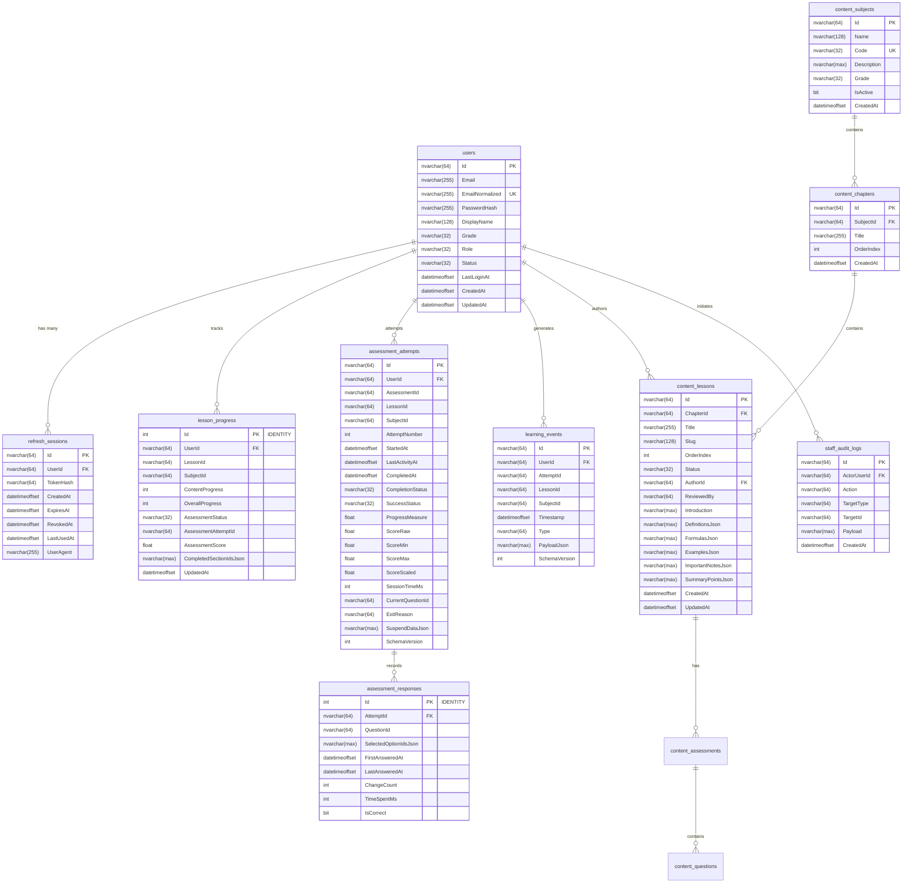

# STUDY_AI — MICROSOFT SQL SERVER SCHEMA & MIGRATION DESIGN
## Phase 14A: Entity Framework Core Physical Data Model

---

### 1. Thông tin kết nối & Cấu hình môi trường

- **Hệ quản trị CSDL**: Microsoft SQL Server 2025 Express Edition (64-bit)
- **Instance**: `.\SQLEXPRESS`
- **Database Name**: `StudyAIDb`
- **Xác thực**: Windows Authentication (`Trusted_Connection=True`)
- **Connection String**:
  ```text
  Server=.\SQLEXPRESS;Database=StudyAIDb;Trusted_Connection=True;MultipleActiveResultSets=true;TrustServerCertificate=True
  ```
- **Công cụ di chuyển CSDL (Migration)**: Entity Framework Core Migrations (`InitialSqlServerCreate`)

---

### 2. Sơ đồ thực thể quan hệ (Entity-Relationship Diagram)



---

### 3. Danh sách 13 Bảng vật lý trong CSDL `StudyAIDb`

1. `__EFMigrationsHistory`: Bảng quản lý lịch sử migration tự động của EF Core.
2. `users`: Bảng người dùng trung tâm, lưu email chuẩn hóa có chỉ mục độc nhất (`IX_users_EmailNormalized`), mật khẩu băm Argon2id và cờ trạng thái (`active`, `suspended`, `disabled`).
3. `refresh_sessions`: Quản lý phiên token xoay vòng bảo mật cao; mỗi phiên gắn với băm SHA-256 duy nhất của refresh token.
4. `staff_audit_logs`: Bảng nhật ký kiểm toán không thể sửa xóa (`append-only`), ghi lại mọi hành động can thiệp của nhân sự nội bộ.
5. `lesson_progress`: Theo dõi tiến độ học bài; chỉ mục kép duy nhất trên `(UserId, LessonId)` đảm bảo tính toàn vẹn khi upsert.
6. `assessment_attempts`: Ghi lại chi tiết từng lượt làm bài đánh giá, thời gian làm bài chính xác đến mili-giây, điểm số SCORM/xAPI chuẩn hóa từ 0.0 đến 1.0.
7. `assessment_responses`: Bản ghi chi tiết câu trả lời của học sinh cho từng câu hỏi, số lần đổi đáp án (`ChangeCount`), kết quả đúng/sai.
8. `learning_events`: Kho dữ liệu sự kiện telemetry học tập phân tán thời gian thực, phục vụ phân tích dữ liệu và phát hiện lỗ hổng kiến thức.
9. `content_subjects`: Danh mục các môn học GDPT 2018 (môn Toán 12, code: `MATH12`).
10. `content_chapters`: Các chương học thuộc từng môn học cụ thể.
11. `content_lessons`: Chi tiết nội dung bài học khoa học, bao gồm định nghĩa, công thức toán học, ví dụ minh họa và ghi chú quan trọng.
12. `content_assessments`: Bài kiểm tra trắc nghiệm gắn liền với bài học.
13. `content_questions`: Bộ câu hỏi đánh giá theo chuẩn GDPT 2018 (Trắc nghiệm nhiều lựa chọn, Đúng/Sai, Điền số ngắn).

---

### 4. Chiến lược chỉ mục & Tối ưu hóa hiệu năng

- **Clustered Indexes**: Áp dụng mặc định trên các khóa chính `Id` (GUID / string format `usr_*`, `sess_*`, `att_*` hoặc IDENTITY integer).
- **Unique Indexes**:
  - `IX_users_EmailNormalized`: Tìm kiếm người dùng O(1) khi đăng nhập, áp dụng filter `WHERE [EmailNormalized] IS NOT NULL`.
  - `IX_lesson_progress_UserId_LessonId`: Tối ưu hóa cho truy vấn tiến độ cá nhân và lệnh upsert đồng bộ offline-first.
  - `IX_assessment_responses_AttemptId_QuestionId`: Đảm bảo không trùng lặp bản ghi câu trả lời trong cùng một lượt làm bài.
  - `IX_content_subjects_Code`: Đảm bảo mã môn học duy nhất toàn hệ thống.
- **Foreign Key Cascades**:
  - Xóa người dùng tự động xóa sạch các phiên `refresh_sessions`.
  - Xóa môn học cascade xóa chương, bài học, và các bài kiểm tra trực thuộc.
  - Xóa bài thi cascade xóa các câu trả lời chi tiết trong `assessment_responses`.
