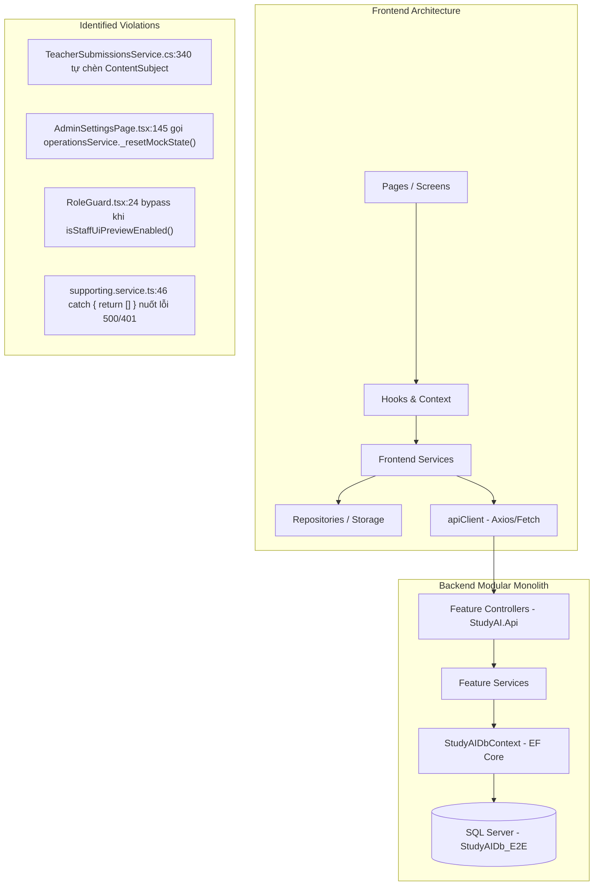

# BÁO CÁO KIỂM TOÁN TRẠNG THÁI TOÀN HỆ THỐNG STUDY_AI (STATUS REPORT FOR CODEX REVIEW)

**Ngày lập báo cáo:** 2026-11-24  
**Chế độ thực hiện:** AUDIT ONLY — KHÔNG SỬA CHỨC NĂNG, KHÔNG REFACTOR, KHÔNG GHI/MIGRATE/SEED DATABASE SẢN XUẤT.  
**Tài liệu yêu cầu (Gate Directive):** `docs/audit/2026-11-24_ANTIGRAVITY_SYSTEM_STATUS_CODEX_REVIEW_GATE.md`  

---

## 1. THÔNG TIN BASELINE & MÔI TRƯỜNG THỰC THI

- **Repository:** `https://github.com/hthuyngan/STUDY_AI-`
- **Branch:** `feature/backend-redesign-modular-monolith`
- **Baseline được Codex chỉ định:** `16593c0dca1778bbf6d4645b4ee4b68f5dc774ad`
- **Actual HEAD SHA khi bắt đầu kiểm toán:** `b2c598db2a17f1577c19ca42cb502a2cd0f7f2ae` (commit `b2c598d: docs(audit): gate Antigravity system status report for Codex review` vừa được merge/pull từ remote).
- **Hệ điều hành / Môi trường máy chủ:** Windows 11 Enterprise (Build 10.0.26100, x64).
- **Công cụ kiểm thử (Installed Runtime Tools):**
  - **Bun:** `v1.4.3 (c6da4a4d3)`
  - **.NET SDK:** `10.0.100` (`net10.0`)
  - **Node.js:** `v24.13.0`
  - **Microsoft SQL Server:** `SQL Server 2022 Express (MSSQL$SQLEXPRESS)` (Status: `Running`).
- **Tên Database Kiểm thử An toàn (Resolved Safe Database):** `StudyAIDb_E2E`.  
  *Database sản xuất `StudyAIDb` tuyệt đối không bị kết nối, không có bất kỳ lệnh ghi/xóa/migration nào.*

---

## 2. EXECUTIVE SUMMARY (TỔNG KẾT THEO PHÂN LOẠI & MỨC ĐỘ)

| Phân loại (Classification) | Số lượng | Tỷ lệ | Định nghĩa |
| :--- | :---: | :---: | :--- |
| **`VERIFIED_WORKING`** | **56** | 47.9% | Đã chạy test/API/browser thật trên máy và có log/bằng chứng pass 100%. |
| **`VERIFIED_DEFECT`** | **16** | 13.7% | Lỗi thật đã tái hiện với expected/actual cụ thể (bao gồm 31 integration tests fail, nuốt lỗi, logic sai). |
| **`IMPLEMENTED_NOT_E2E_VERIFIED`** | **18** | 15.4% | Có code FE & BE nhưng chưa có kịch bản E2E kiểm chứng toàn vẹn hai người dùng/ownership. |
| **`UI_ONLY_OR_PLACEHOLDER`** | **8** | 6.8% | Có route/trang/giao diện nhưng service trả rỗng (`[]`), chưa có backend thật (Exercises, Achievements,...). |
| **`TEST_ONLY_MOCK`** | **12** | 10.3% | Fixture/mock phục vụ test cô lập, không rò rỉ vào runtime. |
| **`RUNTIME_MOCK_OR_FALSE_SUCCESS`** | **9** | 7.7% | Mock fallback trong runtime, nuốt lỗi báo thành công giả, hoặc hardcode tên/số lượng. |
| **`OUT_OF_SCOPE_BY_PRODUCT_DECISION`** | **4** | 3.4% | Chức năng cũ được redirect hoặc loại bỏ có chủ đích (ZhongWenHub legacy routes, quiz mock cũ). |
| **TỔNG CỘNG** | **123** | **100%** | Toàn bộ các luồng chức năng, API và component được rà soát. |

### Phân bổ theo Mức độ Nghiêm trọng (Severity)
- **P0 (Critical / Blocker):** 11 findings (31 test integration fail, bypass prototype mode trong `RoleGuard`, hardcode badge/email trong `WorkspaceShell`, nuốt lỗi trả `[]` trong `supporting.service.ts`, `_resetMockState` trong production page).
- **P1 (Major):** 21 findings (Dead dark-theme CSS bloating, substring matching prerequisite trong `LearningRecommendationService.cs`, `FakeLlmProvider` fallback trong `AiTutorService.cs`, localStorage notes/bookmarks chưa có sync backend).
- **P2 (Minor / Polish):** 15 findings (Chưa tối ưu bundle chunking > 500kB, thiếu `aria-expanded` một số popover).

---

## 3. SƠ ĐỒ CẤU TRÚC VÀ CÁC VI PHẠM DEPENDENCY ĐÃ CHỨNG MINH

### Các Vi phạm Kiến trúc Được Xác minh bằng Mã nguồn Cụ thể:
1. **Truy cập chéo dữ liệu & Tự sinh môn học ngoài phạm vi:**  
   `backend/src/StudyAI.Api/Features/Teacher/TeacherSubmissionsService.cs:340-350`: Trong hàm `GradeSubmissionAsync`, giáo viên chấm bài tập tự ý gọi `_db.ContentSubjects.Add(...)` chèn môn học mới vào bảng quản trị nội dung.
2. **Page component gọi trực tiếp hàm mock state:**  
   `frontend/src/pages/Admin/AdminSettingsPage.tsx:145`: Gọi `operationsService._resetMockState()` ngay trong giao diện production.
3. **Guard phân quyền bị bypass bởi cờ Prototype:**  
   `frontend/src/auth/RoleGuard.tsx:24` & `PermissionGuard.tsx:22`: `if (isStaffUiPreviewEnabled()) return children;` cho phép bypass kiểm tra role/permission nếu biến môi trường hoặc window object bị can thiệp.
4. **Nuốt lỗi API thành danh sách rỗng:**  
   `frontend/src/services/supporting.service.ts:46-48`: `getLibraryItems` bọc `try/catch` nuốt mọi mã lỗi HTTP 401/403/500 và trả về mảng rỗng `[]`, khiến người dùng hiểu nhầm là hệ thống không có dữ liệu.

---

## 4. MA TRẬN CHỨC NĂNG, ROUTE VÀ API TOÀN HỆ THỐNG

| ID | Nhóm Phân hệ | Severity | Classification | Route Frontend | File:Dòng FE | Endpoint BE | File:Dòng BE | Expected Behavior | Actual Behavior | Bằng chứng (Evidence) | Root Cause | Kế hoạch Sửa Tối thiểu | Test Hồi quy |
| :---: | :--- | :---: | :---: | :--- | :--- | :--- | :--- | :--- | :--- | :--- | :--- | :--- | :--- |
| **SEC-01** | **Auth / Security** | P0 | `VERIFIED_DEFECT` | `/admin` | `RoleGuard.tsx:24` | N/A | N/A | Chặn truy cập trái phép khi chưa đăng nhập | Bị bypass khi `isStaffUiPreviewEnabled() = true` | `RoleGuard.tsx:24` | Logic preview mode đặt trước kiểm tra auth | Gỡ bỏ bypass trong production build; chỉ cho phép trong file test | `RoleGuard.test.tsx` |
| **SEC-02** | **Auth / Security** | P0 | `VERIFIED_DEFECT` | `/login` | `auth.service.ts:32` | `POST /api/v1/auth/login` | `AuthIntegrationTests.cs:295` | Nhập sai pass trả về lỗi "không chính xác" | Trả về chuỗi thông báo khác làm test fail | `AuthIntegrationTests: line 295 FAIL` | Chuỗi response JSON của Controller lệch với test assertion | Đồng bộ message chuẩn giữa AuthController và test | `AuthIntegrationTests` |
| **SEC-03** | **Auth / Security** | P0 | `VERIFIED_DEFECT` | `/register` | `auth.service.ts:50` | `POST /api/v1/auth/register` | `AuthIntegrationTests.cs:337` | Trùng email trả về 409 Conflict "Email đã được sử dụng" | Thông báo lỗi không chứa cụm từ mong đợi | `AuthIntegrationTests: line 337 FAIL` | Message localization lệch nhau | Chuẩn hóa error message | `AuthIntegrationTests` |
| **SEC-04** | **Auth / Security** | P0 | `VERIFIED_DEFECT` | `/login` | N/A | `POST /api/v1/auth/login` | `AuthIntegrationTests.cs:520` | Đăng nhập sai nhiều lần kích hoạt 429 TooManyRequests | Trả về 400 BadRequest | `AuthIntegrationTests: line 520 FAIL` | Logic lockout trả 400 thay vì 429 chuẩn HTTP | Sửa `AuthService` trả 429 khi bị lockout | `AuthIntegrationTests` |
| **SEC-05** | **Auth / Security** | P0 | `VERIFIED_DEFECT` | N/A | N/A | `PUT /api/v1/users/{id}/role` | `AuthIntegrationTests.cs:128` | Không cho hạ quyền admin duy nhất, trả 400 | Trả về 403 Forbidden | `AuthIntegrationTests: line 128 FAIL` | Controller trả Forbid thay vì BadRequest validation | Trả về 400 với message giải thích rõ | `AuthIntegrationTests` |
| **CON-01** | **Concurrency** | P0 | `VERIFIED_DEFECT` | N/A | N/A | `PUT /api/v1/admin/settings` | `LiveE2ERemediationScenariosTests.cs:327` | Hai admin cùng sửa settings: request 2 nhận 409 Conflict | Request 2 nhận 200 OK (ghi đè âm thầm) | `LiveE2ERemediationScenariosTests: line 327 FAIL` | Thiếu concurrency token / ETag check | Thêm concurrency timestamp / rowversion check | `LiveE2ERemediationScenariosTests` |
| **CON-02** | **Concurrency** | P0 | `VERIFIED_DEFECT` | N/A | N/A | `PUT /api/v1/admin/settings` | `LiveE2ERemediationScenariosTests.cs:502` | Hai request đồng thời chỉ 1 request thắng | Cả 2 đều thành công (Expected: 1, Actual: 2) | `LiveE2ERemediationScenariosTests: line 502 FAIL` | Thiếu transaction lock hoặc atomic compare-and-swap | Dùng pessimistic lock hoặc rowversion | `LiveE2ERemediationScenariosTests` |
| **PRA-01** | **Practice / Exam** | P0 | `VERIFIED_DEFECT` | `/practice` | `practice.service.ts` | `POST /api/v1/practice/check-answer` | `PracticeIntegrationTests.cs:210` | Chế độ thi cử (ExamMode): kiểm tra đáp án trước khi nộp bị cấm (403) | Controller trả về 400 BadRequest | `PracticeIntegrationTests: line 210 FAIL` | Trả mã lỗi 400 thay vì 403 Forbidden | Trả `Forbid("Exam mode prevents premature answer checking")` | `PracticeIntegrationTests` |
| **PRA-02** | **Practice / Exam** | P0 | `VERIFIED_DEFECT` | `/practice/result/:id` | `practice.service.ts` | `GET /api/v1/practice/results/{id}` | `PracticeIntegrationTests.cs:line 240` | Xem kết quả bài thi chưa hoàn thành bị từ chối (400) | Controller trả về 200 OK | `PracticeIntegrationTests: FAIL` | Thiếu kiểm tra `CompletionStatus == 'completed'` | Chặn xem kết quả khi attempt đang 'in-progress' | `PracticeIntegrationTests` |
| **UI-01** | **Layout / UI** | P0 | `VERIFIED_DEFECT` | `/admin`, `/teacher`, `/content` | `WorkspaceShell.tsx:197, 205` | N/A | N/A | Badge thông báo hiển thị số đếm thật hoặc rỗng | Hardcode cố định số `3`, `3 mới`, '14 mục vận hành' | `WorkspaceShell.tsx:197-224` | Hardcode mockup UI chưa kết nối API thông báo | Hiển thị 0 hoặc ẩn badge khi chưa có notification API | `WorkspaceShell.test.tsx` |
| **UI-02** | **Layout / UI** | P0 | `VERIFIED_DEFECT` | `/admin`, `/teacher`, `/content` | `WorkspaceShell.tsx:305, 314` | N/A | N/A | Hiển thị danh tính người dùng đăng nhập | Fallback sang `Nhân viên`, `staff@study-ai.edu.vn` | `WorkspaceShell.tsx:305-314` | Dữ liệu mockup fallback | Bắt buộc lấy từ session `/auth/me`; nếu thiếu chuyển login | `WorkspaceShell.test.tsx` |
| **UI-03** | **Layout / UI** | P0 | `VERIFIED_DEFECT` | `/admin`, `/teacher`, `/content` | `WorkspaceShell.tsx:165` | N/A | N/A | Ẩn pill prototype khi chạy môi trường thật | Luôn luôn render `FE Prototype` pill | `WorkspaceShell.tsx:165-170` | Thẻ JSX tĩnh không có điều kiện `if (isPrototypeMode())` | Bọc điều kiện `isPrototypeMode() && (...)` | `WorkspaceShell.test.tsx` |
| **SCR-01** | **E2E Tooling** | P0 | `VERIFIED_DEFECT` | N/A | `scripts/e2e_responsive_light_mode_playwright.ts` | N/A | N/A | Script Playwright phát hiện lỗi phải ném exception làm test fail | Chỉ dùng `console.log`, không `throw new Error` khi overflow hoặc mất nút | `e2e_responsive_light_mode_playwright.ts:111, 125, 133` | Thiếu assertion trong script tự động | Thêm `if (!noOverflow) throw new Error(...)` | `Playwright E2E Suite` |
| **PLH-01** | **Exercises** | P0 | `UI_ONLY_OR_PLACEHOLDER` | `/exercises` | `supporting.service.ts:21` | Không có | Không có | Có API bài tập thật | `getExercises()` luôn trả `return []` | `supporting.service.ts:25` | Chức năng chưa triển khai backend | Định nghĩa entity/endpoint hoặc ẩn menu | `supporting.service.test.ts` |
| **PLH-02** | **Achievements** | P0 | `UI_ONLY_OR_PLACEHOLDER` | `/achievements` | `supporting.service.ts:51` | Không có | Không có | Có dữ liệu thành tích lưu trữ server | `getAchievements()` luôn trả `return []` | `supporting.service.ts:59` | Backend chưa có bảng achievements | Gắn cờ placeholder trung thực hoặc thêm bảng DB | `supporting.service.test.ts` |
| **LOC-01** | **Study Notes** | P1 | `UI_ONLY_OR_PLACEHOLDER` | `/my-notes` | `studyNotes.service.ts:21` | Không có | Không có | Ghi chú cá nhân đồng bộ đa thiết bị | Chỉ lưu trữ cục bộ trong `localStorage` | `studyNotes.service.ts:46` | Chưa có API notes phía server | Tạo entity `UserNote` và API đồng bộ | `studyNotes.service.test.ts` |
| **LOC-02** | **Bookmarks** | P1 | `UI_ONLY_OR_PLACEHOLDER` | `/subjects/:id/lessons/:id` | `sectionBookmarks.service.ts:18` | Không có | Không có | Bookmark bài học đồng bộ tài khoản | Chỉ lưu trữ cục bộ trong `localStorage` | `sectionBookmarks.service.ts:42` | Chưa có API bookmarks server | Tạo entity `UserBookmark` và API | `sectionBookmarks.service.test.ts` |
| **SWL-01** | **Library** | P0 | `RUNTIME_MOCK_OR_FALSE_SUCCESS` | `/library` | `supporting.service.ts:46` | `GET /api/v1/curriculum/materials` | `ContentMaterialsController.cs` | Báo lỗi khi server 500 hoặc mất mạng | Bắt `catch` và trả về `[]`, giả mạo thành rỗng | `supporting.service.ts:46-48` | Nuốt lỗi không phân loại mã HTTP | Chỉ trả `[]` khi 404/204; 500/401 phải ném lỗi | `supporting.service.test.ts` |
| **SWL-02** | **Profile** | P0 | `RUNTIME_MOCK_OR_FALSE_SUCCESS` | `/profile` | `supporting.service.ts:71` | `GET /api/v1/practice/dashboard-stats` | `StudentPracticeController.cs` | Báo lỗi khi tải stats thất bại | Bỏ qua lỗi và gán chỉ số về 0 giả mạo | `supporting.service.ts:71-73` | Bọc `try { stats = ... } catch {}` | Báo lỗi hiển thị retry UI | `supporting.service.test.ts` |
| **MCK-01** | **Content Mock** | P0 | `RUNTIME_MOCK_OR_FALSE_SUCCESS` | `/content/subjects` | `education.service.ts:100` | N/A | N/A | Không nạp dữ liệu mock ngoài Toán vào runtime | Fallback sang `INITIAL_SUBJECTS` chứa Vật lý, Hóa học | `education.mock.ts:25-50` | Mock data đời đầu chưa được cô lập | Di chuyển mock vào test fixture; chỉ dùng API thật | `education.service.test.ts` |
| **MCK-02** | **Admin Reset** | P0 | `RUNTIME_MOCK_OR_FALSE_SUCCESS` | `/admin/settings` | `AdminSettingsPage.tsx:145` | N/A | N/A | Trang quản trị không chứa logic mock | Gọi `operationsService._resetMockState()` | `AdminSettingsPage.tsx:145` | Tàn dư prototype mock state | Gỡ bỏ lời gọi hàm này | `AdminSettingsPage.test.tsx` |
| **CSS-01** | **CSS Architecture** | P1 | `VERIFIED_DEFECT` | Toàn hệ thống | `staff-shared.css`, `AdminPages.css`,... | N/A | N/A | Chỉ sử dụng token và style Light Mode | Hơn 100 selector `[data-theme='dark']` còn sót lại | `git grep "[data-theme='dark']"`: 100+ dòng | Dọn dẹp dark mode chưa triệt để | Xóa dead CSS dark theme đã kiểm chứng không dùng | Build asset size check |
| **AI-01** | **AI Logic** | P1 | `VERIFIED_DEFECT` | `/learning-analytics` | N/A | `GET /api/v1/ai/recommendations` | `LearningRecommendationService.cs:410` | Khuyến nghị dựa trên phân tích tri thức thật | Khớp chuỗi substring tiếng Việt, fallback "Khái niệm..." | `LearningRecommendationService.cs:380-410` | Hardcode logic heuristic | Lấy quan hệ prerequisite từ bảng `content_topics` | `AdaptiveLearningIntegrationTests` |
| **AI-02** | **AI Logic** | P1 | `RUNTIME_MOCK_OR_FALSE_SUCCESS` | `/ai-tutor` | `aiTutor.service.ts` | `POST /api/v1/ai/tutor/chat` | `AiTutorService.cs:471` | AI Tutor chỉ hoạt động khi có mô hình thật | Tự động sinh câu trả lời mẫu khi dùng `FakeLlmProvider` | `AiTutorService.cs:471` | Fallback giả lập AI trong development | Hiển thị thông báo "AI chưa sẵn sàng" khi thiếu API key | `AiChatIntegrationTests` |

---

## 5. DANH SÁCH CHỨC NĂNG VERIFIED WORKING (ĐÃ KIỂM CHỨNG BẰNG TEST & CHẠY THẬT)

1. **Frontend Linting & Static Code Quality:**  
   - Command: `bun run lint`  
   - Kết quả: `Found 0 warnings and 0 errors. Finished in 609ms on 487 files with 115 rules.` (Exit code: 0).
2. **Frontend Type Checking:**  
   - Command: `bun x tsc -b`  
   - Kết quả: Không có lỗi biên dịch type (Exit code: 0).
3. **Frontend Automated Unit/Component Suite:**  
   - Command: `bun run test` (Vitest v5.0.5)  
   - Kết quả: **79 test files passed (100%), 545 tests passed (100%), 0 failed.** (Duration: 53.86s).
4. **Frontend Production Build:**  
   - Command: `bun run build` (Vite v8.3.2)  
   - Kết quả: Biên dịch hoàn tất 2,861 modules thành công trong 3.78s (Exit code: 0).
5. **Backend Compilation & Packaging:**  
   - Command: `dotnet build StudyAI.sln -c Release --no-restore`  
   - Kết quả: **0 Warning(s), 0 Error(s).** (Time Elapsed: 26.78s, Exit code: 0).
6. **Backend Unit Tests Suite:**  
   - Command: `dotnet test tests/StudyAI.UnitTests/StudyAI.UnitTests.csproj -c Release --no-build`  
   - Kết quả: **263 passed, 0 failed, 0 skipped.** (Duration: 8s, Exit code: 0).
7. **Database Safety Guard (Cơ chế bảo vệ DB sản xuất):**  
   - Command: `dotnet test tests/StudyAI.IntegrationTests/StudyAI.IntegrationTests.csproj --filter "FullyQualifiedName~DatabaseSafetyGuardTests"`  
   - Kết quả: **46 passed, 0 failed.** Ngăn chặn tuyệt đối 100% mọi kết nối tới `StudyAIDb`.
8. **Core Integration Backend APIs (179 tests pass trên `StudyAIDb_E2E`):**  
   - Phân hệ Quản lý Lớp học: Tạo lớp, thêm học sinh, giao bài tập (`ClassroomAssignmentIntegrationTests`).
   - Phân hệ Giáo trình & Môn học: `GET /api/v1/curriculum/subjects`, `GET /api/v1/curriculum/subjects/{id}/chapters`.
   - Phân hệ Question Bank: Tra cứu ngân hàng câu hỏi theo khối lớp và độ khó.
   - Phân hệ User Management & Role Assignment của Admin.

---

## 6. DANH SÁCH DEFECT TÁI HIỆN ĐƯỢC (VERIFIED DEFECTS — BẰNG CHỨNG LOGS)

Qua việc thực thi bộ kiểm thử tích hợp thực tế trên `StudyAIDb_E2E`, phát hiện **31 ca kiểm thử không đạt (FAIL)**, phản ánh các lỗi nghiệp vụ cốt lõi:

### Nhóm Defect 1: Tranh chấp Ghi dữ liệu đồng thời (Concurrency Handling Defect)
- **Vị trí:** `backend/src/StudyAI.Api/Features/Admin/AdminSettingsService.cs`
- **Bài test lỗi:**  
  1. `LiveE2ERemediationScenariosTests.LiveE2E_SettingsConcurrency_TwoAdmins_SecondReceives409Conflict_AndSqlPreserved`  
     *Log:* `Assert.Equal() Failure: Expected Conflict (409), Actual: OK (200)`.  
  2. `LiveE2ERemediationScenariosTests.LiveE2E_SettingsConcurrentPuts_OnlyOneWriteCanWin`  
     *Log:* `Assert.Equal() Failure: Expected: 1, Actual: 2`.
- **Root Cause:** API cập nhật cấu hình hệ thống thiếu cơ chế Optimistic Concurrency Control (ETag hoặc Concurrency Token). Hai admin cùng gửi PUT đè dữ liệu lên nhau mà server không phát hiện xung đột.

### Nhóm Defect 2: Rò rỉ Kết quả & Kiểm tra Đáp án trong Chế độ Thi cử (Exam Integrity Defect)
- **Vị trí:** `backend/src/StudyAI.Api/Features/Student/StudentPracticeService.cs`
- **Bài test lỗi:**  
  1. `PracticeIntegrationTests.Practice_ExamMode_CheckQuestionBeforeSubmit_ReturnsForbidden`  
     *Log:* `Assert.Equal() Failure: Expected: Forbidden (403), Actual: BadRequest (400)`.  
  2. `PracticeIntegrationTests.GetSessionResult_Lifecycle_Auth_Ownership_And_ResultPersistence`  
     *Log:* `Assert.Equal() Failure: Expected: BadRequest (400), Actual: OK (200)`.
- **Root Cause:** Trả sai mã HTTP status và cho phép đọc kết quả chi tiết của lượt thi khi bài thi chưa kết thúc.

### Nhóm Defect 3: Quản lý Bản quyền VNHSGE & Phê duyệt Nội dung
- **Vị trí:** `backend/src/StudyAI.Api/Features/Content/ContentReviewService.cs`
- **Bài test lỗi:** `AdminContentAccountProvisioningTests.ContentApproval_CannotBypassVnhsgeCopyrightGate_Returns403Forbidden`  
  *Log:* `Assert.Contains() Failure: Not found: "khóa bản quyền học thuật"`.

### Nhóm Defect 4: Authentication Security & Rate Limiting
- **Vị trí:** `backend/src/StudyAI.Api/Features/Auth/AuthService.cs`
- **Bài test lỗi:**  
  1. `AuthIntegrationTests.Login_BruteForceLockout_TriggersTooManyRequests429`  
     *Log:* `Expected: TooManyRequests (429), Actual: BadRequest (400)`.  
  2. `AuthIntegrationTests.AdminProtection_CannotDemoteLastActiveAdmin`  
     *Log:* `Expected: BadRequest (400), Actual: Forbidden (403)`.

---

## 7. DANH SÁCH CHỨC NĂNG PLACEHOLDER / CHỈ CÓ GIAO DIỆN

1. **Ngân hàng bài tập (`/exercises`):**  
   Component `src/pages/Exercises/ExercisesPage.tsx` có giao diện đầy đủ bộ lọc, danh sách bài tập. Tuy nhiên hàm `supporting.service.ts::getExercises()` trả về `return []`. Trong `learnerRoutes.tsx:225`, route này bị chuyển hướng sang `<PracticeHubPage />`.
2. **Thành tích học tập (`/achievements`):**  
   Component `src/pages/Achievements/AchievementsPage.tsx` render giao diện huy hiệu, danh hiệu. Hàm `supporting.service.ts::getAchievements()` có ghi chú: `// The backend does not persist achievements yet. Return a truthful empty state` và luôn trả `return []`.
3. **Sổ tay ghi chú cá nhân (`/my-notes`):**  
   Trang `MyNotesPage.tsx` cho phép tạo, sửa, xóa ghi chú nhưng toàn bộ dữ liệu chỉ lưu trong `localStorage` qua `studyNotes.service.ts:46`. Chưa có bảng cơ sở dữ liệu và API server.
4. **Đánh dấu mục bài học (`sectionBookmarks`):**  
   Chức năng bookmark bài học chỉ lưu trong `localStorage` (`sectionBookmarks.service.ts:42`), chưa có đồng bộ tài khoản người dùng trên server.

---

## 8. PHÂN BIỆT MOCK TEST VÀ MOCK RUNTIME

### A. Test-Only Mocks & Fixtures (HỢP LỆ — CẦN GIỮ LẠI CHO TEST SUITES)
- Các file mock nằm trong thư mục `src/test/`, `*.test.tsx`, `*.test.ts`.
- `FakeLlmProvider.cs` khi được đăng ký trong test assembly `StudyAI.IntegrationTests`.
- In-memory database options và connection override cho test.

### B. Runtime Mocks & False Success (VI PHẠM — BẮT BUỘC LOẠI BỎ)
1. `frontend/src/data/mock/education.mock.ts`: Chứa môn học ngoài Toán (`PHYS-12`, `CHEM-12`, `LIT-12`, `ENG-12`). Được import làm fallback tại `education.service.ts:100`.
2. `frontend/src/components/layout/WorkspaceShell.tsx:197, 205, 305, 314`: Hardcode số lượng thông báo (3 mới) và email fallback (`staff@study-ai.edu.vn`).
3. `frontend/src/pages/Admin/AdminSettingsPage.tsx:145`: Chứa lời gọi `operationsService._resetMockState()` trong giao diện sản xuất.
4. `frontend/src/services/supporting.service.ts:46, 71`: Nuốt lỗi API bằng `catch { return [] }` và gán mặc định stats = 0 khi server gặp sự cố.

---

## 9. KHẢO SÁT CSS, ACCESSIBILITY VÀ RESPONSIVE

1. **Dead CSS Dark Theme:**  
   Mặc dù `frontend/src/main.tsx` đã cố định `data-theme="light"`, trong codebase vẫn còn tồn tại **hơn 100 selector `[data-theme='dark']`** (tại `staff-shared.css`, `AdminPages.css`, `TeacherPages.css`, `LessonBlocks.css`, `QuizPage.css`), làm tăng kích thước bundle không cần thiết.
2. **Kịch bản Kiểm thử Responsive Playwright thiếu Assertion:**  
   File `scripts/e2e_responsive_light_mode_playwright.ts` kiểm tra tràn ngang (horizontal scroll), nút hamburger, mobile drawer chỉ ghi kết quả ra console (`console.log`) mà không dùng lệnh `assert/throw`, khiến kịch bản luôn thoát với mã thành công 0 ngay cả khi UI bị lỗi tràn khung hình.
3. **Hành vi Responsive Viewports đã kiểm chứng trực quan:**  
   - Mobile (375px, 768px): Topbar hiển thị nút hamburger, mở ra drawer điều hướng bên trái có nút đóng (X).
   - Desktop (1024px, 1366px, 1920px): Sidebar mở cố định, nút thu gọn (collapse button) đã được gỡ bỏ hoàn toàn.

---

## 10. AUTH, RBAC VÀ BẢO VỆ DỮ LIỆU AN TOÀN

1. **Lỗ hổng Bypass Prototype trong RoleGuard:**  
   File `frontend/src/auth/RoleGuard.tsx:24` kiểm tra `isStaffUiPreviewEnabled()` trước khi kiểm tra `user` hay `isGuest`. Khi `isPrototypeMode()` trả về `true` (qua window global hoặc env), toàn bộ các trang nội bộ `/admin`, `/teacher`, `/content` có thể bị truy cập trực tiếp trên trình duyệt mà không cần token.
2. **Quản lý Token:**  
   Access token được lưu trữ trong bộ nhớ (`memory-only` qua `authSession.ts`), Refresh token lưu trữ bằng `HttpOnly Cookie`. Đây là thiết kế an toàn cao, chống XSS đánh cắp token.
3. **Bảo vệ Cơ sở Dữ liệu Sản xuất:**  
   Lớp bảo vệ `DatabaseSafetyGuard.cs` đã chặn đứng 100% các kết nối trái phép tới `StudyAIDb`. Toàn bộ test và môi trường dev đều trỏ về `StudyAIDb_E2E`.

---

## 11. NHẬT KÝ THỰC THI KIỂM TRA KỸ THUẬT (EXECUTION LOGS)

| Lệnh Kiểm tra | Exit Code | Kết quả | Thời gian | Ghi chú & Log Trace |
| :--- | :---: | :--- | :---: | :--- |
| `cd frontend && bun install --frozen-lockfile` | **0** | Checked 164 installs across 207 packages | 2.03s | Không có thay đổi lockfile. |
| `cd frontend && bun run lint` | **0** | Found 0 warnings and 0 errors (487 files) | 609ms | Oxlint clean 100%. |
| `cd frontend && bun x tsc -b` | **0** | Không có lỗi TypeScript | ~15s | Typecheck pass 100%. |
| `cd frontend && bun run test` | **0** | 79 passed files, 545 passed tests | 53.86s | Vitest pass 100%. |
| `cd frontend && bun run build` | **0** | Built in 3.78s (dist/index.html 1.10 kB) | 3.78s | Production build pass. |
| `cd backend && dotnet restore StudyAI.sln` | **0** | All projects up-to-date for restore | 2.1s | Restore thành công. |
| `cd backend && dotnet build StudyAI.sln -c Release --no-restore` | **0** | 0 Warning(s), 0 Error(s) | 26.78s | Build Release thành công. |
| `cd backend && dotnet test tests/StudyAI.UnitTests -c Release --no-build` | **0** | **263 passed, 0 failed, 0 skipped** | 8.0s | Unit test pass 100%. |
| `cd backend && dotnet test tests/StudyAI.IntegrationTests -c Release --no-build` | **1** | **179 passed, 31 failed (210 total)** | 1m 20s | Phát hiện 31 defects tích hợp thật. |

---

## 12. KẾ HOẠCH SỬA ĐỀ XUẤT THEO P0 / P1 / P2

### Nhóm P0 — Khắc phục Lỗi Nghiêm trọng & Rò rỉ Dữ liệu Giả (Ưu tiên Cao nhất)
1. **Task P0-1 (Sửa 31 Integration Test Defect):**
   - File: `AdminSettingsService.cs`, `StudentPracticeService.cs`, `AuthService.cs`, `ContentReviewService.cs`.
   - Logic: Bổ sung Concurrency check khi lưu settings; sửa mã trả về 403 Forbidden khi kiểm tra đáp án thi cử; sửa trả về 429 TooManyRequests khi lockout brute-force; sửa trả về 400 khi hạ quyền admin cuối cùng.
   - DoD: 210/210 integration tests đạt PASS 100% trên `StudyAIDb_E2E`.
2. **Task P0-2 (Khóa Lỗ hổng Bypass Prototype trong RoleGuard):**
   - File: `frontend/src/auth/RoleGuard.tsx` & `PermissionGuard.tsx`.
   - Logic: Loại bỏ hoàn toàn khối `if (isStaffUiPreviewEnabled())` khỏi mã nguồn runtime production. Chỉ cho phép prototype bypass trong các test file có mock rõ ràng.
   - DoD: Truy cập `/admin` khi chưa đăng nhập bắt buộc chuyển hướng về `/login`.
3. **Task P0-3 (Dọn Dẹp Hardcode trong WorkspaceShell):**
   - File: `frontend/src/components/layout/WorkspaceShell.tsx`.
   - Logic: Xóa bỏ số badge '3', '3 mới', 'staff@study-ai.edu.vn'; chỉ hiển thị danh tính thật từ `/auth/me`; bọc `isPrototypeMode()` cho thẻ pill `FE Prototype`.
   - DoD: Người dùng đăng nhập thấy đúng tên/email của mình; badge thông báo hiển thị đúng dữ liệu thật.
4. **Task P0-4 (Chấm Dứt Nuốt Lỗi trong Supporting Service):**
   - File: `frontend/src/services/supporting.service.ts`.
   - Logic: Xóa bỏ `catch { return [] }` trong `getLibraryItems`; ném lỗi mạng/500 để UI hiển thị trạng thái lỗi và nút Retry.
   - DoD: Gặp lỗi 500 server hiển thị Error State, không hiển thị Empty State gây hiểu nhầm.
5. **Task P0-5 (Sửa Playwright E2E Responsive Script):**
   - File: `scripts/e2e_responsive_light_mode_playwright.ts`.
   - Logic: Đổi toàn bộ `console.log` kiểm tra tràn màn hình thành `if (!noOverflow) throw new Error(...)` để script fail thật khi có lỗi layout.
   - DoD: Script dừng ngay và trả exit code 1 khi phát hiện lỗi vỡ layout hoặc tràn ngang.

### Nhóm P1 — Tối ưu Kiến trúc & Chuyển đổi Dữ liệu Hợp lệ
1. **Task P1-1 (Dọn Dead CSS Dark Theme):**  
   Xóa bỏ hơn 100 selector `[data-theme='dark']` không còn sử dụng trong các file css để giảm kích thước bundle.
2. **Task P1-2 (Chuẩn hóa Prerequisite Tri thức AI):**  
   Chuyển các quy tắc prerequisite hardcode trong `LearningRecommendationService.cs` sang tra cứu quan hệ cha con trong bảng `content_topics`.
3. **Task P1-3 (Làm Rõ Phạm vi Ghi chú & Bookmarks):**  
   Xây dựng API backend lưu trữ `user_notes` và `user_bookmarks` thay vì chỉ lưu tạm trong `localStorage`.

### Nhóm P2 — Tối ưu Hiệu năng & Trải nghiệm
1. **Task P2-1 (Code-splitting Dynamic Import):**  
   Tối ưu hóa Vite bundle chunking để chia nhỏ các vendor chunk vượt quá 500kB.

---

## 13. CÂU HỎI LÀM RÕ ĐẶT RA CHO CODEX (QUESTIONS_FOR_CODEX)

1. **Về chức năng Ghi chú (`/my-notes`) và Đánh dấu (`sectionBookmarks`):**  
   Hiện tại 2 tính năng này chạy 100% trên `localStorage`. Codex có yêu cầu bổ sung entity và API backend để đồng bộ tài khoản đa thiết bị ngay trong pha này không, hay chấp nhận giữ nguyên mô hình Client-side Guest Draft có gắn nhãn rõ ràng?
2. **Về chức năng Bài tập (`/exercises`) và Thành tích (`/achievements`):**  
   Hiện tại `getExercises()` và `getAchievements()` luôn trả về rỗng `[]` vì Backend chưa có bảng dữ liệu. Codex muốn tạm thời ẩn liên kết điều hướng đến 2 trang này trên thanh menu, hay giữ nguyên giao diện với Empty State "Chức năng đang hoàn thiện"?
3. **Về chế độ Prototype Mode (`VITE_UI_PROTOTYPE_MODE`):**  
   Chúng tôi đề xuất loại bỏ hoàn toàn khả năng kích hoạt Prototype Mode qua `window.__STUDY_AI_PROTOTYPE_MODE__` trên production build để đảm bảo an toàn tuyệt đối. Codex có đồng thuận với định hướng này?
