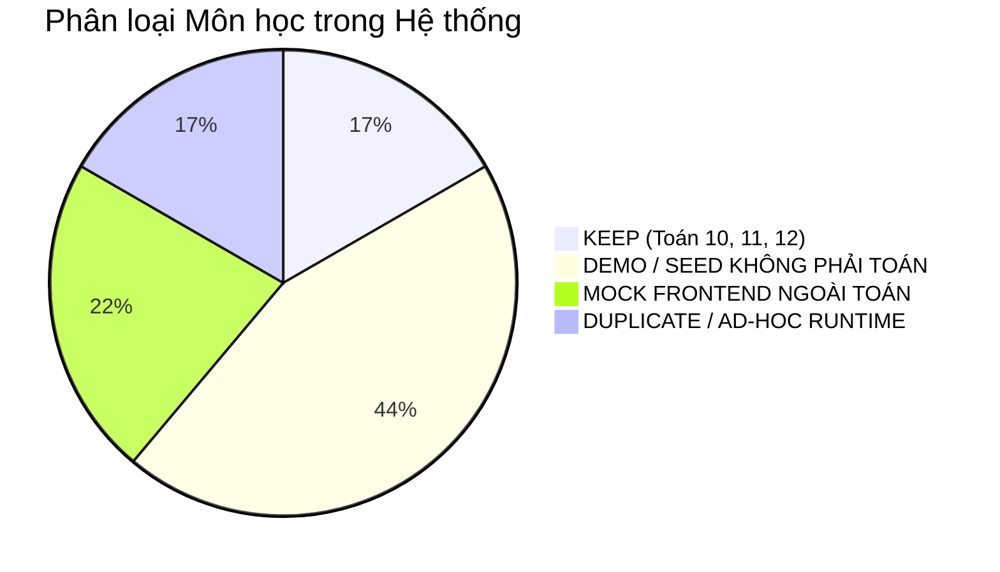
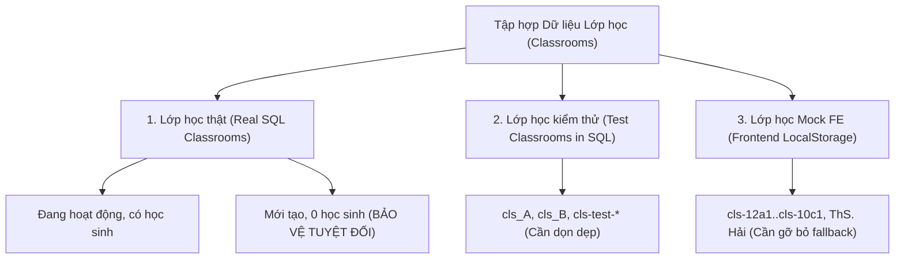
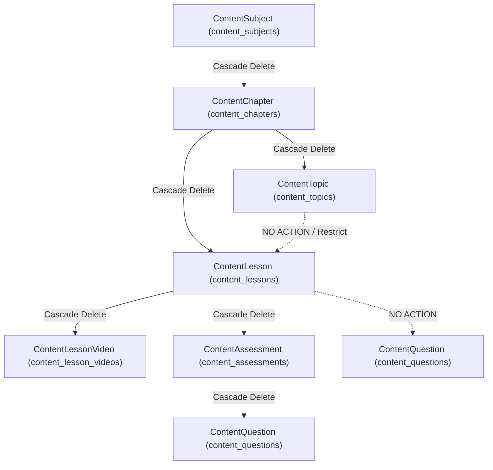
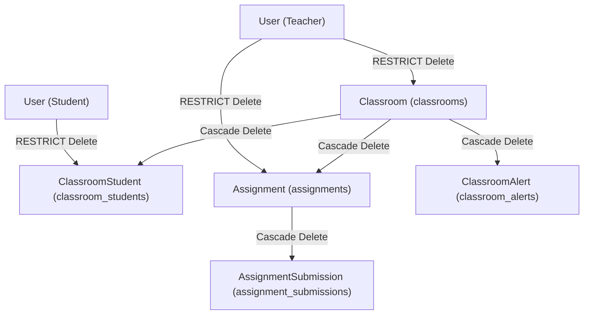

# STUDY_AI — MATH 10–12 ONLY DATA INVENTORY & ENTITY RELATION ANALYSIS

**Audit Date:** 2026-11-23  
**Status:** COMPLETE AUDIT (AUDIT & PLAN ONLY — ZERO SOURCE CODE / DB MODIFICATIONS)  
**Target Branch:** `feature/backend-redesign-modular-monolith`  
**Working Branch:** `audit/math-only-cleanup-plan-20261123`  
**Reference Baseline Commit:** `16593c049d5bf1e4b373eaef9ee2c2a0d7830cb3`  

---

## 1. MỤC TIÊU VÀ PHẠM VI AUDIT

### 1.1. Bối cảnh & Mục đích
Hệ thống giáo dục **STUDY_AI** được định vị chuyên sâu phục vụ học sinh Trung học phổ thông Việt Nam theo Chương trình Giáo dục Phổ thông 2018 (GDPT 2018), tập trung cốt lõi vào 03 môn:
1. **Toán lớp 10** (`sub_math10` / `MATH10`)
2. **Toán lớp 11** (`sub_math11` / `MATH11`)
3. **Toán lớp 12** (`sub_math12` / `MATH12`)

Qua quá trình phát triển, kiểm thử tích hợp (integration tests) và di chuyển dữ liệu (migrations/seeds), hệ thống hiện đang tồn tại:
- Các môn học ngoài phạm vi Toán (`sub_phys12`, `sub_chem12`, `sub_bio12`, `sub_lit12`, `sub_eng12`, `sub_hist12`, `sub_geo12`, `sub_civic12`).
- Các bản ghi môn học kiểm thử/rác do test sinh ra (`TEST_*`, `SEC_*`, `PHYS12_*`, `SUB_*`, `VID-*`, `PERF_*`, môn có tên chứa "kiểm thử").
- Dữ liệu môn học trùng lặp/legacy (`math` vs `sub_math12`).
- Lớp học mẫu/giả trong frontend mock (`cls-12a1`, `cls-12a2`, `cls-11b1`, `cls-10c1`) và dữ liệu test classroom.
- Nguy cơ xóa nhầm lớp học thật do giáo viên tạo mới nhưng chưa có học sinh (`StudentCount == 0`).

### 1.2. Nguyên tắc bảo vệ dữ liệu tối cao
1. **Tuyệt đối không thao tác ghi, xóa, drop, truncate trên database `StudyAIDb` (Protected Production Database).**
2. **Bảo toàn dữ liệu thật:** Tuyệt đối không xóa bài học, chương, câu hỏi, video thuộc Toán 10, 11, 12 và không xóa lớp học thật của giáo viên.
3. **Chế độ thực hiện:** Audit và lập kế hoạch thuần túy (Audit & Plan Only) — chưa sửa đổi code và chưa chạy lệnh SQL xóa dữ liệu trong turn này.

---

## 2. CANONICAL MATH 10–12 DEFINITIONS (CHUẨN DỮ LIỆU TOÁN 10–12)

Dữ liệu chuẩn được định nghĩa và kiểm chứng từ `backend/data/curriculum/math-vietnam-catalog.v1.json` và cấu trúc khởi tạo tại `DbInitializer.cs`:

| Thuộc tính | Toán lớp 10 (Math 10) | Toán lớp 11 (Math 11) | Toán lớp 12 (Math 12) |
| :--- | :--- | :--- | :--- |
| **Canonical Subject ID** | `sub_math10` | `sub_math11` | `sub_math12` |
| **Subject Code** | `MATH10` | `MATH11` | `MATH12` |
| **Tên hiển thị** | `Toán 10` | `Toán 11` | `Toán 12` |
| **Khối lớp (`Grade`)** | `10` | `11` | `12` |
| **Số chương chuẩn** | 5 chương (`MATH10_C1` → `MATH10_C5`) | 2 chương (`MATH11_C1` → `MATH11_C2`) | 4 chương (`MATH12_C1` → `MATH12_C4`) |
| **Nguồn tham chiếu** | Khan Academy VN / GDPT 2018 | Khan Academy VN / GDPT 2018 | Khan Academy VN / GDPT 2018 |
| **URL tham chiếu** | `https://vi.khanacademy.org/math/toan-lop-10-vietnam` | `https://vi.khanacademy.org/math/toan-lop-11-viet-nam` | `https://vi.khanacademy.org/math/toan-lop-12-viet-nam` |
| **Bản quyền nội dung** | CC BY-NC-SA 4.0 | CC BY-NC-SA 4.0 | CC BY-NC-SA 4.0 |
| **Video nhúng** | Video giáo dục YouTube có bản quyền cho phép nhúng (`embedAllowed: true`) | Video giáo dục YouTube có bản quyền cho phép nhúng (`embedAllowed: true`) | Video giáo dục YouTube có bản quyền cho phép nhúng (`embedAllowed: true`) |
| **Trạng thái kích hoạt** | `IsActive = true` | `IsActive = true` | `IsActive = true` |

---

## 3. BẢNG PHÂN LOẠI TOÀN BỘ MÔN HỌC (SUBJECT CATEGORIZATION INVENTORY)

Dựa trên phân tích mã nguồn (`DbInitializer.cs`, `StudentCurriculumService.cs`, `education.mock.ts`, `subjects.service.ts`, `CurriculumImportConfirmService.cs`), toàn bộ đối tượng môn học được phân thành 4 nhóm rõ rệt:

### 3.1. Nhóm 1: KEEP — Dữ liệu chuẩn Toán 10–12 bắt buộc giữ lại
| Subject ID | Code | Tên môn | Khối | Trạng thái | Nguồn gốc | Hành động |
| :--- | :--- | :--- | :--- | :--- | :--- | :--- |
| `sub_math10` | `MATH10` | Toán 10 | 10 | `IsActive = true` | `DbInitializer.cs:39`, `math-vietnam-catalog.v1.json` | **GIỮ NGUYÊN (KEEP)** |
| `sub_math11` | `MATH11` | Toán 11 | 11 | `IsActive = true` | `DbInitializer.cs:150`, `math-vietnam-catalog.v1.json` | **GIỮ NGUYÊN (KEEP)** |
| `sub_math12` | `MATH12` | Toán 12 | 12 | `IsActive = true` | `DbInitializer.cs:262`, `math-vietnam-catalog.v1.json` | **GIỮ NGUYÊN (KEEP)** |

Toàn bộ các thực thể con liên quan (`ContentChapter`, `ContentTopic`, `ContentLesson`, `ContentLessonVideo`, `ContentAssessment`, `ContentQuestion`, `LessonProgress`, `AssessmentAttempt`, `StudentTopicMastery`) của 3 môn này là tài sản dữ liệu cốt lõi, **tuyệt đối không được xóa**.

---

### 3.2. Nhóm 2: DUPLICATE — Môn học trùng lặp / Ad-hoc / Legacy cần hợp nhất
| Subject ID | Code | Tên môn | Khối | Vị trí phát hiện trong code | Nguyên nhân phát sinh | Rủi ro & Hướng xử lý |
| :--- | :--- | :--- | :--- | :--- | :--- | :--- |
| `math` | `MATH-12` | Toán học 12 | 12 | `education.mock.ts:10`, `subjects.service.ts:159` | Dữ liệu mock ban đầu của FE trước khi chuẩn hóa `sub_math12`. | **DUPLICATE**: FE vẫn chứa điều kiện `s.id === 'math'`. Cần trỏ toàn bộ tham chiếu về `sub_math12` và dọn dẹp mock. |
| `sub_math` + `{g}` (tự tạo) | `MATH{g}` | Toán {g} | {g} | `TeacherSubmissionsService.cs:340-350` | Khi giáo viên chấm bài tập mà môn chưa có trong DB, service tự chèn `ContentSubject` ad-hoc. | **AD-HOC INSERT**: Cần ngăn chặn hành vi tự chèn này. Đối chiếu xem có bản ghi con nào phụ thuộc không trước khi dọn. |
| Guid-based Math ID | `MATH*` | Toán * | 10-12 | `CurriculumImportConfirmService.cs:164` | Import môn học qua JSON/CSV tự sinh `Guid.NewGuid().ToString("N")` nếu mã code chưa có. | **UNCONTROLLED ID**: Cần chuẩn hóa map về `sub_math10/11/12` tương ứng với Code. |

---

### 3.3. Nhóm 3: DEMO / TEST — Môn không phải Toán và môn kiểm thử rác cần loại bỏ
| Mã môn (Code) | ID dự kiến | Tên môn học | Vị trí phát hiện trong code | Loại dữ liệu | Hướng xử lý đề xuất |
| :--- | :--- | :--- | :--- | :--- | :--- |
| `PHYS12` | `sub_phys12` | Vật lý 12 | `DbInitializer.cs:322`, `subjects.service.ts:35` | Standard Seed 12 | **Loại khỏi runtime**, ẩn/xóa an toàn |
| `CHEM12` | `sub_chem12` | Hóa học 12 | `DbInitializer.cs:323`, `subjects.service.ts:43` | Standard Seed 12 | **Loại khỏi runtime**, ẩn/xóa an toàn |
| `BIO12` | `sub_bio12` | Sinh học 12 | `DbInitializer.cs:324`, `subjects.service.ts:51` | Standard Seed 12 | **Loại khỏi runtime**, ẩn/xóa an toàn |
| `LIT12` | `sub_lit12` | Ngữ văn 12 | `DbInitializer.cs:325`, `subjects.service.ts:57` | Standard Seed 12 | **Loại khỏi runtime**, ẩn/xóa an toàn |
| `ENG12` | `sub_eng12` | Tiếng Anh 12 | `DbInitializer.cs:326`, `subjects.service.ts:65` | Standard Seed 12 | **Loại khỏi runtime**, ẩn/xóa an toàn |
| `HIST12` | `sub_hist12` | Lịch sử 12 | `DbInitializer.cs:327`, `subjects.service.ts:71` | Standard Seed 12 | **Loại khỏi runtime**, ẩn/xóa an toàn |
| `GEO12` | `sub_geo12` | Địa lý 12 | `DbInitializer.cs:328`, `subjects.service.ts:79` | Standard Seed 12 | **Loại khỏi runtime**, ẩn/xóa an toàn |
| `CIVIC12` | `sub_civic12` | GD Kinh tế & Pháp luật 12 | `DbInitializer.cs:329`, `subjects.service.ts:87` | Standard Seed 12 | **Loại khỏi runtime**, ẩn/xóa an toàn |
| `TEST_*` | `*` | Các môn kiểm thử | `StudentCurriculumService.cs:51` | Tàn dư integration tests | **Loại khỏi runtime**, dọn sạch khỏi DB test |
| `SEC_*` | `*` | Security test subjects | `StudentCurriculumService.cs:51` | Tàn dư integration tests | **Loại khỏi runtime**, dọn sạch khỏi DB test |
| `SUB_*` | `*` | Subject test artifacts | `StudentCurriculumService.cs:51` | Tàn dư integration tests | **Loại khỏi runtime**, dọn sạch khỏi DB test |
| `VID-*` | `*` | Video test artifacts | `StudentCurriculumService.cs:51` | Tàn dư integration tests | **Loại khỏi runtime**, dọn sạch khỏi DB test |
| `PERF_*` | `*` | Performance test subjects | `StudentCurriculumService.cs:51` | Tàn dư integration tests | **Loại khỏi runtime**, dọn sạch khỏi DB test |

---

### 3.4. Nhóm 4: REVIEW BEFORE REMOVAL — Môn cần kiểm tra ràng buộc trước khi xóa
Trước khi chạy bất kỳ câu lệnh SQL `DELETE` vật lý nào đối với các môn thuộc Nhóm 2 và Nhóm 3 trên môi trường kiểm thử/E2E:
1. Phải chạy query kiểm tra xem môn học đó có bản ghi liên kết trong:
   - `content_questions` (`SubjectId`)
   - `lesson_progress` (`SubjectId`)
   - `assessment_attempts` (`SubjectId`)
   - `student_topic_masteries` (`SubjectId`)
2. **Quy tắc xử lý:**
   - Nếu môn có `0` bản ghi liên kết: Có thể xóa an toàn (Safe to delete).
   - Nếu môn có bản ghi liên kết thuộc dữ liệu test: Xóa theo thứ tự đảo ngược các bảng phụ thuộc hoặc xóa cascade có kiểm soát trong script rehearsal.
   - Nếu môn có bản ghi liên kết nhưng chưa xác minh được nguồn gốc: Đặt `IsActive = false` (Soft-disable), **không xóa vật lý**.

---

## 4. BẢNG PHÂN LOẠI TOÀN BỘ LỚP HỌC (CLASSROOM DATA INVENTORY)

### 4.1. Phân loại chi tiết các dạng lớp học

#### 1. Lớp học thật (Real SQL Classrooms)
- **Đặc điểm định danh:**
  - Được tạo thông qua API `POST /api/v1/classrooms` (`TeacherClassroomsService.cs:111-129`).
  - Định dạng ID: `cls-{Guid:N}[..12]` (chuỗi 12 ký tự bắt đầu bằng `cls-`, ví dụ: `cls-8f2a1b4c9d0e`).
  - `TeacherId`: Liên kết khóa ngoại hợp lệ tới tài khoản thật trong bảng `users` (`Role = "teacher"` hoặc `"admin"`).
  - `Subject`: Thường là `"Toán học"`, `"Toán 10"`, `"Toán 11"`, `"Toán 12"`.
- **CRITICAL INVARIANT (BẤT BIẾN TỐI QUAN TRỌNG):**
  - Một lớp học do giáo viên thật tạo mới hoàn toàn có thể có `StudentCount = 0` và `AssignmentCount = 0`.
  - **Tuyệt đối không sử dụng điều kiện `StudentCount == 0` làm căn cứ để xóa lớp học.**
  - Hành động: **BẢO VỆ NGUYÊN VẸN 100% (KEEP).**

#### 2. Lớp học kiểm thử trong SQL (Test Classrooms in Database)
- **Đặc điểm định danh:**
  - Sinh ra trong quá trình chạy bộ test: `PracticeIntegrationTests.cs:723`, `ZeroMockPersistenceAndRbacIntegrationTests.cs:319`, `PhaseAi05TeacherManagementUnitTests.cs`.
  - ID thường có dạng: `cls_A`, `cls_B`, `cls-test-*`, `cls-demo-*` hoặc `TeacherId` liên kết với tài khoản test có email `@test.local`, `usr_test_*`.
- **Hành động:**
  - Nhận diện qua query kiểm tra `TeacherId` và tên lớp.
  - Được cô lập và dọn sạch trên database `StudyAIDb_E2E`.

#### 3. Lớp học Mock trên Frontend (Mock LocalStorage Fallback)
- **Vị trí trong mã nguồn:**
  - `frontend/src/services/classroom.service.ts:41-118` (`INITIAL_CLASSES`):
    * `cls-12a1`: "Lớp 12A1" — GVCN: "ThS. Nguyễn Văn Hải"
    * `cls-12a2`: "Lớp 12A2" — GVCN: "Cô Trần Mai Linh"
    * `cls-11b1`: "Lớp 11B1" — GVCN: "ThS. Lê Hoàng Nam"
    * `cls-10c1`: "Lớp 10C1" — GVCN: "Cô Phạm Bích Ngọc"
  - `frontend/src/data/staff/teacher.mock.ts:25-50` (`INITIAL_MOCK_CLASSES`): File dead code không được import.
  - `frontend/src/pages/Teacher/TeacherClassesPage.tsx:41, 128`: Hardcode mặc định `homeroomTeacherName: 'ThS. Nguyễn Văn Hải'` khi mở form tạo lớp.
  - `frontend/src/pages/Admin/AdminClassesPage.tsx:37, 110`: Hardcode `homeroomTeacherName: 'ThS. Nguyễn Văn Hải'`.
- **Vấn đề runtime:**
  - Tại `classroom.service.ts:594`, khi chưa đăng nhập hoặc token không hợp lệ (`!getAccessToken()`), service nạp toàn bộ 4 lớp mock này vào `localStorage` (`study_ai_classes_v4`).
  - Khi người dùng đăng nhập tài khoản giáo viên mới chưa có lớp, nếu logic kiểm tra token chập chờn, giao diện có nguy cơ hiển thị 4 lớp học mẫu của giáo viên "Nguyễn Văn Hải" thay vì hiển thị trạng thái rỗng trung thực (truthful empty state).
- **Hành động đề xuất:**
  - Xóa bỏ mock fallback `INITIAL_CLASSES` khỏi runtime; hiển thị empty state rõ ràng khi giáo viên chưa tạo lớp.
  - Xóa file dead code `teacher.mock.ts`.
  - Bỏ hardcode `homeroomTeacherName: 'ThS. Nguyễn Văn Hải'` trong form tạo lớp để lấy thông tin từ giáo viên đang đăng nhập.

---

## 5. BIỂU ĐỒ QUAN HỆ THỰC THỂ VÀ RÀNG BUỘC TOÀN VẸN (EF CORE RELATIONSHIPS & FK CONSTRAINTS)

Dựa trên cấu hình EF Core Fluent API trong `backend/src/StudyAI.Api/Data/StudyAIDbContext.cs`:

### 5.1. Cây phân cấp Nội dung (Content Hierarchy)

### 5.2. Các bảng liên kết ngoại vi đến `SubjectId` (Cross-Cutting Foreign References)
Đây là các bảng tham chiếu trực tiếp đến `SubjectId` mà **không tự động cascade**:

| Tên bảng SQL | Entity C# | Cột tham chiếu | Behavior xóa | Phân tích rủi ro khi xóa Subject |
| :--- | :--- | :--- | :--- | :--- |
| `content_questions` | `ContentQuestion` | `SubjectId` (varchar 64) | Independent index, `LessonId` có `OnDelete(DeleteBehavior.NoAction)` | Nếu câu hỏi có `SubjectId` trỏ về môn bị xóa, SQL có thể để lại orphan record hoặc cản trở xóa. |
| `student_topic_masteries` | `StudentTopicMastery` | `SubjectId` (varchar 64) | `OnDelete(DeleteBehavior.NoAction)` (`StudyAIDbContext.cs:1013`) | **RỦI RO CAO NHẤT:** Xóa môn học có dữ liệu mastery sẽ bị SQL Server chặn ngay lập tức với lỗi Foreign Key Constraint Violation. |
| `lesson_progress` | `LessonProgress` | `SubjectId` (varchar 64) | Composite index `{UserId, SubjectId}` | Dữ liệu tiến độ học tập của học sinh. Xóa môn sẽ làm mồ côi bản ghi tiến độ. |
| `assessment_attempts` | `AssessmentAttempt` | `SubjectId` (varchar 64) | Indexed, FK to User | Dữ liệu lịch sử làm bài thi/luyện tập. |
| `learning_recommendations` | `LearningRecommendation` | `SubjectId` (varchar 64) | Indexed | Dữ liệu gợi ý học tập AI sinh ra. |

### 5.3. Cây quan hệ Lớp học (Classroom Relationships)

- Khi xóa một `Classroom`: EF Core cascade xóa `classroom_students`, `assignments` (kéo theo `assignment_submissions`), và `classroom_alerts`.
- Khóa ngoại từ `TeacherId` sang `User` có hành vi `DeleteBehavior.Restrict` — không thể xóa một User nếu họ đang là chủ nhiệm của lớp học.

---

## 6. PHÂN TÍCH RỦI RO MẤT DỮ LIỆU & LỖI HỆ THỐNG (DATA LOSS RISKS)

1. **Rủi ro 1: Lỗi Foreign Key Violation khi chạy SQL DELETE môn học**  
   - *Nguyên nhân:* `StudentTopicMastery` và `ContentQuestion` có `DeleteBehavior.NoAction` đối với môn học và bài học.  
   - *Hậu quả:* Lệnh `DELETE FROM content_subjects WHERE code = 'PHYS12'` sẽ ném exception `SqlException (547): The DELETE statement conflicted with the REFERENCE constraint`.  
   - *Giải pháp:* Trước khi xóa, phải kiểm tra các bảng phụ thuộc hoặc áp dụng giải pháp vô hiệu hóa mềm (`IsActive = false`) trước.

2. **Rủi ro 2: Xóa nhầm lớp học thật mới tạo của giáo viên**  
   - *Nguyên nhân:* Kịch bản dọn dẹp lọc `StudentCount == 0` hoặc nhầm lẫn giữa lớp thật và lớp mock.  
   - *Hậu quả:* Giáo viên vừa tạo lớp để chuẩn bị giảng dạy bị mất trắng thông tin lớp, mã lớp và lịch sử.  
   - *Giải pháp:* Tiêu chí nhận diện lớp kiểm thử bắt buộc phải dựa trên `TeacherId` (tài khoản test), tiền tố mã lớp test (`cls-test-`), tuyệt đối không dựa vào sĩ số học sinh.

3. **Rủi ro 3: Đứt gãy thống kê Dashboard học sinh & giáo viên**  
   - *Nguyên nhân:* `StudentPracticeService.cs:1005` duyệt qua danh sách môn học trong DB để tính `subjectProgressList`. Nếu có môn rác hoặc môn bị xóa gây mất mapping với các `AssessmentAttempt` cũ, dashboard sẽ tính sai độ chính xác hoặc ném lỗi null reference.  
   - *Giải pháp:* Chuẩn hóa API dashboard chỉ truy vấn theo whitelist 3 môn Toán (`sub_math10`, `sub_math11`, `sub_math12`).

4. **Rủi ro 4: Vi phạm nguyên tắc bảo vệ cơ sở dữ liệu `StudyAIDb`**  
   - *Nguyên nhân:* Chạy nhầm script dọn dẹp hoặc test suite vào database production.  
   - *Hậu quả:* Mất dữ liệu người dùng thật, vi phạm quy định bảo vệ dữ liệu trong `AGENTS.md`.  
   - *Giải pháp:* Toàn bộ thao tác chạy thử (dry-run) và kiểm thử chỉ được phép thực thi trên `StudyAIDb_E2E` với cờ kiểm tra fail-closed connection string.

---

## 7. BẢNG TIÊU CHUẨN XÁC MINH KIỂM TOÁN (VERIFICATION STANDARDS)

| Mã Hạng mục | Đối tượng kiểm toán | Trạng thái xác minh | Căn cứ chứng minh |
| :--- | :--- | :--- | :--- |
| **INV-SUB-01** | Canonical Math 10-12 IDs (`sub_math10..12`) | **VERIFIED** | Khớp 100% giữa `math-vietnam-catalog.v1.json`, `DbInitializer.cs` và `SubjectGradeResolver.cs`. |
| **INV-SUB-02** | Seeded non-math subjects (`sub_phys12..civic12`) | **VERIFIED** | Được code cứng tại `DbInitializer.cs:320-330`, tự động chèn khi khởi tạo DB. |
| **INV-SUB-03** | Blacklist logic trong `StudentCurriculumService` | **VERIFIED** | `StudentCurriculumService.cs:51` chứa điều kiện loại trừ thủ công 7 tiền tố test. |
| **INV-SUB-04** | Ad-hoc subject creation trong Teacher grading | **VERIFIED** | `TeacherSubmissionsService.cs:340-350` tự động tạo `ContentSubject` khi chấm điểm. |
| **INV-CLS-01** | Frontend mock classes (`cls-12a1..10c1`) | **VERIFIED** | Khai báo tại `classroom.service.ts:41` và sử dụng làm fallback localStorage tại dòng 594. |
| **INV-CLS-02** | Form tạo lớp học hardcode tên GVCN | **VERIFIED** | `TeacherClassesPage.tsx:41, 128` hardcode `'ThS. Nguyễn Văn Hải'`. |
| **INV-CLS-03** | Phân biệt lớp thật 0 học sinh vs lớp giả | **VERIFIED** | Lớp thật có ID sinh bởi `TeacherClassroomsService.cs:113` gắn với `TeacherId` trong bảng `users`. |
| **INV-REL-01** | FK Constraint NoAction trên `StudentTopicMastery` | **VERIFIED** | Khai báo Fluent API tại `StudyAIDbContext.cs:1013`. |
