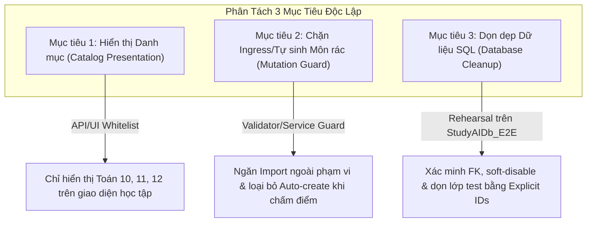
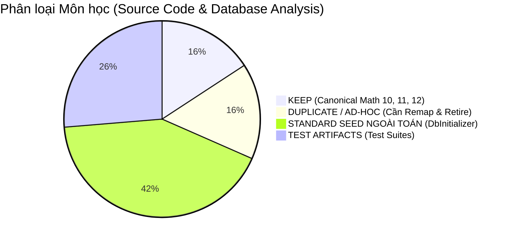

# STUDY_AI — MATH 10–12 ONLY: BẢNG KIỂM KÊ DỮ LIỆU & PHÂN TÍCH QUAN HỆ THỰC THỂ (REVISED)

**Audit Date:** 2026-11-23  
**Trạng thái:** AUDIT & PLAN ONLY (Chưa sửa mã nguồn, chưa sửa database)  
**Nhánh nguồn:** `feature/backend-redesign-modular-monolith`  
**Nhánh kế hoạch:** `audit/math-only-cleanup-plan-20261123` (Draft PR #23)  
**Reference Baseline Commit:** `16593c049d5bf1e4b373eaef9ee2c2a0d7830cb3`  

---

## 1. MỤC TIÊU VÀ NGUYÊN TẮC PHÂN TÁCH 3 CẤP ĐỘ

Để xử lý dứt điểm tình trạng môn học rác và lớp học mẫu mà không gây nhầm lẫn hoặc rủi ro mất dữ liệu, kế hoạch phân định rõ ràng **03 mục tiêu kỹ thuật độc lập**:



1. **Mục tiêu 1 — Hiển thị Danh mục Chuẩn (Catalog Presentation):**  
   Đảm bảo toàn bộ API học sinh (`/api/v1/curriculum/subjects`, `/api/v1/practice/dashboard-stats`) và giao diện người dùng chỉ hiển thị và điều hướng trên 3 môn Toán chuẩn.
2. **Mục tiêu 2 — Ngăn Tự Tạo Môn Học Ngoài Phạm Vi (Mutation & Ingress Prevention):**  
   Chặn đứng các luồng ghi dữ liệu có thể chèn môn rác mới vào cơ sở dữ liệu (`CurriculumImportValidator`, `CurriculumImportConfirmService`, `TeacherSubmissionsService`, `DbInitializer`).
3. **Mục tiêu 3 — Dọn dẹp Dữ liệu SQL sau khi Xác minh Ràng buộc (Database Cleanup):**  
   Thực thi trên môi trường kiểm thử cô lập `StudyAIDb_E2E`, kiểm kê toàn bộ khóa ngoại, snapshot trạng thái, soft-disable và dọn dẹp các lớp test theo ID cụ thể.

> [!CAUTION]
> **CẢNH BÁO NGUYÊN TẮC AN TOÀN:**  
> - **Ẩn dữ liệu trên FE hoặc lọc API KHÔNG đồng nghĩa với việc đã dọn sạch dữ liệu trong SQL.**  
> - **Tuyệt đối không chạy bất kỳ câu lệnh ghi/xóa/migration nào trên `StudyAIDb` (Protected Production Database).**  
> - **Không sử dụng câu lệnh DELETE wildcard (`WHERE Id LIKE 'cls-test%'`) để xóa hàng loạt lớp học.**

---

## 2. CANONICAL MATH 10–12 PAIR IDENTIFIERS (CHUẨN ĐỊNH DANH CẶP ĐÔI BẮT BUỘC)

Hệ thống định nghĩa duy nhất 3 bộ định danh chính thức theo chuẩn GDPT 2018 (tham chiếu `backend/data/curriculum/math-vietnam-catalog.v1.json`):

| Thuộc tính | Toán lớp 10 (Math 10) | Toán lớp 11 (Math 11) | Toán lớp 12 (Math 12) |
| :--- | :--- | :--- | :--- |
| **Canonical Subject ID** | `sub_math10` | `sub_math11` | `sub_math12` |
| **Canonical Subject Code** | `MATH10` | `MATH11` | `MATH12` |
| **Khối lớp chuẩn (`Grade`)** | `10` | `11` | `12` |
| **Tên hiển thị chuẩn** | `Toán 10` | `Toán 11` | `Toán 12` |
| **Số chương theo GDPT 2018** | 5 chương (`MATH10_C1` → `MATH10_C5`) | 2 chương (`MATH11_C1` → `MATH11_C2`) | 4 chương (`MATH12_C1` → `MATH12_C4`) |
| **Nguồn tham chiếu bản quyền** | Khan Academy Vietnam / CC BY-NC-SA 4.0 | Khan Academy Vietnam / CC BY-NC-SA 4.0 | Khan Academy Vietnam / CC BY-NC-SA 4.0 |
| **Embed Video Status** | YouTube Edu / `embedAllowed = true` | YouTube Edu / `embedAllowed = true` | YouTube Edu / `embedAllowed = true` |

### 2.1. Phân tích Rủi ro của Whitelist lỏng lẻo (`ID hợp lệ OR Code hợp lệ`)
Nếu áp dụng whitelist dạng `WHERE (Id IN ('sub_math10', ...) OR Code IN ('MATH10', ...))` mà không kiểm tra cặp khớp:
- **Trường hợp Anomaly 1 (Code đúng, ID sai):** Nếu trong DB tồn tại bản ghi rác có `Code = 'MATH10'` nhưng `Id = 'sub_math10_dup'` hoặc `{Guid}`, câu truy vấn `OR` sẽ trả về cả 2 bản ghi, gây trùng lặp môn học trên UI.
- **Trường hợp Anomaly 2 (ID đúng, Code sai):** Nếu bản ghi có `Id = 'sub_math10'` nhưng `Code = 'MATH-OLD'` hoặc bị sửa, các luồng phân giải theo `Code` sẽ bị gãy.
- **Quy tắc Whitelist Cặp đôi Bắt buộc (Strict Pair Whitelist):**
  Một môn học chỉ được công nhận là canonical nếu và chỉ nếu thỏa mãn đồng thời:
  $$\text{Subject} \in \{ (sub\_math10, MATH10, 10), (sub\_math11, MATH11, 11), (sub\_math12, MATH12, 12) \}$$

---

## 3. BẢNG PHÂN LOẠI & ÁNH XẠ ID MÔN HỌC (SUBJECT TAXONOMY & REMAPPING TABLE)



### 3.1. Bảng Ánh xạ ID Cũ / Trùng lặp sang ID Chuẩn (Subject ID Remapping Table)

| ID Hiện tại / Nguồn gốc | Code Hiện tại | Khối (`Grade`) | Trạng thái Nguồn gốc | Canonical Target ID | Canonical Target Code | Ràng buộc Phụ thuộc cần Chuyển đổi |
| :--- | :--- | :--- | :--- | :--- | :--- | :--- |
| `math` | `MATH-12` | `Lớp 12` | Mock FE (`education.mock.ts:10`) & Migration cũ | `sub_math12` | `MATH12` | `content_chapters`, `content_questions`, `lesson_progress`, `assessment_attempts`, `student_topic_masteries` |
| `sub_math{g}` (tự sinh) | `MATH{g}` | `{g}` (10, 11, 12) | Do `TeacherSubmissionsService:340` tự chèn | `sub_math{g}` | `MATH{g}` | `student_topic_masteries` |
| `{Guid:N}` (do Import sinh) | `MATH10` | `10` | Do `CurriculumImportConfirmService:164` tự sinh | `sub_math10` | `MATH10` | `content_chapters`, `content_questions` |
| `{Guid:N}` (do Import sinh) | `MATH11` | `11` | Do `CurriculumImportConfirmService:164` tự sinh | `sub_math11` | `MATH11` | `content_chapters`, `content_questions` |
| `{Guid:N}` (do Import sinh) | `MATH12` | `12` | Do `CurriculumImportConfirmService:164` tự sinh | `sub_math12` | `MATH12` | `content_chapters`, `content_questions` |

### 3.2. Quy trình Chuyển quan hệ An toàn & Bảo toàn Lịch sử Học tập (Safe Remapping Protocol)
Trước khi vô hiệu hóa hoặc xóa các ID môn học cũ/trùng lặp trên database rehearsal:
1. **Kiểm tra sự tồn tại của Canonical Target:** Xác nhận `sub_math10`, `sub_math11`, `sub_math12` đã tồn tại trong DB với `IsActive = 1`.
2. **Cập nhật Khóa ngoại (FK Re-pointing) theo thứ tự:**
   ```sql
   -- Ví dụ Remap từ 'math' sang 'sub_math12'
   UPDATE content_chapters SET SubjectId = 'sub_math12' WHERE SubjectId = 'math';
   UPDATE content_questions SET SubjectId = 'sub_math12' WHERE SubjectId = 'math';
   UPDATE assessment_attempts SET SubjectId = 'sub_math12' WHERE SubjectId = 'math';
   UPDATE learning_recommendations SET SubjectId = 'sub_math12' WHERE SubjectId = 'math';
   ```
3. **Xử lý Trùng lặp Khóa phức hợp (Composite Key Deduplication):**
   - Với `lesson_progress`: Có chỉ mục duy nhất `{UserId, LessonId}` (không có `SubjectId` trong PK). Tuy nhiên có chỉ mục `{UserId, SubjectId}`. Ta chỉ cập nhật khi chưa có bản ghi cùng `LessonId`.
   - Với `student_topic_masteries`: Có chỉ mục duy nhất `{UserId, SubjectId, TopicName}`. Nếu học sinh đã có mastery record ở cả `math` và `sub_math12`, hợp nhất bằng cách lấy điểm mastery cao nhất và số lần làm bài cộng dồn trước khi xóa bản ghi cũ.
4. **Bảo toàn lịch sử:** Không xóa điểm số hay lịch sử làm bài; toàn bộ tiến độ được quy tụ về môn chuẩn `sub_math12`.

---

## 4. BẢNG KIỂM KÊ TOÀN DIỆN LỚP HỌC (EVIDENCE-BASED CLASSROOM AUDIT)

### 4.1. Tiêu chí Đánh giá Bằng chứng (Evidence Rubric)
Để tránh xóa nhầm dữ liệu thật, một lớp học chỉ được đưa vào danh sách dọn dẹp khi thỏa mãn **toàn bộ 4 tiêu chí bằng chứng sau**:
1. **Bằng chứng Chủ sở hữu (Owner Evidence):** `TeacherId` thuộc tài khoản test cô lập (Email chứa `@test.local`, `usr_test_*`) HOẶC không tồn tại trong bảng `users` (tài khoản mồ côi từ test cũ).
2. **Bằng chứng Lịch sử Bài tập & Điểm số (History Evidence):** Lớp có `0` bài nộp có điểm của học sinh thật (`GradedSubmissionCount == 0`).
3. **Bằng chứng Mã định danh / Fixture (Fixture Evidence):** Mã lớp thuộc danh sách fixture được code cứng trong test suite (`cls_A`, `cls_B` trong `PracticeIntegrationTests.cs`).
4. **Loại trừ Tuyệt đối (Strict Preservation Exception):**  
   **BẤT KỲ LỚP HỌC NÀO ĐƯỢC TẠO BỞI GIÁO VIÊN THẬT (Tài khoản User có role `teacher` hoặc `admin` hợp lệ), DÙ CÓ SĨ SỐ HỌC SINH BẰNG 0 (`StudentCount == 0`), ĐỀU ĐƯỢC BẢO VỆ TUYỆT ĐỐI 100% (KEEP).**

### 4.2. Bảng Kiểm kê và Đánh giá An toàn từng Nhóm Lớp học

| Nhóm Lớp học | ID / Mẫu nhận diện | Chủ sở hữu (`TeacherId` / Email) | Bằng chứng Nguồn gốc | Số HS | Số Bài tập | Số Bài nộp | Điểm số Học sinh | Quyết định Kiểm toán | Mức độ An toàn |
| :--- | :--- | :--- | :--- | :---: | :---: | :---: | :---: | :--- | :--- |
| **Lớp Giáo viên Thật (Đang hoạt động)** | `cls-{Guid:N}[..12]` | Giáo viên thật (`users.Role = 'teacher'`) | API `POST /api/v1/classrooms` | > 0 | > 0 | > 0 | Điểm thật | **BẢO VỆ TUYỆT ĐỐI (KEEP)** | Rủi ro cực cao nếu xóa |
| **Lớp Giáo viên Thật (Mới tạo, chưa có HS)** | `cls-{Guid:N}[..12]` | Giáo viên thật (`users.Role = 'teacher'`) | API `POST /api/v1/classrooms` | **0** | 0 | 0 | Không có | **BẢO VỆ TUYỆT ĐỐI (KEEP)** | Rủi ro cực cao nếu xóa |
| **Lớp Fixture Test Integration** | `cls_A`, `cls_B` | `usr_test_teacher_A/B` | `PracticeIntegrationTests.cs:723` | 1-2 | 1 | 1 | Điểm test | **Xác minh & Dọn dẹp trên E2E DB** | An toàn trên DB E2E |
| **Lớp Mock LocalStorage (Frontend)** | `cls-12a1`, `cls-12a2`, `cls-11b1`, `cls-10c1` | `tch-01..04` ("ThS. Nguyễn Văn Hải",...) | `classroom.service.ts:41` | 3-5 | 1-2 | Mock | Điểm mock | **Gỡ bỏ Mock Fallback khỏi Runtime** | 100% an toàn (Client-side) |

---

## 5. PHÂN TÁCH GIỮA PHÁT HIỆN TỪ MÃ NGUỒN VÀ BẢN GHI SQL THỰC TẾ

| Hạng mục Kiểm toán | Phát hiện từ Phân tích Mã nguồn (Source Code Analysis) | Trạng thái Xác minh trên Database SQL | Ghi chú Rủi ro & Phạm vi |
| :--- | :--- | :--- | :--- |
| **8 Môn Seed ngoài Toán** | Được code cứng tại `DbInitializer.cs:320-330` (`sub_phys12`..`sub_civic12`). | **ĐÃ XÁC MINH CƠ CHẾ SINH:** Mỗi lần DB khởi tạo hoặc seed lại, code tự chèn 8 bản ghi này. | Cần vô hiệu hóa trong `DbInitializer.cs` để ngăn chặn tái sinh. |
| **Tự sinh môn khi chấm bài** | `TeacherSubmissionsService.cs:340-350` tự thêm `ContentSubject` khi `subjectExists == false`. | **ĐÃ XÁC MINH MÃ NGUỒN:** Gây ô nhiễm DB khi giáo viên chấm bài tập có tiêu đề chứa từ khóa lạ. | Phải xóa bỏ hoàn toàn đoạn code `_db.ContentSubjects.Add(...)`. |
| **Tự sinh môn khi Import** | `CurriculumImportConfirmService.cs:164` tự tạo subject với `Guid.NewGuid()`. | **ĐÃ XÁC MINH MÃ NGUỒN:** Thiếu whitelist kiểm tra `sub.Code` tại bước import. | Bổ sung kiểm tra whitelist `MATH10, 11, 12` trong validator và confirm service. |
| **Lớp học Mock FE** | `classroom.service.ts:41-118` khai báo `INITIAL_CLASSES` với "ThS. Nguyễn Văn Hải". | **XÁC MINH CLIENT-SIDE:** Chỉ tồn tại trong `localStorage` khi unauthenticated; nhánh authenticated lấy DB thật. | Giữ nguyên nhánh authenticated, chỉ bỏ nạp mock vào runtime authenticated. |
| **Khóa ngoại `NoAction`** | `StudyAIDbContext.cs:1013` cấu hình `NoAction` trên `StudentTopicMastery`. | **XÁC MINH FLUENT API:** SQL Server sẽ throw foreign key violation nếu xóa subject có mastery. | Bắt buộc kiểm tra count phụ thuộc trước khi soft-disable/xóa. |
