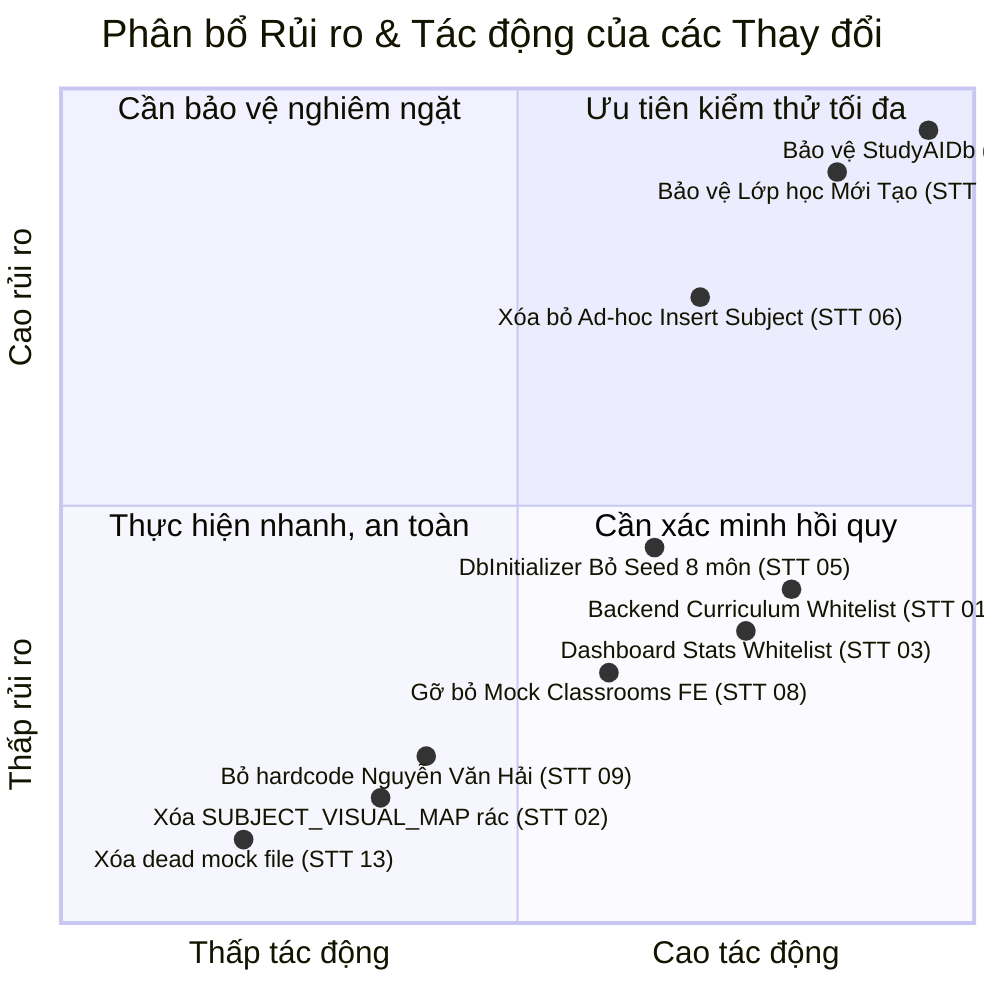

# STUDY_AI — MATH 10–12 ONLY: MA TRẬN TÁC ĐỘNG FRONTEND, BACKEND & DATABASE (IMPACT MATRIX)

**Tài liệu:** Bảng Đối chiếu Tác động Toàn hệ thống (FE - BE - SQL Impact Matrix)  
**Ngày kiểm toán:** 2026-11-23  
**Chế độ thực hiện:** AUDIT & PLAN ONLY (Chưa sửa mã nguồn)  
**Nhánh nguồn:** `feature/backend-redesign-modular-monolith`  
**Nhánh kế hoạch:** `audit/math-only-cleanup-plan-20261123`  

---

## 1. TỔNG QUAN MA TRẬN TÁC ĐỘNG

Bảng ma trận dưới đây phân tích chi tiết từng tính năng bị ảnh hưởng khi chuyển đổi hệ thống sang mô hình **Chỉ phục vụ Toán 10–12** và dọn dẹp lớp học mock/test.  
Mỗi luồng nghiệp vụ được đối chiếu từ: **Giao diện FE → API Endpoint → Service Backend → Bảng SQL & Ràng buộc → Thay đổi Đề xuất → Rủi ro & Giải pháp Kiểm soát**.

---

## 2. BẢNG MA TRẬN TÁC ĐỘNG CHI TIẾT (FULL-STACK IMPACT MATRIX)

| STT | Tính năng / Phân hệ | File & Component Frontend | API Endpoint & HTTP Method | Backend Service & Hàm thực thi | Bảng SQL & Ràng buộc liên quan | Thay đổi Đề xuất (Proposed Change) | Rủi ro & Giải pháp Kiểm soát (Risk & Mitigation) |
| :---: | :--- | :--- | :--- | :--- | :--- | :--- | :--- |
| **01** | **Khám phá Môn học (Learner Curriculum)** | `frontend/src/services/curriculum.service.ts`, `frontend/src/pages/Dashboard/DashboardPage.tsx` | `GET /api/v1/curriculum/subjects` | `StudentCurriculumService.cs` → `GetSubjectsAsync` | `content_subjects`, `content_chapters`, `content_lessons` | Thay thế blacklist thủ công (dòng 50-51) bằng positive whitelist: chỉ lấy `sub_math10`, `sub_math11`, `sub_math12` (hoặc `MATH10..12`). | **Rủi ro:** Học sinh không tìm thấy môn học nếu ID trong DB lệch mã code.   **Giải pháp:** Filter theo cả `Id` chuẩn và `Code` chuẩn (`MATH10..12`). |
| **02** | **Bản đồ trực quan Môn học (Subject Visual Meta)** | `frontend/src/services/subjects.service.ts` (`SUBJECT_VISUAL_MAP`) | Client-side utility (mapping metadata) | Không áp dụng (Client-side) | Không áp dụng | Xóa 8 môn ngoài Toán khỏi `SUBJECT_VISUAL_MAP`: `PHYS12`, `CHEM12`, `BIO12`, `LIT12`, `ENG12`, `HIST12`, `GEO12`, `CIVIC12`. Chuẩn hóa hàm `getSubjects()`. | **Rủi ro:** Màn hình FE bị crash nếu có component nào cố lấy icon của `PHYS12`.   **Giải pháp:** `resolveVisualMeta` đã có fallback default icon an toàn. |
| **03** | **Tiến độ Học sinh trên Dashboard (Practice Dashboard Stats)** | `frontend/src/pages/Dashboard/DashboardPage.tsx`, `frontend/src/services/practice.service.ts` | `GET /api/v1/practice/dashboard-stats` | `StudentPracticeService.cs` → `GetDashboardStatsAsync` | `content_subjects`, `lesson_progress`, `assessment_attempts` | Sửa dòng 1005: whitelist 3 môn Toán thay vì chỉ lọc `!s.Name.StartsWith("TEST_")`. Đảm bảo `subjectProgressList` chỉ phản ánh Toán 10–12. | **Rủi ro:** Sai lệch tổng số bài luyện tập hoặc streak nếu attempt cũ liên kết môn khác.   **Giải pháp:** Thống kê streak và tổng câu làm dựa trên `UserId`, chỉ phân bổ progress theo môn Toán. |
| **04** | **Phân giải Môn học & Khối lớp (Subject Grade Resolver)** | Toàn bộ các flow cần xác định môn (`AI Tutor`, `Exam Prep`, `Practice`) | Nội bộ Backend Utility | `SubjectGradeResolver.cs` → `ResolveSubjectAsync` | `content_subjects` (`IsActive`), `content_lessons`, `content_chapters` | Giữ nguyên quy tắc ưu tiên 6 cấp nhưng bổ sung điều kiện lọc chỉ chọn môn Toán (`sub_math10..12`) khi resolve theo `userGrade`. | **Rủi ro:** Không nhận diện được môn khi học sinh đổi lớp.   **Giải pháp:** Unit tests `SubjectGradeResolverTests` đã bao phủ, bảo đảm luôn trả về đúng môn Toán theo khối lớp. |
| **05** | **Khởi tạo Dữ liệu Hệ thống (Database Initializer)** | Backend Startup Seed | Khởi động ứng dụng (`DbInitializer.InitializeAsync`) | `DbInitializer.cs` → `InitializeAsync` | `content_subjects`, `content_chapters`, `content_lessons`, `content_questions` | Loại bỏ hoặc vô hiệu hóa đoạn seed 8 môn tiêu chuẩn ngoài Toán (`sub_phys12..civic12`, dòng 320-350). Chỉ khởi tạo duy nhất Toán 10, 11, 12. | **Rủi ro:** Khi reset DB test, thiếu các môn nếu có test cũ phụ thuộc.   **Giải pháp:** Rà soát và cập nhật test suites để sử dụng `sub_math10` làm đối tượng test chuẩn. |
| **06** | **Chấm bài Tập & Cập nhật Mastery (Teacher Grading)** | `frontend/src/pages/Teacher/TeacherClassDetailPage.tsx` | `POST /api/v1/teacher/submissions/{submissionId}/grade` | `TeacherSubmissionsService.cs` → `GradeSubmissionAsync` | `content_subjects` (PK `Id`), `student_topic_masteries` (FK `SubjectId`) | Xóa bỏ hoàn toàn side-effect tự động chèn `ContentSubject` (dòng 340-350). Lấy `SubjectId` từ ngữ cảnh Classroom/Assignment. | **Rủi ro:** Lỗi lưu mastery nếu bài tập không có môn học hợp lệ.   **Giải pháp:** Kiểm tra hợp lệ trước khi chấm, fallback an toàn về `sub_math12` của lớp học nếu thiếu. |
| **07** | **Quản lý Nội dung Môn học (Content Management)** | `frontend/src/pages/Content/ContentSubjectsPage.tsx`, `frontend/src/services/education.service.ts` | `GET /api/v1/content/subjects`, `POST /api/v1/content/subjects` | `ContentSubjectsService.cs` → `ListSubjectsAsync`, `CreateSubjectAsync` | `content_subjects` (`Code` UNIQUE), `content_chapters` (Cascade) | Mặc định chỉ hiển thị và quản lý các môn thuộc chương trình Toán THPT GDPT 2018 (`MATH10`, `MATH11`, `MATH12`). Ngăn admin vô tình tạo môn ngoài phạm vi. | **Rủi ro:** Admin không xem được môn cũ để dọn dẹp.   **Giải pháp:** Cung cấp filter tùy chọn `includeInactive=true` cho admin khi cần audit. |
| **08** | **Danh sách Lớp học Giáo viên (Teacher Classrooms)** | `frontend/src/pages/Teacher/TeacherClassesPage.tsx`, `frontend/src/services/classroom.service.ts` | `GET /api/v1/classrooms` | `TeacherClassroomsService.cs` → `ListClassroomsAsync` | `classrooms` (FK `TeacherId` Restrict), `classroom_students` (Cascade), `assignments` (Cascade) | 1. Khi đã đăng nhập, xóa bỏ fallback localStorage nạp 4 lớp mock (`cls-12a1..10c1`).   2. Hiển thị truthful empty state khi giáo viên chưa có lớp. | **Rủi ro:** Giáo viên mới thấy màn hình trống không biết làm gì tiếp theo.   **Giải pháp:** Hiển thị nút "Tạo lớp học đầu tiên" rõ ràng theo phong cách Evondev UI/UX. |
| **09** | **Tạo Lớp học Mới (Teacher Create Classroom)** | `frontend/src/pages/Teacher/TeacherClassesPage.tsx` (Dialog Form) | `POST /api/v1/classrooms` | `TeacherClassroomsService.cs` → `CreateClassroomAsync` | `classrooms` (Tự sinh ID `cls-{Guid:N}[..12]`) | Xóa bỏ giá trị hardcode `homeroomTeacherName: 'ThS. Nguyễn Văn Hải'`. Tự động điền `user.displayName` của giáo viên đang thao tác. | **Rủi ro:** Người dùng chưa đặt display name thì trường bị rỗng.   **Giải pháp:** Fallback sang `user.email` hoặc "Giáo viên" như logic Backend `TeacherClassroomsService.cs:108`. |
| **10** | **Bảo vệ Lớp học Mới (Classroom Preservation Guard)** | Database Data Cleanup Script | Không qua API (SQL Rehearsal Script) | Không áp dụng (DB Direct) | `classrooms`, `classroom_students` | **NGHIÊM CẤM** dùng điều kiện `StudentCount == 0` để xóa lớp học. Chỉ xóa lớp kiểm thử có `TeacherId` thuộc test suite hoặc tiền tố `cls-test-*`. | **Rủi ro:** Xóa mất lớp học thật vừa tạo của giáo viên.   **Giải pháp:** Bắt buộc kiểm tra `TeacherId` thuộc danh sách giáo viên thật trước khi thực thi xóa. |
| **11** | **Báo cáo Thống kê Toàn hệ thống (Admin System Analytics)** | `frontend/src/pages/Admin/AdminDashboardPage.tsx` | `GET /api/v1/admin/analytics` | `AdminDashboardService.cs` → `GetSystemAnalyticsAsync` | `content_subjects`, `lesson_progress`, `content_lessons` | Sửa dòng 296: Lọc danh sách `subjects` theo whitelist Toán 10–12 để tỷ lệ hoàn thành bài học không bị kéo tụt bởi các môn rỗng không có bài. | **Rủi ro:** Thống kê thay đổi số liệu so với phiên bản trước.   **Giải pháp:** Số liệu mới chính xác hơn vì phản ánh đúng chương trình học đang vận hành thực tế. |
| **12** | **Gia sư Trí tuệ Nhân tạo (AI Tutor Learning Context)** | `frontend/src/pages/AiTutor/AiTutorPage.tsx` | `POST /api/v1/ai/tutor/chat`, `GET /api/v1/ai/mastery` | `AiTutorService.cs` → `ProcessChatAsync`, `LearningAnalyticsService.cs` | `student_topic_masteries` (FK `SubjectId`), `content_questions` | Định tuyến tri thức gia sư AI bám sát cây kiến thức Toán 10, 11, 12. Không nhận diện nhầm sang các chủ đề lý, hóa. | **Rủi ro:** Prompt AI bị mất ngữ cảnh nếu học sinh hỏi bài không nêu rõ lớp.   **Giải pháp:** Tận dụng `SubjectGradeResolver` để lấy khối lớp từ profile học sinh làm ngữ cảnh mặc định. |
| **13** | **Dọn dẹp File Mock Dư thừa (Dead Mock Cleanup)** | `frontend/src/data/staff/teacher.mock.ts`, `frontend/src/data/mock/education.mock.ts` | Client-side only | Không áp dụng | Không áp dụng | 1. Xóa file dead code `teacher.mock.ts` (chứa `INITIAL_MOCK_CLASSES`).   2. Làm sạch `education.mock.ts` chỉ giữ cấu trúc Toán. | **Rủi ro:** Gây lỗi build nếu còn file nào ngầm import.   **Giải pháp:** Đã quét toàn bộ dự án (`git grep`), xác nhận không có file nào import `INITIAL_MOCK_CLASSES`. |
| **14** | **Bảo vệ Cơ sở Dữ liệu Sản xuất (StudyAIDb Guard)** | Toàn bộ script dọn dẹp và test harness | Direct Connection String & EF Core migrations | Tất cả Backend services | Cơ sở dữ liệu `StudyAIDb` (SQL Server) | Thiết lập kiểm tra fail-closed: Nếu chuỗi kết nối chứa `Database=StudyAIDb` mà thực hiện lệnh xóa/chỉnh sửa, script phải lập tức dừng và báo lỗi. | **Rủi ro:** Nhầm lẫn môi trường trong file `.env` hoặc `appsettings.json`.   **Giải pháp:** Hard-check trong script dọn dẹp: chỉ chạy khi `DB_NAME == "StudyAIDb_E2E"`. |

---

## 3. ĐÁNH GIÁ MỨC ĐỘ RỦI RO & THỨ TỰ ƯU TIÊN KIỂM THỬ

### 3.1. Nhóm Rủi ro Cao (P0 - High Risk / Critical Attention)
1. **Bảo vệ `StudyAIDb` (STT 14):** Bất kỳ thao tác kiểm thử hay dọn dẹp nào phải được kiểm soát kết nối tuyệt đối.
2. **Bảo vệ Lớp học mới tạo (STT 10):** Tuyệt đối không xóa lớp học thật có `StudentCount == 0`.
3. **Bỏ Ad-hoc Subject creation trong Teacher grading (STT 06):** Phải đảm bảo việc bỏ dòng tự sinh môn không làm fail flow chấm bài của giáo viên.

### 3.2. Nhóm Rủi ro Trung bình (P1 - Medium Risk / Regression Verification)
1. **Backend Curriculum Whitelist (STT 01 & 03):** Cần đảm bảo sau khi lọc whitelist, toàn bộ 100% học sinh lớp 10, 11, 12 đều nhìn thấy đúng danh mục bài học của mình.
2. **Gỡ bỏ Mock Classrooms Fallback (STT 08):** Xác nhận giáo viên mới thấy truthful empty state, không bị màn hình trắng (blank screen).
3. **Admin Dashboard Analytics (STT 11):** Xác nhận các biểu đồ thống kê vẫn render mượt mà.

### 3.3. Nhóm Rủi ro Thấp (P2 - Low Risk / Quick Cleanup)
1. **Xóa `SUBJECT_VISUAL_MAP` rác (STT 02):** Thay đổi tĩnh trên FE.
2. **Xóa hardcode Nguyễn Văn Hải (STT 09):** Thay đổi giao diện form.
3. **Xóa dead mock file `teacher.mock.ts` (STT 13):** Không ảnh hưởng code đang chạy.
