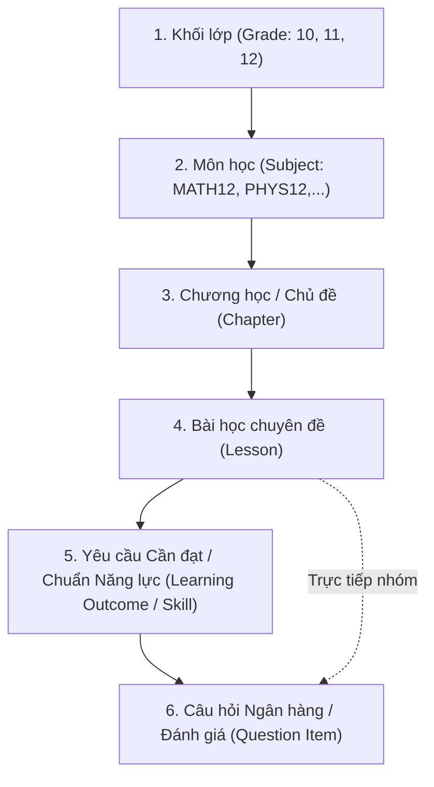

# STUDY_AI — Bản đồ Chương trình Giáo dục (Curriculum Mapping)
## Khung Phân cấp Năng lực & Kiến thức Chuẩn GDPT 2018 (Ưu tiên Toán lớp 12)

Ngày ban hành: 09/11/2026  
Căn cứ pháp lý & sư phạm: Chương trình Giáo dục phổ thông 2018 (Ban hành kèm theo Thông tư số 32/2018/TT-BGDĐT ngày 26/12/2018 của Bộ trưởng Bộ Giáo dục và Đào tạo).  
Nhóm môn ưu tiên: **Toán học Lớp 12** (Phần Giải tích và Hình học không gian).  
Tác quyền: Hội đồng Sư phạm STUDY_AI biên soạn độc lập, tham chiếu khung yêu cầu cần đạt chính thức của Bộ GD&ĐT.

---

## 1. Kiến trúc Phân cấp Khái niệm (Pedagogical Hierarchy)

Hệ thống STUDY_AI tổ chức cây tri thức theo 6 cấp bậc chặt chẽ:

### Nguyên lý thiết kế:
1. **Phù hợp chuẩn quốc gia**: Bám sát đúng các "Yêu cầu cần đạt" quy định trong Thông tư 32/2018/TT-BGDĐT đối với từng mạch kiến thức Toán học (Đại số & Một số yếu tố Giải tích, Hình học & Đo lường, Thống kê & Xác suất).
2. **Định hướng đánh giá năng lực**: Mỗi câu hỏi trong ngân hàng đều gắn với một Yêu cầu cần đạt cụ thể và phân loại theo 4 cấp độ tư duy của Bộ GD&ĐT:
   - **Nhận biết** (Recall / Easy)
   - **Thông hiểu** (Comprehension / Medium)
   - **Vận dụng** (Application / Hard)
   - **Vận dụng cao** (Advanced Application / Expert)
3. **Phù hợp cấu trúc đề thi tốt nghiệp THPT mới**: Hỗ trợ 3 định dạng câu hỏi hiện đại:
   - Trắc nghiệm nhiều lựa chọn (4 phương án, chọn 1 đáp án đúng).
   - Trắc nghiệm Đúng/Sai (Mỗi câu hỏi có 4 ý a, b, c, d độc lập).
   - Trắc nghiệm Trả lời ngắn (Điền số hoặc phân số tối giản).

---

## 2. Bản đồ Chi tiết Môn Toán Lớp 12 (GDPT 2018)

Dưới đây là ánh xạ chương trình chuẩn dành cho Toán 12 theo Thông tư 32/2018/TT-BGDĐT:

### Bảng 2.1. Danh mục các Chương học Toán 12 (Chapters Outline)

| Mã Chương | Tên Chương học theo GDPT 2018 | Mạch Kiến thức | Số tiết ước tính | Trạng thái triển khai |
| :--- | :--- | :--- | :---: | :---: |
| `CHP_MATH12_01` | **Ứng dụng đạo hàm để khảo sát và vẽ đồ thị của hàm số** | Giải tích | 24 tiết | **Sẵn sàng mẫu đầy đủ (Pilot)** |
| `CHP_MATH12_02` | **Toạ độ của vectơ trong không gian** | Hình học | 14 tiết | Đang chuẩn bị dữ liệu |
| `CHP_MATH12_03` | **Các số đặc trưng đo mức độ phân tán cho mẫu số liệu ghép nhóm** | Thống kê | 10 tiết | Đang chuẩn bị dữ liệu |
| `CHP_MATH12_04` | **Nguyên hàm. Tích phân và Ứng dụng** | Giải tích | 22 tiết | Kế hoạch đợt 2 |
| `CHP_MATH12_05` | **Phương pháp toạ độ trong không gian (Mặt phẳng, Đường thẳng, Mặt cầu)** | Hình học | 18 tiết | Kế hoạch đợt 2 |
| `CHP_MATH12_06` | **Xác suất có điều kiện và Công thức xác suất toàn phần** | Xác suất | 12 tiết | Kế hoạch đợt 2 |

---

### Bảng 2.2. Ánh xạ Chi tiết Chương 1: Ứng dụng Đạo hàm khảo sát Hàm số

#### Bài học 1: Tính đơn điệu và Cực trị của hàm số (`LES_MATH12_01_01`)
- **Mã Bài học**: `LES_MATH12_01_01` (Slug: `tinh-don-dieu-va-cuc-tri-ham-so`)
- **Chủ đề (Topic)**: Ứng dụng đạo hàm
- **Thời lượng**: 45 phút học lý thuyết + 30 phút luyện tập
- **Yêu cầu cần đạt theo GDPT 2018 (Learning Outcomes)**:
  1. `YCCD-MATH12-01-01`: Nhận biết được tính đồng biến, nghịch biến của một hàm số trên một khoảng dựa vào dấu của đạo hàm cấp một.
  2. `YCCD-MATH12-01-02`: Thể hiện được tính đồng biến, nghịch biến của hàm số thông qua bảng biến thiên.
  3. `YCCD-MATH12-01-03`: Nhận biết được khái niệm điểm cực đại, điểm cực tiểu, giá trị cực đại, giá trị cực tiểu của hàm số.
  4. `YCCD-MATH12-01-04`: Vận dụng được định lý và các quy tắc (Quy tắc 1: đổi dấu $f'(x)$; Quy tắc 2: xét dấu $f''(x_0)$) để tìm cực trị của hàm số đa thức và phân thức.
- **Kỹ năng tương ứng trong hệ thống (`MASTER_SKILLS`)**:
  - `SKILL-MATH-12-DERIV-SIGN`: Xét dấu đạo hàm cấp một.
  - `SKILL-MATH-12-MONOTONICITY`: Kết luận khoảng đơn điệu.
  - `SKILL-MATH-12-EXTREMUM`: Xác định điểm cực trị và giá trị cực trị.
  - `SKILL-MATH-12-VARIATION-TABLE`: Lập và đọc bảng biến thiên.

#### Bài học 2: Giá trị lớn nhất và Giá trị nhỏ nhất của hàm số (`LES_MATH12_01_02`)
- **Mã Bài học**: `LES_MATH12_01_02` (Slug: `gia-tri-lon-nhat-va-nho-nhat-ham-so`)
- **Yêu cầu cần đạt theo GDPT 2018 (Learning Outcomes)**:
  1. `YCCD-MATH12-01-05`: Nhận biết được khái niệm giá trị lớn nhất (GTLN), giá trị nhỏ nhất (GTNN) của hàm số trên một tập hợp số thực.
  2. `YCCD-MATH12-01-06`: Xác định được GTLN và GTNN của hàm số trên một đoạn $[a; b]$ bằng phương pháp so sánh giá trị tại các điểm dừng và hai đầu mút.
  3. `YCCD-MATH12-01-07`: Xác định được GTLN và GTNN của hàm số trên một khoảng mở $(a; b)$ thông qua bảng biến thiên.
  4. `YCCD-MATH12-01-08`: Vận dụng được kiến thức về GTLN, GTNN của hàm số để giải quyết một số bài toán thực tiễn tối ưu hóa (kinh tế, kỹ thuật, hình học).
- **Kỹ năng tương ứng**:
  - `SKILL-MATH-12-MINMAX-SEGMENT`: Tìm GTLN/GTNN trên đoạn.
  - `SKILL-MATH-12-MINMAX-INTERVAL`: Tìm GTLN/GTNN trên khoảng.
  - `SKILL-MATH-12-OPTIMIZATION-WORD`: Ứng dụng giải toán tối ưu thực tế.

#### Bài học 3: Đường tiệm cận của đồ thị hàm số (`LES_MATH12_01_03`)
- **Mã Bài học**: `LES_MATH12_01_03` (Slug: `duong-tiem-can-cua-do-thi-ham-so`)
- **Yêu cầu cần đạt theo GDPT 2018 (Learning Outcomes)**:
  1. `YCCD-MATH12-01-09`: Nhận biết được hình ảnh hình học và định nghĩa của đường tiệm cận đứng, đường tiệm cận ngang của đồ thị hàm số thông qua giới hạn tại vô cực và giới hạn một bên.
  2. `YCCD-MATH12-01-10`: Nhận biết được đường tiệm cận xiên của đồ thị hàm số phân thức hữu tỉ bậc hai trên bậc nhất: $y = \frac{ax^2+bx+c}{px+q}$ ($a \neq 0, p \neq 0$).
  3. `YCCD-MATH12-01-11`: Tìm được phương trình các đường tiệm cận của đồ thị hàm số phân thức hữu tỉ.

#### Bài học 4: Khảo sát sự biến thiên và Vẽ đồ thị của hàm số (`LES_MATH12_01_04`)
- **Mã Bài học**: `LES_MATH12_01_04` (Slug: `khao-sat-va-ve-do-thi-ham-so`)
- **Yêu cầu cần đạt theo GDPT 2018 (Learning Outcomes)**:
  1. `YCCD-MATH12-01-12`: Thực hiện được quy trình khảo sát sự biến thiên và vẽ đồ thị của các hàm số:
     - Hàm đa thức bậc ba: $y = ax^3 + bx^2 + cx + d$ ($a \neq 0$).
     - Hàm phân thức bậc nhất trên bậc nhất: $y = \frac{ax+b}{cx+d}$ ($c \neq 0, ad - bc \neq 0$).
     - Hàm phân thức bậc hai trên bậc nhất: $y = \frac{ax^2+bx+c}{px+q}$ ($a \neq 0, p \neq 0$).
  2. `YCCD-MATH12-01-13`: Nhận biết được tâm đối xứng và trục đối xứng (nếu có) của đồ thị hàm số.
  3. `YCCD-MATH12-01-14`: Vận dụng đồ thị hàm số để biện luận số nghiệm của phương trình, giải bài toán tương giao đồ thị và ứng dụng thực tiễn.

---

## 3. Metadata Đặc tả Câu hỏi và Nội dung (Content Schema Attributes)

Mỗi đơn vị nội dung khi nhập vào hệ thống bắt buộc phải mang đầy đủ các trường metadata sau:

| Trường Metadata | Kiểu dữ liệu | Ý nghĩa | Ví dụ giá trị |
| :--- | :--- | :--- | :--- |
| `Grade` | `string` | Khối lớp | `"12"` |
| `SubjectCode` | `string` | Mã định danh chuẩn môn học | `"MATH12"` |
| `ChapterCode` | `string` | Mã định danh chuẩn chương học | `"CHP_MATH12_01"` |
| `LessonCode` | `string` | Mã định danh chuẩn bài học | `"LES_MATH12_01_01"` |
| `Topic` | `string` | Chủ đề nhánh kiến thức | `"Đơn điệu và Cực trị"` |
| `OutcomeCode` | `string` | Mã Yêu cầu cần đạt GDPT 2018 | `"YCCD-MATH12-01-01"` |
| `Difficulty` | `string` | Mức độ nhận thức sư phạm | `"easy"` (Nhận biết), `"medium"` (Thông hiểu), `"hard"` (Vận dụng) |
| `QuestionType` | `string` | Định dạng câu hỏi | `"multiple-choice"`, `"true-false"`, `"short-answer"` |
| `Prompt` | `string` | Nội dung câu hỏi (chứa KaTeX) | `"Cho hàm số $y = f(x)$ có đạo hàm $f'(x) = x(x-2)^2$..."` |
| `OptionsJson` | `string (JSON)` | Mảng các lựa chọn đáp án | `["Đồng biến trên (0; 2)", "Nghịch biến trên (0; +\\infty)",...]` |
| `CorrectAnswer` | `string` | Ký tự đáp án đúng | `"A"` hoặc `"{\"a\": true, \"b\": false, \"c\": true, \"d\": false}"` |
| `Explanation` | `string` | Lời giải chi tiết sư phạm | `"Ta có $f'(x) = 0 \\iff x = 0$ hoặc $x = 2$..."` |
| `SourceCitation` | `string` | Nguồn trích dẫn học thuật | `"SGK Toán 12 Kết nối tri thức - Bài 1"` hoặc `"Đề tham khảo Tốt nghiệp THPT 2025 BGD&ĐT"` |
| `SourceUrl` | `string` | Đường dẫn tham chiếu (nếu có) | `"https://moet.gov.vn/..."` |
| `LicenseType` | `string` | Tác quyền nội dung | `"STUDY_AI Editorial / Educational Fair Use"` |
| `ContentVersion` | `string` | Phiên bản biên tập | `"GDPT2018.v1.0"` |
| `ModerationStatus` | `string` | Trạng thái kiểm duyệt | `"published"` (Học viên thấy), `"in-review"` (Đang chờ duyệt), `"draft"` |
| `AuthorId` | `string` | ID chuyên viên biên soạn | `"usr_content_staff_01"` |
| `ReviewedBy` | `string` | ID Admin/Reviewer phê duyệt | `"usr_admin_master"` |
| `CreatedAt` | `datetimeoffset` | Thời điểm tạo | `"2026-11-09T13:30:00Z"` |
| `UpdatedAt` | `datetimeoffset` | Thời điểm cập nhật cuối | `"2026-11-09T13:30:00Z"` |

---

## 4. Tuyên bố Bản quyền & Giới hạn Trách nhiệm Sư phạm

> [!NOTE]
> 1. **Khung chương trình chuẩn**: Dựa trên Chương trình tổng thể và Chương trình môn Toán ban hành kèm theo Thông tư 32/2018/TT-BGDĐT của Bộ Giáo dục và Đào tạo.
> 2. **Nội dung bài giảng và câu hỏi**: Toàn bộ lời giảng, ví dụ mẫu, câu hỏi trắc nghiệm và lời giải chi tiết được **Hội đồng Chuyên môn STUDY_AI tự biên soạn độc lập** nhằm mục đích sư phạm, không sao chép nguyên văn sách giáo khoa thương mại của các nhà xuất bản.
> 3. **Phần chưa xác minh**: Danh mục các chương học từ Chương 2 đến Chương 6 được ánh xạ theo cấu trúc chung của chương trình chuẩn; chi tiết từng bài học cụ thể của các chương này sẽ được rà soát và đối chiếu văn bản chính thức trước khi triển khai Checkpoint 2.

