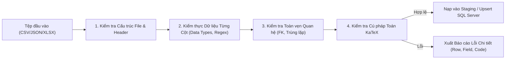

# STUDY_AI — Đặc tả Kỹ thuật Cơ chế Nhập liệu Chương trình học (Import Specification)
## Chuẩn hóa Định dạng Nhập Dữ liệu CSV, JSON, XLSX và Chiến lược Chống Trùng lặp

Ngày ban hành: 09/11/2026  
Mục đích: Thiết kế cơ chế nhập liệu chuẩn hóa dữ liệu chương trình học và ngân hàng câu hỏi cho hệ thống STUDY_AI.  
Trạng thái: Thiết kế kỹ thuật (Design Phase) — Chưa kích hoạt nhập liệu thực tế vào SQL Server.

---

## 1. Nguyên tắc Xử lý Nhập liệu (Ingestion Core Principles)

1. **Nguyên tử hóa theo Đơn vị Khối (Transaction Boundary / Unit of Work)**:
   - Dữ liệu một Môn học hoặc một Chương học khi nhập từ file phải được xử lý trong một Database Transaction duy nhất.
   - Nếu xảy ra lỗi cú pháp nghiêm trọng hoặc thiếu tính toàn vẹn khóa ngoại (FK Violation), toàn bộ batch đó sẽ bị Rollback để tránh tình trạng dữ liệu mồ côi (orphaned records).
2. **Khả năng chạy lại An toàn (Idempotency Strategy)**:
   - File dữ liệu có thể được chạy import nhiều lần mà không tạo ra bản ghi nhân đôi.
   - Sử dụng cơ chế **Upsert** (Nếu tồn tại theo khóa nghiệp vụ duy nhất $\to$ Update; Nếu chưa $\to$ Insert).
3. **Phát hiện Trùng lặp Thông minh (Duplicate Detection Strategy)**:
   - **Môn học**: Dựa trên `Code` chuẩn hóa (`UPPER(TRIM(Code))`).
   - **Chương học**: Dựa trên cặp `(SubjectCode, ChapterCode)`.
   - **Bài học**: Dựa trên cặp `(ChapterCode, LessonCode)` hoặc `Slug`.
   - **Câu hỏi**: Dựa trên mã băm nội dung:
     $$\text{QuestionFingerprint} = \text{SHA256}(\text{LessonCode} + \text{Normalize}(\text{Prompt}))$$
     Nếu câu hỏi trùng Prompt trong cùng một bài học, hệ thống sẽ cảnh báo bản ghi trùng và chỉ cập nhật phương án/lời giải thay vì tạo câu hỏi mới.
4. **Kiểm tra Cú pháp Công thức Toán KaTeX/LaTeX**:
   - Mọi chuỗi chứa ký tự `$` hoặc `$$` phải được kiểm tra tính cân bằng (matching pairs).
   - Kiểm tra các lệnh LaTeX hợp lệ trước khi lưu vào SQL Server để tránh làm hỏng trình render trên ứng dụng React client.

---

## 2. Quy cách Định dạng Tệp Dữ liệu (File Format Specifications)

Hệ thống hỗ trợ 3 định dạng dữ liệu đầu vào chuẩn:

### 2.1. Định dạng JSON (`.json`) — Cấu trúc Cây Phân cấp Hoàn chỉnh
- **Đặc điểm**: Phù hợp nhất cho việc import đồng bộ cả Cây chương trình học (Subject $\to$ Chapters $\to$ Lessons $\to$ Questions).
- **Mã hóa**: `UTF-8` bắt buộc.
- **Cấu trúc mẫu**:
```json
{
  "$schema": "https://studyai.internal/schemas/curriculum-v1.json",
  "version": "GDPT2018.v1.0",
  "grade": "12",
  "subject": {
    "code": "MATH12",
    "name": "Toán 12",
    "description": "Chương trình Toán học Lớp 12 - Chuẩn GDPT 2018",
    "orderIndex": 1,
    "chapters": [
      {
        "code": "CHP_MATH12_01",
        "title": "Chương 1: Ứng dụng đạo hàm để khảo sát và vẽ đồ thị của hàm số",
        "orderIndex": 1,
        "lessons": [
          {
            "code": "LES_MATH12_01_01",
            "title": "Bài 1: Tính đơn điệu và cực trị của hàm số",
            "slug": "tinh-don-dieu-va-cuc-tri-ham-so",
            "orderIndex": 1,
            "status": "draft",
            "theory": {
              "introduction": "Tính đơn điệu là một trong những thuộc tính cơ bản...",
              "definitions": [
                {
                  "term": "Hàm số đồng biến",
                  "content": "Ký hiệu $f(x)$ đồng biến trên $(a; b)$ nếu $\\forall x_1 < x_2 \\implies f(x_1) < f(x_2)$."
                }
              ],
              "formulas": [
                {
                  "name": "Điều kiện cần về cực trị",
                  "latex": "f'(x_0) = 0"
                }
              ]
            },
            "questions": [
              {
                "code": "QST_MATH12_01_01_001",
                "prompt": "Cho hàm số $y = f(x)$ có đạo hàm $f'(x) = x(x-2)^2$. Điểm cực đại của hàm số đã cho là:",
                "options": ["x = 0", "x = 2", "x = -2", "Không có cực đại"],
                "correctAnswer": "A",
                "explanation": "Ta có $f'(x) = 0 \\iff x = 0$ hoặc $x = 2$. Qua $x = 2$, $f'(x)$ không đổi dấu. Qua $x = 0$, $f'(x)$ đổi dấu từ âm sang dương (cực tiểu). Lưu ý xét dấu chi tiết...",
                "difficulty": "medium",
                "type": "multiple-choice",
                "topic": "Cực trị hàm số"
              }
            ]
          }
        ]
      }
    ]
  }
}
```

---

### 2.2. Định dạng CSV (`.csv`) — Bảng Dữ liệu Phẳng cho Ngân hàng Câu hỏi
- **Đặc điểm**: Phù hợp cho việc nhập nhanh hàng trăm câu hỏi trắc nghiệm từ bảng tính.
- **Mã hóa**: `UTF-8 with BOM` (tương thích hoàn hảo với Excel tiếng Việt) hoặc `UTF-8`.
- **Dấu phân cách**: Tự động nhận diện dấu phẩy `,` hoặc dấu chấm phẩy `;`.
- **Quy tắc trích dẫn**: Các trường chứa dấu phẩy, dấu xuống dòng hoặc công thức KaTeX bắt buộc phải được bao quanh bởi dấu ngoặc kép (`"..."`). Dấu ngoặc kép bên trong được escape bằng cặp hai dấu ngoặc kép (`""`).
- **Danh sách cột chuẩn**:
```csv
SubjectCode,ChapterCode,LessonCode,Topic,Difficulty,Type,Prompt,OptionA,OptionB,OptionC,OptionD,CorrectAnswer,Explanation,SourceCitation,LicenseType
MATH12,CHP_MATH12_01,LES_MATH12_01_01,Đơn điệu,easy,multiple-choice,"Hàm số $y = f(x)$ có đạo hàm $f'(x) > 0, \forall x \in (a; b)$. Khẳng định nào sau đây đúng?","Hàm số đồng biến trên $(a; b)$","Hàm số nghịch biến trên $(a; b)$","Hàm số không đổi trên $(a; b)$","Hàm số đạt cực trị tại $x \in (a; b)$",A,"Theo định lý dấu đạo hàm cấp một, $f'(x) > 0$ thì hàm số đồng biến.","SGK Toán 12 Kết nối tri thức - Trang 8",STUDY_AI Editorial
```

---

### 2.3. Định dạng XLSX (`.xlsx`) — Bảng tính Nhiều Trang (Multi-Sheet Workbook)
- **Đặc điểm**: Cho phép các chuyên viên nội dung nhập liệu trong một file Excel duy nhất gồm 4 sheet liên kết:
  1. `Sheet 1: Subjects` (Danh mục môn học)
  2. `Sheet 2: Chapters` (Danh mục chương)
  3. `Sheet 3: Lessons` (Danh mục bài học & nội dung tóm tắt)
  4. `Sheet 4: QuestionBank` (Ngân hàng câu hỏi trắc nghiệm chi tiết)

---

## 3. Quy trình Kiểm thực Dữ liệu (Validation Pipeline)

Trước khi dữ liệu được chuyển đổi và ghi vào cơ sở dữ liệu, engine kiểm thực chạy qua 4 tầng sàng lọc:



### Chi tiết các tầng kiểm tra:
1. **Tầng 1 — Cấu trúc & Mã hóa**:
   - Kiểm tra tệp không rỗng.
   - Kiểm tra đầy đủ các cột bắt buộc (`SubjectCode`, `LessonCode`, `Prompt`, `Options`, `CorrectAnswer`).
2. **Tầng 2 — Kiểu dữ liệu & Enum Giá trị**:
   - `Difficulty` chỉ nhận: `easy`, `medium`, `hard`.
   - `Type` chỉ nhận: `multiple-choice`, `true-false`, `short-answer`.
   - `CorrectAnswer` của `multiple-choice` chỉ nhận: `A`, `B`, `C`, `D`.
   - `Prompt` có độ dài tối thiểu 5 ký tự và tối đa 4000 ký tự.
3. **Tầng 3 — Toàn vẹn Quan hệ**:
   - `SubjectCode` phải tồn tại hoặc nằm trong cùng lô nhập môn học.
   - `LessonCode` phải thuộc về `ChapterCode` đã khai báo.
4. **Tầng 4 — KaTeX Syntax Linting**:
   - Kiểm tra số lượng dấu `$` là số chẵn.
   - Chặn các thẻ script hoặc mã độc (Anti-XSS): Không chứa `<script>`, `onerror=`, `javascript:`.

---

## 4. Định dạng Báo cáo Lỗi Chi tiết (Structured Error Report)

Khi quá trình kiểm thực phát hiện lỗi, hệ thống không báo chung chung mà trả về báo cáo JSON chi tiết đến từng dòng và cột:

```json
{
  "totalRows": 150,
  "validRows": 147,
  "errorCount": 3,
  "status": "VALIDATION_FAILED",
  "errors": [
    {
      "row": 14,
      "field": "CorrectAnswer",
      "errorCode": "INVALID_CORRECT_ANSWER",
      "message": "Giá trị 'E' không hợp lệ cho câu hỏi trắc nghiệm 4 lựa chọn (chỉ chấp nhận A, B, C, D).",
      "rejectedValue": "E"
    },
    {
      "row": 42,
      "field": "Prompt",
      "errorCode": "UNBALANCED_KATEX_DELIMITER",
      "message": "Công thức toán học bị thiếu dấu đóng ngoặc '$': 'Tìm tập xác định của $y = \\sqrt{x-1}'.",
      "rejectedValue": "Tìm tập xác định của $y = \\sqrt{x-1}"
    },
    {
      "row": 89,
      "field": "LessonCode",
      "errorCode": "FOREIGN_KEY_NOT_FOUND",
      "message": "Không tìm thấy mã bài học 'LES_MATH12_99_99' trong hệ thống hoặc file hiện tại.",
      "rejectedValue": "LES_MATH12_99_99"
    }
  ]
}
```

---

## 5. Chiến lược Phân quyền & Kiểm soát Nhập liệu (RBAC & Audit Trail)

1. **Phân quyền người nhập**:
   - Chỉ người dùng có vai trò `admin` hoặc `content` (Content Staff) mới có quyền gửi yêu cầu import.
   - Trạng thái mặc định của mọi bài học và câu hỏi sau khi import là **`draft`** (Bản nháp), chưa được hiển thị ngay cho học viên.
2. **Quy trình Duyệt độc lập sau Import (Dual-Control)**:
   - Toàn bộ nội dung import phải đi qua quy trình kiểm duyệt độc lập của Phase 17 (`/approve` bởi Reviewer/Admin khác với người thực hiện import).
3. **Ghi nhật ký Kiểm toán (Audit Logging)**:
   - Mọi đợt import đều sinh một bản ghi trong `staff_audit_logs` gồm:
     - `StaffUserId`: ID người thực hiện.
     - `Action`: `"content.bulk_import"`.
     - `Details`: Tên file, số lượng bản ghi thành công, danh sách ID môn/bài học đã tạo.

