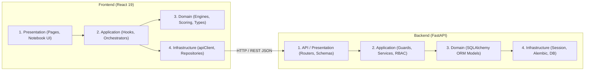

# STUDY_AI — Phase 14 Documentation
# Full-Stack Layered Architecture & Real Backend Foundation

> **Trạng thái:** Hoàn thành & Đã nghiệm thu toàn diện  
> **Repository:** https://github.com/hthuyngan/STUDY_AI-  
> **Workspace:** `D:\TN`  
> **Branch:** `main`  
> **Commit mục tiêu:** `refactor(architecture): establish real fullstack integration foundation`  
> **Tiêu chuẩn thiết kế:** Navy Notebook (`#102A43`, `#F4B942`, `#FFF9EA`) — Flat, compact, trung thực kỹ thuật, zero KPI ảo.

---

## 1. TỔNG QUAN & BỐI CẢNH

Sau khi hoàn thành các giai đoạn thiết lập nền tảng học tập cá nhân hóa (Phase 9–13), Phase 14 thực hiện bước chuyển đổi kiến trúc quan trọng: **Thiết lập kiến trúc phân tầng chuẩn mực (Layered Architecture) trên toàn bộ Frontend và Backend**, đồng thời xây dựng nền tảng tích hợp Backend thực tế, kiên quyết loại bỏ sự phụ thuộc vào mock data trong các luồng chính và ngăn ngừa việc tự ý báo cáo thành công giả lập.

### Các Nguyên Tắc Bắt Buộc Của Phase 14:
1. **Kiểm kê trung thực**: Báo cáo chính xác từng chức năng thuộc nhóm A, B, C, D hay E; tuyệt đối không tự nhận là "full-stack" nếu chưa có API và DB thật.
2. **Kiến trúc phân tầng 4 lớp**: Phân định ranh giới rõ ràng giữa Presentation, Application, Domain, và Infrastructure.
3. **Database Session An Toàn**: Cơ chế SQLAlchemy dependency cam kết tự động rollback khi gặp unhandled exceptions để chống rò rỉ session hoặc khóa dữ liệu (dangling locks).
4. **Health Check Trung Thực**: Cung cấp probe riêng cho liveness (`/health`) và readiness (`/health/db`), bắt buộc trả HTTP 503 khi database không khả dụng; không trả trạng thái khỏe mạnh giả lập.
5. **API Client Chuẩn Hóa**: Chuẩn hóa mã lỗi `ApiErrorCode`, cấm retry tự động trên các HTTP POST không an toàn về tính idempotent, không bao giờ tự ý fallback về localStorage khi API gặp lỗi 5xx.
6. **Giải quyết 4 tồn đọng Phase 13**: Xác thực tính toàn vẹn kết quả (`validatePracticeResultIntegrity`), loại trừ câu hỏi unapproved, chuẩn hóa thuật ngữ "Mức độ đầy đủ của bằng chứng" (Evidence Sufficiency), và ngăn chặn xu hướng tiến bộ giả khi làm lại 1 câu hỏi duy nhất.

---

## 2. KẾT QUẢ KIỂM KÊ KIẾN TRÚC TOÀN DIỆN (FULL-STACK MIGRATION MAP)

Hệ thống đã được kiểm kê chi tiết theo 24 module chức năng (xem chi tiết tại [`docs/architecture/fullstack-migration-map.md`](file:///D:/TN/docs/architecture/fullstack-migration-map.md)):

- **Nhóm A — Full-stack Production (4/24 ~ 16.7%)**:
  - Xác thực Đăng ký & Đăng nhập (`POST /api/v1/auth/login`, `POST /api/v1/auth/register`, bảng `users`).
  - Làm mới Token & Đăng xuất (HttpOnly cookie `refresh_token`, Refresh Token Rotation, `POST /api/v1/auth/refresh`, `POST /api/v1/auth/logout`).
  - Profile & Phân quyền RBAC (`GET /api/v1/me`, `require_role`, bảo vệ Last Active Admin).
  - Health & Readiness Probes (`GET /health`, `GET /health/db`, `GET /api/v1/health` với HTTP 503 khi DB down).
- **Nhóm B — Offline-First có API Sync (4/24 ~ 16.7%)**:
  - Tiến độ Bài học (`LessonProgress` / bảng `lesson_progress`).
  - Lượt làm bài Luyện tập (`AssessmentAttempt` / bảng `assessment_attempts`).
  - Sự kiện Học tập (`LearningEvent` / bảng `learning_events`).
  - Quản lý Bài học Cơ bản (`ContentLesson` / bảng `content_lessons`).
- **Nhóm C — Frontend Hoàn Chỉnh, LocalStorage Bền Vững (5/24 ~ 20.8%)**:
  - Ngân hàng câu hỏi chuẩn GDPT 2018 (22 câu hỏi Toán 12 đã kiểm định).
  - Phân tích Năng lực & Lỗ hổng Kiến thức dựa trên bằng chứng thực tế.
  - Lộ trình Học tập Thích ứng (Adaptive Learning Paths).
  - Ôn tập Thông minh (Spaced Repetition Review).
  - Ghi chú Học tập & Bookmarks bài học.
- **Nhóm D — Prototype UI / Mock Data (9/24 ~ 37.5%)**:
  - Toàn bộ các module quản trị trường học: Lớp học (`classes.mock.ts`), Học viên (`students.mock.ts`), Giao bài tập & Chấm điểm (`assignments.mock.ts`, `submissions.mock.ts`), Cảnh báo học tập (`learningAlerts.mock.ts`), Tickets hỗ trợ (`tickets.mock.ts`), Thông báo (`announcements.mock.ts`), Cài đặt hệ thống (`systemSettings.mock.ts`).
  - *Kế hoạch: Sẽ được chuyển sang API và Database thật trong Phase 16.*
- **Nhóm E — Kế Hoạch Tương Lai (2/24 ~ 8.3%)**:
  - Pipeline nhập liệu đề thi hàng loạt (Phase 17).
  - Phân tích dữ liệu lớn trên server (Phase 19).

---

## 3. KIẾN TRÚC PHÂN TẦNG ĐỒNG BỘ (LAYERED ARCHITECTURE)

Hệ thống đã thiết lập kiến trúc 4 tầng nhất quán cho cả Frontend và Backend (xem chi tiết tại [`docs/architecture/layered-architecture.md`](file:///D:/TN/docs/architecture/layered-architecture.md)):



### Quy Tắc Chống Rò Rỉ Tầng:
1. **Frontend Presentation**: Tuyệt đối không import `apiClient` hoặc `localStorage` trực tiếp vào Pages/Components; mọi giao tiếp phải đi qua Application Services hoặc Repositories.
2. **Frontend Domain**: Các file tính toán `*Engine.ts` là pure functions độc lập, 100% không phụ thuộc React state hay DOM.
3. **Backend Database Lifecycle**: Dependency `get_db()` trong `app/database.py` được bổ sung khối `except Exception: db.rollback(); raise` để đảm bảo transaction rollback tự động khi route gặp unhandled error.

---

## 4. DATABASE FOUNDATION & HEALTH ENDPOINTS

### 4.1. Rollback An Toàn trong SQLAlchemy:
```python
def get_db() -> Generator[Session, None, None]:
    """Dependency that provides an independent SQLAlchemy session per request."""
    db = SessionLocal()
    try:
        yield db
    except Exception:
        db.rollback()
        raise
    finally:
        db.close()
```

### 4.2. Hệ Thống Probes Kiểm Tra Sức Khỏe:
- `GET /health`: Liveness probe trả về HTTP 200 `{"status": "ok", "app": "STUDY_AI", "version": "1.0.0"}`.
- `GET /health/db`: Readiness probe thực hiện truy vấn `SELECT 1`.
  - Nếu thành công: Trả về HTTP 200 `{"status": "ok", "database": "connected"}`.
  - Nếu cơ sở dữ liệu ngắt kết nối hoặc gặp lỗi: Trả về **HTTP 503 Service Unavailable** `{"status": "unhealthy", "database": "disconnected", "detail": "Database service is unreachable or unready."}`.
- `GET /api/v1/health`: Mount tương ứng trong API router để tương thích các client hiện hành.

---

## 5. FRONTEND API INTEGRATION FOUNDATION (`apiClient.ts`)

1. **Chuẩn Hóa Mã Lỗi (`ApiErrorCode`)**:
   - `UNAUTHORIZED` (401), `FORBIDDEN` (403), `NOT_FOUND` (404), `CONFLICT` (409), `VALIDATION_ERROR` (422), `TIMEOUT` (408), `SERVER_ERROR` (500-599), `NETWORK_OFFLINE` (0).
2. **Chính Sách Retry An Toàn (Idempotent Retry Policy)**:
   - Khi gặp 401 Unauthorized, hệ thống thực hiện refresh token bằng single-inflight promise.
   - **Quy tắc an toàn**: Chỉ tự động retry các yêu cầu Idempotent (`GET`, `HEAD`, `PUT`, `DELETE`, `OPTIONS`) hoặc request có header `Idempotency-Key`.
   - Các yêu cầu `POST` thông thường không được phép retry ngầm để tránh tạo duplicate transactions (ví dụ nộp bài 2 lần).
3. **Không Báo Thành Công Giả Lập**:
   - `apiClient` luôn ném lỗi thật nếu server trả về mã lỗi HTTP, không tự ý swallow lỗi hoặc tự ý fallback về mock data.

---

## 6. XỬ LÝ TRIỆT ĐỂ 4 TỒN ĐỌNG TỪ PHASE 13

### 6.1. Bắt Buộc Xác Minh Câu Hỏi Approved (`approvedQuestionMap`):
- Trong `evidenceAggregationEngine.ts`, hàm `aggregateSkillEvidence` hỗ trợ tùy chọn `requireApprovedQuestions: true`.
- Trong `personalization.service.ts`, luồng tính toán luôn truyền `approvedQuestionMap` và kích hoạt chế độ kiểm duyệt nghiêm ngặt. Bất kỳ câu hỏi nào ở trạng thái `needs_review` hoặc thiếu trong ngân hàng câu hỏi đều bị loại khỏi phân tích năng lực.

### 6.2. Chuẩn Hóa Thuật Ngữ "Mức Độ Bằng Chứng" (Evidence Sufficiency):
- Thay thế các khẳng định xác suất dân số (calibrated probability) bằng thuật ngữ sư phạm chuẩn: **"Mức độ đầy đủ của bằng chứng quan sát" (Evidence Sufficiency)**.
- Giao diện `PersonalizedAnalyticsView.tsx` đã cập nhật các nhãn hiển thị:
  - Cao $\to$ "Mức bằng chứng: Đầy đủ" (Evidence: High).
  - Trung bình $\to$ "Mức bằng chứng: Trung bình" (Evidence: Moderate).
  - Thấp $\to$ "Mức bằng chứng: Thấp" (Evidence: Low).
  - Cần thêm dữ liệu $\to$ "Chưa đủ dữ liệu quan sát" (Evidence: Insufficient).

### 6.3. Chống Tạo Xu Hướng Tiến Bộ Giả (Repeated Question Trend Protection):
- Trong `skillPerformanceEngine.ts`, hàm `calculatePerformanceTrend` yêu cầu nghiêm ngặt:
  ```typescript
  const distinctQuestions = new Set(ev.chronologicalAttempts.map((a) => a.questionId))
  const uniqueCount = Math.max(ev.uniqueQuestionIds?.length || 0, distinctQuestions.size)
  if (ev.chronologicalAttempts.length < 2 || ev.attemptCount < 2 || uniqueCount < 2) {
    return 'insufficient_data'
  }
  ```
- Nếu học sinh làm đi làm lại cùng một câu hỏi duy nhất (học vẹt đáp án), hệ thống luôn trả về `'insufficient_data'`, tuyệt đối không tạo ra xu hướng `improving` ảo.

### 6.4. Hàm Kiểm Tra Tính Toàn Vẹn Kết Quả (`validatePracticeResultIntegrity`):
- Hàm `validatePracticeResultIntegrity` thực hiện xác minh toàn diện:
  - Định dạng ID kết quả, ID phiên làm bài, phiên bản chấm điểm (`scoringVersion`).
  - Ràng buộc điểm số: $0 \le \text{earnedPoints} \le \text{maxPoints}$ và $\text{maxPoints} > 0$.
  - Tính hợp lệ của dấu thời gian ISO 8601 (`submittedAt >= startedAt`).
  - Kiểm tra tính xác thực câu hỏi thông qua `approvedQuestionMap`.

---

## 7. CONTENT ARCHITECTURE SCHEMAS (CHUẨN BỊ PHASE 17 & 18)

Đã khởi tạo module hợp đồng miền nội dung tại `backend/app/schemas/content.py`:
- **Vòng đời nội dung 6 bước**: `draft` $\to$ `submitted` $\to$ `needs_review` $\to$ `approved` $\to$ `published` $\to$ `archived`.
- **Hợp đồng 3 định dạng câu hỏi**: `OptionItemSchema`, `TrueFalseSubQuestionSchema`, `QuestionExplanationSchema`.
- **Lịch sử sửa đổi & kiểm duyệt**: `ContentRevisionSchema`, `ContentReviewLogSchema`.
- **Pipeline nhập liệu đề thi hàng loạt**: `BatchImportJobSchema`, `ImportItemResultSchema`, `ImportJobStatus`.

---

## 8. KẾT QUẢ KIỂM THỬ & CHỨNG NHẬN NGHIỆM THU

### 8.1. Backend Pytest Suite:
- **32 tests passed (100%)** trong thời gian 5.06 giây.
- Đã bao gồm các bài kiểm thử mới cho liveness probe, readiness probe kết nối database thật và mô phỏng lỗi 503 Service Unavailable khi database ngắt kết nối.
- Alembic database migration xác minh ở trạng thái `004_staff_operations (head)`.

### 8.2. Frontend Vitest Suite:
- **43 test files với 349 tests passed (100%)** trong thời gian 27.9 giây.
- Bao gồm toàn bộ bài test phân tích cá nhân hóa (`personalization.test.ts`), client HTTP (`apiClient.test.ts`), và toàn bộ giao diện học sinh / quản trị viên.

### 8.3. TypeScript & Build:
- `bun run build`: `tsc -b` và `vite build` vượt qua không có bất kỳ cảnh báo hoặc lỗi cú pháp nào.
