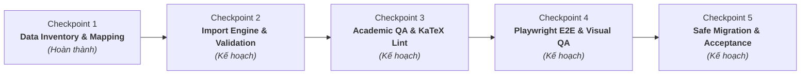

# STUDY_AI — Phase 18: Curriculum Data Import & Academic Quality Assurance
## Hệ thống Nhập liệu Chương trình học Chuẩn GDPT 2018 & Đảm bảo Chất lượng Học thuật

Ngày khởi động: 09/11/2026  
Môi trường công nghệ: ASP.NET Core Web API .NET 10 (`10.0.14`), Entity Framework Core 10, Microsoft SQL Server, React 19, TypeScript, Bun `1.4.2`.  
Design System: **Navy Notebook** (Deep Navy `#102A43`, Warm Amber `#F4B942`, Cream Paper `#FFF9EA`).  
Trạng thái hiện tại: **Checkpoint 1 Hoàn thành (Data Inventory & Curriculum Mapping)**.

---

## 1. Mục tiêu Tổng thể Phase 18

Phase 18 giải quyết bài toán cốt lõi về **dữ liệu học thuật thực tế** cho nền tảng STUDY_AI:
1. Chuẩn hóa toàn bộ cấu trúc dữ liệu theo Khung chương trình Giáo dục Phổ thông 2018 của Bộ GD&ĐT (Thông tư 32/2018/TT-BGDĐT), ưu tiên môn Toán học Lớp 12.
2. Xây dựng bộ từ điển dữ liệu (Data Dictionary) và cơ chế nhập liệu đa định dạng (CSV, JSON, XLSX) cho phép nạp hàng nghìn bài học, câu hỏi có công thức KaTeX/LaTeX phức tạp.
3. Cơ chế kiểm soát chất lượng học thuật nghiêm ngặt (Academic Quality Assurance): Ngăn chặn câu hỏi sai đáp án, công thức toán bị lỗi render hoặc thiếu tính toàn vẹn quan hệ.
4. Đảm bảo quy trình phê duyệt độc lập (Dual-Control Moderation) và bảo mật tuyệt đối đáp án (Zero-Leak Security) đã xây dựng ở Phase 17.
5. Bảo toàn 100% dữ liệu tài khoản và phiên đăng nhập của `StudyAIDb`.

---

## 2. Lộ trình Triển khai Phase 18 qua 5 Checkpoints

### Chi tiết các Checkpoints:
- **Checkpoint 1 — Data Inventory & Curriculum Mapping** *(Hiện tại)*:
  - Kiểm kê toàn bộ cơ sở dữ liệu `StudyAIDb` và `StudyAIDb_E2E`.
  - Phân tích khoảng cách schema (Gap Analysis).
  - Lập bản đồ tri thức GDPT 2018 cho môn Toán 12 (4 bài học mẫu, 13 cụm kỹ năng).
  - Thiết kế đặc tả định dạng nhập liệu CSV/JSON/XLSX và tạo bộ file mẫu tại `docs/content/templates/`.
- **Checkpoint 2 — Ingestion Engine & Batch Upsert**:
  - Triển khai controller/service xử lý upload file CSV/JSON.
  - Áp dụng cơ chế Idempotent Upsert chống trùng lặp dữ liệu.
  - Quản lý giao dịch Transaction / Unit of Work đảm bảo an toàn.
- **Checkpoint 3 — Academic Quality Assurance & Formula Linting**:
  - Bộ kiểm tra cú pháp KaTeX toán học tự động.
  - Kiểm tra 4 phương án trắc nghiệm không trùng lặp, có đáp án duy nhất và lời giải chi tiết.
- **Checkpoint 4 — Playwright E2E Verification & UI Rendering**:
  - Kịch bản kiểm thử giao diện CMS nhập liệu và giao diện học viên xem bài giảng.
  - Nghiệm thu hiển thị công thức toán trên Desktop (1440px) và Mobile (390px).
- **Checkpoint 5 — Safe Database Migration & Production Acceptance**:
  - Sao lưu database `StudyAIDb`.
  - Áp dụng 2 pending migrations an toàn dưới sự phê duyệt của người dùng.
  - Đồng bộ sản phẩm lên GitHub và GitHub Pages.

---

## 3. Kết quả Thực hiện Checkpoint 1 (Chi tiết Kỹ thuật)

### 3.1. Các tài liệu đã thiết lập
1. [`docs/content/data-inventory.md`](file:///E:/AI_tutor/docs/content/data-inventory.md): Báo cáo kiểm kê chi tiết từng bảng, số lượng bản ghi, chỉ mục và tình trạng pending migrations.
2. [`docs/content/curriculum-mapping.md`](file:///E:/AI_tutor/docs/content/curriculum-mapping.md): Bản đồ chương trình học GDPT 2018 phân cấp 6 tầng cho môn Toán 12.
3. [`docs/content/import-specification.md`](file:///E:/AI_tutor/docs/content/import-specification.md): Đặc tả kỹ thuật quy trình kiểm thực dữ liệu 4 tầng và báo cáo lỗi có cấu trúc.
4. [`docs/content/data-dictionary.md`](file:///E:/AI_tutor/docs/content/data-dictionary.md): Từ điển dữ liệu chuẩn hóa cho tất cả các bảng nội dung.
5. [`docs/content/phase18-gap-analysis.md`](file:///E:/AI_tutor/docs/content/phase18-gap-analysis.md): Ma trận so sánh hiện trạng schema và nhu cầu Phase 18.
6. Thư mục file mẫu:
   - [`docs/content/templates/curriculum_import_sample.json`](file:///E:/AI_tutor/docs/content/templates/curriculum_import_sample.json)
   - [`docs/content/templates/question_bank_sample.csv`](file:///E:/AI_tutor/docs/content/templates/question_bank_sample.csv)
   - [`docs/content/templates/question_bank_sample.json`](file:///E:/AI_tutor/docs/content/templates/question_bank_sample.json)

### 3.2. Tiêu chuẩn Chất lượng Đạt được (Quality Gates)
- **Backend .NET 10**:
  - `dotnet restore`: All projects up-to-date.
  - `dotnet build`: Succeeded (0 Warning, 0 Error).
  - `dotnet test`: **51 / 51 tests PASS** (11 unit tests, 40 integration tests trên `StudyAIDb_E2E`).
- **Frontend React 19**:
  - `bun run lint` (Oxlint): **0 errors, 0 warnings** trên 389 files.
  - `bun run test:run` (Vitest): **356 / 356 tests PASS (100%)**.
  - `bun run build`: Succeeded trong 950ms.
- **An toàn Cơ sở Dữ liệu**:
  - `StudyAIDb` được giữ nguyên vẹn 100%, không bị ảnh hưởng bởi bất kỳ lệnh ghi nào.

---

## 4. Dừng Kiểm tra (Stop Gate)

Theo đúng quy định của dự án:
- Sau khi hoàn tất Checkpoint 1, tiến trình tạm dừng để báo cáo kết quả và gửi commit SHA lên GitHub.
- Chờ ý kiến phản hồi và phê duyệt trước khi chuyển sang Checkpoint 2.

