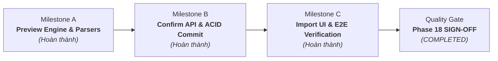

# STUDY_AI — Phase 18: Curriculum Data Import & Academic Quality Assurance
## Hệ thống Nhập liệu Chương trình học Chuẩn GDPT 2018 & Đảm bảo Chất lượng Học thuật

Ngày khởi động: 09/11/2026  
Ngày hoàn thành: 10/11/2026  
Môi trường công nghệ: ASP.NET Core Web API .NET 10 (`10.0.14`), Entity Framework Core 10, Microsoft SQL Server, React 19, TypeScript, Bun `1.4.2`.  
Design System: **Navy Notebook** (Deep Navy `#102A43`, Warm Amber `#F4B942`, Cream Paper `#FFF9EA`).  
Trạng thái: **COMPLETED (Milestones A, B, C Hoàn thành & Nghiệm thu toàn diện)**.

---

## 1. Mục tiêu Tổng thể Phase 18

Phase 18 giải quyết bài toán cốt lõi về **dữ liệu học thuật thực tế** cho nền tảng STUDY_AI:
1. Chuẩn hóa toàn bộ cấu trúc dữ liệu theo Khung chương trình Giáo dục Phổ thông 2018 của Bộ GD&ĐT (Thông tư 32/2018/TT-BGDĐT), ưu tiên môn Toán học Lớp 12.
2. Xây dựng bộ từ điển dữ liệu (Data Dictionary) và cơ chế nhập liệu đa định dạng (CSV, JSON, XLSX) cho phép nạp hàng nghìn bài học, câu hỏi có công thức KaTeX/LaTeX phức tạp.
3. Cơ chế kiểm soát chất lượng học thuật nghiêm ngặt (Academic Quality Assurance): Ngăn chặn câu hỏi sai đáp án, công thức toán bị lỗi render hoặc thiếu tính toàn vẹn quan hệ.
4. Triển khai trọn vẹn quy trình Dual-Control 2 bước (Preview & Strict Confirm) và ghi vết kiểm toán hệ thống `StaffAuditLog`.
5. Bảo toàn 100% dữ liệu tài khoản và phiên đăng nhập của `StudyAIDb`. Tất cả kịch bản kiểm thử chạy nghiêm ngặt trên `StudyAIDb_E2E`.

---

## 2. Kết quả Thực hiện & Nghiệm thu Toàn diện (Final Acceptance)

### Chi tiết các Milestones:
- **Milestone A — Preview Ingestion Engine & Parsers**:
  - Hỗ trợ đa định dạng: JSON phân cấp, CSV phẳng, XLSX nhiều sheet.
  - Bộ kiểm định dữ liệu học thuật 4 tầng (`CurriculumImportValidator`): Kiểm tra XSS, bắt buộc trường dữ liệu, kiểm tra hợp lệ cấu trúc trắc nghiệm.
  - Preview Token lưu `IMemoryCache` (thời hạn 1 giờ) với SHA-256 fingerprint.
- **Milestone B — Confirm API & Safe In-Transaction Execution**:
  - Endpoint `POST /api/v1/content/import/confirm` bảo vệ RBAC (`content`/`admin`).
  - Strict-only, insert-only policy; bảo đảm tính toàn vẹn khóa ngoại (AuthorId) và trạng thái bài học mặc định `draft`.
  - Kiểm tra xung đột nội bộ batch (duplicate slug trong chương, duplicate question prompt trong bài học).
  - Ghi nhận `StaffAuditLog` trong cùng giao dịch SQL Server ACID.
- **Milestone C — Curriculum Import UI & End-to-End Verification**:
  - Giao diện nhập liệu tại `/content/import` tích hợp Design System Navy Notebook (hỗ trợ Light/Dark mode).
  - Kéo thả file, thanh tiến trình upload, hiển thị KPI thống kê 4 tầng, danh sách cảnh báo/lỗi, modal ConfirmDialog chống double-click.
  - Phân quyền RBAC nghiêm ngặt: `content` và `admin` truy cập đầy đủ; `learner` bị chặn fail-closed (403 Forbidden).
  - Bộ kịch bản Playwright E2E 7/7 kịch bản vượt qua 100% trên `StudyAIDb_E2E`.

---

## 3. Tiêu chuẩn Chất lượng Đạt được (Quality Gates)

- **Backend .NET 10**:
  - `dotnet build`: Succeeded (**0 Warning, 0 Error**).
  - Unit tests: **44 / 44 tests PASS (100%)**.
  - Integration tests: **98 / 98 tests PASS (100%)** trên `StudyAIDb_E2E`.
- **Frontend React 19**:
  - `oxlint --deny-warnings`: **0 errors, 0 warnings** trên 394 files.
  - `bun run test` (Vitest): **379 / 379 tests PASS (100%)** qua 48 test files.
  - `bun run build`: Production build thành công không lỗi.
- **Playwright E2E Suite**:
  - **7 / 7 scenarios PASS (100%)**:
    1. Login & điều hướng `/content/import`.
    2. Client-side validation chặn file không hỗ trợ (.pdf).
    3. Strict-only fail-closed chặn confirm khi preview có lỗi.
    4. Preview hợp lệ hiển thị KPI và mở khóa Confirm.
    5. Modal ConfirmDialog & thực thi Confirm ghi AuditLog.
    6. Đối soát SQL Server (`StudyAIDb_E2E`): Subject, Chapter, Lesson (draft), Question, AuditLog.
    7. Điều hướng Content Workspace & đối soát Backend API (`GET /subjects`, `GET /lessons`).
- **An toàn Cơ sở Dữ liệu**:
  - `StudyAIDb` được giữ nguyên vẹn 100%, không bị ảnh hưởng bởi bất kỳ lệnh ghi nào.

---

## 4. Dừng Kiểm tra (Stop Gate)

- Phase 18 đã hoàn thành toàn bộ mục tiêu kỹ thuật, kiểm thử hồi quy và nghiệm thu thực tế.
- **Tuyệt đối dừng tại đây, KHÔNG tự ý triển khai Phase 19.**
