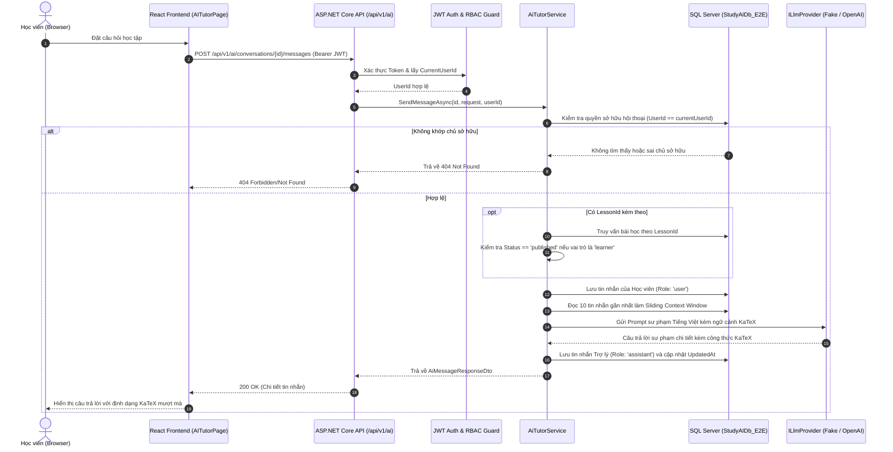

# STUDY_AI — Phase 19: Real AI Tutor & Contextual Chat
## Tích hợp Trợ lý Học tập AI Thực tế, Ngữ cảnh Bài học & Lưu trữ Hội thoại SQL Server

Ngày khởi động: 10/11/2026  
Ngày hoàn thành: 10/11/2026  
Môi trường công nghệ: ASP.NET Core Web API .NET 10 (`10.0.14`), Entity Framework Core 10, Microsoft SQL Server, React 19, TypeScript, Bun `1.4.2`, KaTeX `0.16.22`.  
Design System: **Navy Notebook** (Deep Navy `#102A43`, Warm Amber `#F4B942`, Cream Paper `#FFF9EA`).  
Trạng thái: **COMPLETED (Hoàn thành toàn diện, Vượt qua 100% Quality Gates)**.

---

## 1. Mục tiêu Tổng thể Phase 19

Phase 19 chuyển đổi AI Tutor từ mô phỏng frontend (localStorage/mock data) thành **hệ thống trợ lý học tập AI thực tế** kết nối trực tiếp backend ASP.NET Core và cơ sở dữ liệu:
1. **Kiến trúc Nhà cung cấp LLM Đa năng (LLM Provider Abstraction)**: Thiết kế giao diện `ILlmProvider`, triển khai `FakeLlmProvider` sư phạm chuẩn KaTeX cho local dev / integration tests không phụ thuộc API key ngoài, và `OpenAiLlmProvider` tương thích OpenAI API qua cấu hình môi trường bảo mật.
2. **Cơ sở dữ liệu & Lưu trữ Bền vững (Persistence)**: Thiết kế bảng `ai_conversations` và `ai_messages` trong EF Core; Migration `20261110001600_AddAiChatConversationsAndMessages` áp dụng nghiêm ngặt trên `StudyAIDb_E2E`.
3. **Bộ API Quản lý Hội thoại Đầy đủ**:
   - `GET /api/v1/ai/conversations`: Liệt kê danh sách hội thoại của người dùng.
   - `POST /api/v1/ai/conversations`: Tạo cuộc hội thoại mới.
   - `GET /api/v1/ai/conversations/{id}`: Lấy chi tiết kèm toàn bộ lịch sử tin nhắn.
   - `PATCH /api/v1/ai/conversations/{id}`: Đổi tiêu đề hoặc lưu trữ (archive).
   - `DELETE /api/v1/ai/conversations/{id}`: Xóa hội thoại và xóa liên đới (cascade) toàn bộ tin nhắn.
   - `POST /api/v1/ai/conversations/{id}/messages`: Gửi tin nhắn mới và nhận phản hồi sư phạm từ AI.
   - `POST /api/v1/ai/chat`: Endpoint trợ lý nhanh không cần tạo trước ID hội thoại.
4. **Bảo mật Đa người dùng & Phân quyền (Ownership & RBAC)**:
   - Người dùng chỉ được truy cập vào hội thoại do chính mình tạo ra (`UserId == currentUserId`), ngăn chặn triệt để rò rỉ IDOR (404/403).
   - Khi hỏi về ngữ cảnh bài học (`LessonId`), hệ thống xác thực trạng thái bài học: Người dùng vai trò `learner` tuyệt đối bị chặn không được hỏi về bài học nháp `draft` (403 Forbidden).
5. **Giao diện Người dùng & Fail-Closed Frontend**:
   - Loại bỏ cơ chế fallback mock im lặng khi đã có token đăng nhập; hiển thị banner lỗi trực quan (`data-testid="chat-error-banner"`) khi API trả lỗi.
   - Rehydrate lịch sử hội thoại từ database khi tải lại trang hoặc chuyển đổi giữa các cuộc trò chuyện.
6. **Bảo toàn Cơ sở Dữ liệu**:
   - `StudyAIDb` được bảo vệ tuyệt đối (0 lượt ghi).

---

## 2. Kiến trúc Hệ thống & Luồng Dữ liệu

---

## 3. Tiêu chuẩn Chất lượng Đạt được (Quality Gates)

### A. Backend .NET 10 (`backend/StudyAI.sln`)
- `dotnet build`: Succeeded (**0 Warning, 0 Error**).
- **Unit Tests**: **51 / 51 tests PASS (100%)** trong `StudyAI.UnitTests.dll`.
  - Bao gồm các unit test chuyên sâu cho `AiTutorService`: Validation độ dài prompt (2000 ký tự), giới hạn ngữ cảnh, phân quyền bài học nháp, format system prompt KaTeX.
- **Integration Tests**: **107 / 107 tests PASS (100%)** trong `StudyAI.IntegrationTests.dll` thực thi trực tiếp trên `StudyAIDb_E2E`.
  - Bao gồm 9 bài test tích hợp hoàn chỉnh: Tạo/sửa/xóa/truy vấn hội thoại, cô lập người dùng (IDOR protection), ngữ cảnh bài học, chặn hỏi bài học draft (403), xử lý lỗi timeout nhà cung cấp (504), xử lý lỗi provider (502), và Quick Chat.

### B. Frontend React 19 (`frontend/`)
- `oxlint --deny-warnings`: **0 errors, 0 warnings** trên 395 files.
- `bun run test:run` (Vitest): **384 / 384 tests PASS (100%)** qua 49 test files.
  - Bao gồm test suite mới `src/services/aiTutor.api.test.ts` kiểm thử đầy đủ hành vi gọi API backend thực tế, xử lý lỗi fail-closed, không fallback mock khi đã xác thực.
- `bun run build`: Production build thành công (**1.51s**).

### C. Playwright End-to-End Suite (`scripts/e2e_phase19_playwright.ts`)
- **6 / 6 scenarios PASS (100%)** chạy trực tiếp trên môi trường máy chủ cục bộ và cơ sở dữ liệu `StudyAIDb_E2E`:
  1. **Learner Login & Điều hướng `/ai-tutor`**: Xác thực đăng nhập học viên và render khung layout AI Tutor.
  2. **Khởi tạo Cuộc trò chuyện & Gợi ý câu hỏi**: Khởi tạo conversation mới với các thẻ gợi ý sư phạm.
  3. **Gửi câu hỏi & Nhận phản hồi thực tế từ AI Tutor**: Gửi câu hỏi có hậu tố ngẫu nhiên, nhận phản hồi sư phạm giải thích chi tiết có KaTeX.
  4. **Chat Ngữ cảnh Bài học (Contextual Learning)**: Điều hướng từ URL bài học, nạp và hiển thị huy hiệu ngữ cảnh bài học (`.contextual-header-badge` / `.composer-context-chip`).
  5. **Xác minh Lưu trữ Cơ sở Dữ liệu SQL Server**: Đối soát trực tiếp trong `StudyAIDb_E2E` xác nhận số lượng hội thoại và tin nhắn người dùng + trợ lý được ghi nhận chính xác bền vững.
  6. **Tải lại Trang & Phục hồi Lịch sử (Rehydration)**: Tải lại trình duyệt, phục hồi danh sách hội thoại từ database vào sidebar `.conv-item-root` liền mạch.

- Ảnh chụp màn hình nghiệm thu trực quan lưu tại `docs/visual-qa/phase-19/`:
  - `phase19_01_ai_tutor_loaded.png`
  - `phase19_02_new_chat_empty_state.png`
  - `phase19_03_ai_response_received.png`
  - `phase19_04_contextual_lesson_chat.png`
  - `phase19_05_reloaded_history_persisted.png`
  - Báo cáo kiểm định: `phase19_e2e_report.json`

---

## 4. An toàn Cơ sở Dữ liệu

- Cơ sở dữ liệu chính `StudyAIDb` được giữ **nguyên vẹn 100%**, không có bất kỳ bảng AI hay dữ liệu kiểm thử nào bị ghi nhầm.
- Toàn bộ bảng `ai_conversations` và `ai_messages` chỉ được tạo và thao tác trên `StudyAIDb_E2E`.
- `DatabaseSafetyGuard` (cả bản C# và TypeScript) luôn kiểm soát chặn đứng mọi hành vi ghi vào cơ sở dữ liệu không hợp lệ.

---

## 5. Dừng Kiểm tra (Stop Gate)

- **Phase 19 đã hoàn thành toàn bộ mục tiêu kỹ thuật, kiểm thử hồi quy và nghiệm thu thực tế.**
- **TUYỆT ĐỐI DỪNG TẠI ĐÂY, KHÔNG TỰ Ý BẮT ĐẦU PHASE 20.**
