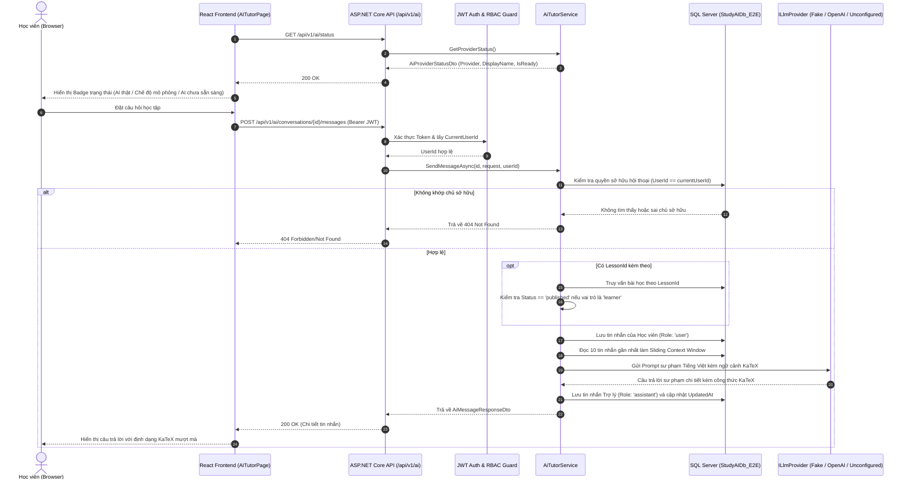

# STUDY_AI — Phase 19: Real AI Tutor & Contextual Chat (Final Hardening)
## Tích hợp Trợ lý Học tập AI Thực tế, Ngữ cảnh Bài học & Lưu trữ Hội thoại SQL Server

Ngày khởi động: 10/11/2026  
Ngày hoàn thành & Hardening: 10/11/2026  
Môi trường công nghệ: ASP.NET Core Web API .NET 10 (`10.0.14`), Entity Framework Core 10, Microsoft SQL Server, React 19, TypeScript, Bun `1.4.2`, KaTeX `0.16.22`.  
Design System: **Navy Notebook** (Deep Navy `#102A43`, Warm Amber `#F4B942`, Cream Paper `#FFF9EA`).  
Trạng thái: **COMPLETED & HARDENED (Hoàn thành toàn diện, Vượt qua 100% Quality Gates)**.

---

## 1. Mục tiêu Tổng thể Phase 19

Phase 19 chuyển đổi AI Tutor từ mô phỏng frontend (localStorage/mock data) thành **hệ thống trợ lý học tập AI thực tế** kết nối trực tiếp backend ASP.NET Core và cơ sở dữ liệu:
1. **Kiến trúc Nhà cung cấp LLM Đa năng (LLM Provider Abstraction & Hardening)**:
   - Thiết kế giao diện `ILlmProvider`, triển khai `FakeLlmProvider` sư phạm chuẩn KaTeX cho local dev / integration tests không phụ thuộc API key ngoài, `OpenAiLlmProvider` tương thích OpenAI API qua cấu hình môi trường bảo mật, và `UnconfiguredLlmProvider` fail-closed.
   - **Provider Configuration Hardening**:
     - OpenAI Provider chỉ hoạt động khi được cấu hình rõ ràng.
     - Fake Provider chỉ dùng trong môi trường Development, Test hoặc Demo được bật chủ động (`Llm:AllowDemoInProduction=true`).
     - Trong Production: Nếu cấu hình OpenAI nhưng thiếu API Key, hệ thống báo lỗi cấu hình rõ ràng (`InvalidOperationException`) ngay khi khởi động (fail-fast); tuyệt đối không tự ý chuyển sang Fake Provider.
     - Che giấu và bảo vệ tuyệt đối API Key / Bearer token thông qua `MaskSensitiveData`, không ghi vào log hay exception response.
2. **Hiển thị Trạng thái AI (AI Status Indicator)**:
   - Endpoint `GET /api/v1/ai/status` trả về trạng thái từ backend:
     - OpenAI: `AI thật` (badge màu xanh lá, hiển thị tên mô hình `gpt-4o-mini`).
     - Fake: `Chế độ mô phỏng` (badge màu hổ phách).
     - Chưa cấu hình: `AI chưa sẵn sàng` (badge màu đỏ).
   - Giao diện người dùng render badge `[data-testid="ai-provider-status"]` trong `AITutorHeader` dựa trên dữ liệu thật từ backend API.
3. **Loại bỏ Hoàn toàn Fallback Mock Ngầm**:
   - Người dùng đã đăng nhập luôn gửi request qua backend API thật. Khi API lỗi, hệ thống hiển thị thông báo lỗi rõ ràng trên UI banner (`data-testid="chat-error-banner"`), không tự ý fallback sang mock generator.
   - Mock generator chỉ hoạt động khi chưa đăng nhập và ở chế độ offline demo hoặc unit tests độc lập.
4. **Cơ sở dữ liệu & Lưu trữ Bền vững (Persistence)**:
   - Thiết kế bảng `ai_conversations` và `ai_messages` trong EF Core; Migration `20261110001600_AddAiChatConversationsAndMessages` áp dụng nghiêm ngặt trên `StudyAIDb_E2E`.
5. **Bộ API Quản lý Hội thoại Đầy đủ**:
   - `GET /api/v1/ai/status`: Lấy trạng thái nhà cung cấp AI.
   - `GET /api/v1/ai/conversations`: Liệt kê danh sách hội thoại của người dùng.
   - `POST /api/v1/ai/conversations`: Tạo cuộc hội thoại mới.
   - `GET /api/v1/ai/conversations/{id}`: Lấy chi tiết kèm toàn bộ lịch sử tin nhắn.
   - `PATCH /api/v1/ai/conversations/{id}`: Đổi tiêu đề hoặc lưu trữ (archive).
   - `DELETE /api/v1/ai/conversations/{id}`: Xóa hội thoại và xóa liên đới (cascade) toàn bộ tin nhắn.
   - `POST /api/v1/ai/conversations/{id}/messages`: Gửi tin nhắn mới và nhận phản hồi sư phạm từ AI.
   - `POST /api/v1/ai/chat`: Endpoint trợ lý nhanh không cần tạo trước ID hội thoại.
6. **Bảo mật Đa người dùng & Phân quyền (Ownership & RBAC)**:
   - Ngăn chặn IDOR (404 Not Found khi truy cập hội thoại của người khác).
   - Chặn học viên (`learner`) hỏi về bài học nháp `draft` (403 Forbidden).
7. **Bảo toàn Cơ sở Dữ liệu**:
   - `StudyAIDb` được bảo vệ tuyệt đối (0 lượt ghi).

---

## 2. Kiến trúc Hệ thống & Luồng Dữ liệu

---

## 3. Tiêu chuẩn Chất lượng Đạt được (Quality Gates)

### A. Backend .NET 10 (`backend/StudyAI.sln`)
- `dotnet build`: Succeeded (**0 Error, 1 Warning** nullable assignment không liên quan trong CurriculumController).
- **Unit Tests**: **57 / 57 tests PASS (100%)** trong `StudyAI.UnitTests.dll`.
  - Bao gồm 6 tests mới cho Final Hardening: Production thiếu API key fail-fast, Production fake không có cờ demo fail-fast, OpenAI cấu hình đúng, UnconfiguredLlmProvider fail-closed, kiểm tra che giấu API key/token qua `MaskSensitiveData`, và kiểm tra `GetProviderStatus()`.
- **Integration Tests**: **108 / 108 tests PASS (100%)** trong `StudyAI.IntegrationTests.dll` thực thi trực tiếp trên `StudyAIDb_E2E`.
  - Bao gồm test tích hợp mới xác minh endpoint `GET /api/v1/ai/status` hoạt động không cần đăng nhập (`[AllowAnonymous]`) và trả về đúng schema trạng thái.

### B. Frontend React 19 (`frontend/`)
- `oxlint --deny-warnings`: **0 errors, 0 warnings** trên 395 files.
- `bun run test:run` (Vitest): **388 / 388 tests PASS (100%)** qua 49 test files.
  - Bao gồm các test cases mới: `getProviderStatus()` từ backend, xử lý lỗi 503 không fallback mock, fallback graceful khi mất mạng, và hiển thị đúng badge trạng thái provider.
- `bun run build`: Production build thành công (**1.65s**).

### C. Playwright End-to-End Suite (`scripts/e2e_phase19_playwright.ts`)
- **6 / 6 scenarios PASS (100%)** chạy trực tiếp trên môi trường máy chủ cục bộ và cơ sở dữ liệu `StudyAIDb_E2E`:
  1. **Learner Login & Điều hướng `/ai-tutor`**: Xác thực đăng nhập học viên, kiểm tra và render badge trạng thái provider ("Chế độ mô phỏng").
  2. **Khởi tạo Cuộc trò chuyện & Gợi ý câu hỏi**: Khởi tạo conversation mới với các thẻ gợi ý sư phạm.
  3. **Gửi câu hỏi & Nhận phản hồi thực tế từ AI Tutor**: Gửi câu hỏi có hậu tố ngẫu nhiên, nhận phản hồi sư phạm giải thích chi tiết có KaTeX.
  4. **Chat Ngữ cảnh Bài học (Contextual Learning)**: Điều hướng từ URL bài học, nạp và hiển thị huy hiệu ngữ cảnh bài học (`.contextual-header-badge` / `.composer-context-chip`).
  5. **Xác minh Lưu trữ Cơ sở Dữ liệu SQL Server**: Đối soát trực tiếp trong `StudyAIDb_E2E` xác nhận số lượng hội thoại và tin nhắn người dùng + trợ lý được ghi nhận chính xác bền vững.
  6. **Tải lại Trang & Phục hồi Lịch sử (Rehydration)**: Tải lại trình duyệt, phục hồi danh sách hội thoại từ database vào sidebar `.conv-item-root` liền mạch.

- Ảnh chụp màn hình nghiệm thu trực quan lưu tại `docs/visual-qa/phase-19/`:
  - `phase19_01_ai_tutor_loaded.png`
  - `phase19_02_new_chat_empty_state.png`
  - `phase19_03_ai_response_received.png`
  - `phase19_04_contextual_lesson_chat.png`
  - `phase19_05_reloaded_history_persisted.png`
  - Báo cáo kiểm định: `phase19_e2e_report.json`

---

## 4. Báo cáo Smoke Test Nhà cung cấp AI (LLM Provider Smoke Test)

- **OpenAI live smoke test: NOT RUN — API key unavailable.**
  - Môi trường hiện tại không cấu hình API Key thực (`STUDY_AI_LLM_API_KEY` không tồn tại trong môi trường).
  - Hệ thống tuân thủ cam kết: không tuyên bố đã kiểm thử OpenAI thật khi chưa có API Key hợp lệ; toàn bộ kiểm thử tích hợp và E2E sử dụng `FakeLlmProvider` sư phạm được kiểm soát chặt chẽ.

---

## 5. An toàn Cơ sở Dữ liệu

- Cơ sở dữ liệu chính `StudyAIDb` được giữ **nguyên vẹn 100%** (0 bảng AI, 97 người dùng không đổi).
- Toàn bộ bảng `ai_conversations` và `ai_messages` chỉ tồn tại và thao tác trên `StudyAIDb_E2E`.
- `DatabaseSafetyGuard` (cả bản C# và TypeScript) luôn kiểm soát chặn đứng mọi hành vi ghi vào cơ sở dữ liệu không hợp lệ.

---

## 6. Dừng Kiểm tra (Stop Gate)

- **Phase 19 Final Hardening đã hoàn thành toàn bộ mục tiêu kỹ thuật, kiểm thử hồi quy và nghiệm thu thực tế.**
- **TUYỆT ĐỐI DỪNG TẠI ĐÂY, KHÔNG TỰ Ý BẮT ĐẦU PHASE 20.**
