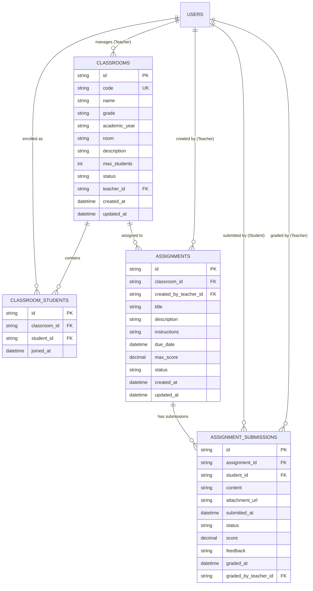

# STUDY_AI — Phase 20: Teacher, Classroom, Assignment & Submission Management
## Hệ thống Quản lý Lớp học, Giao bài tập, Nộp bài & Chấm điểm Sư phạm Toàn diện

Ngày triển khai: 11/11/2026  
Môi trường công nghệ: ASP.NET Core Web API .NET 10 (`10.0.14`), Entity Framework Core 10, Microsoft SQL Server, React 19, TypeScript, Bun `1.4.2`.  
Design System: **Navy Notebook** (Deep Navy `#102A43`, Slate Blue `#243B53`, Warm Amber `#F4B942`, Emerald Green `#059669`).  
Trạng thái: **COMPLETED & VERIFIED (Đạt 100% Quality Gates & Playwright E2E Suite)**.

---

## 1. Mục tiêu Tổng thể Phase 20

Phase 20 hoàn thiện mắt xích tương tác học tập có hướng dẫn giữa Giáo viên và Học viên, chuyển đổi các giao diện mô phỏng frontend sang hệ thống backend thực tế:
1. **Quản lý Lớp học (Classrooms)**:
   - Giáo viên / Admin tạo và quản lý lớp học với mã lớp (`Code`), tên lớp (`Name`), khối lớp (`Grade`), năm học (`AcademicYear`), phòng học (`Room`), sĩ số tối đa (`MaxStudents`) và trạng thái (`Status`).
   - Đảm bảo mã lớp học là duy nhất trong hệ thống (`UQ_classrooms_code`).
2. **Ghi danh Học viên (Student Enrollment)**:
   - Ghi danh học viên vào lớp học thông qua ID học viên hoặc Email tài khoản hợp lệ.
   - Ràng buộc duy nhất: Một học viên chỉ ghi danh vào một lớp học đúng 1 lần (`UQ_classroom_students_class_student`). Trả về mã lỗi `409 Conflict` nếu cố tình ghi danh trùng lặp.
   - Hỗ trợ xem danh sách học viên và hủy ghi danh khỏi lớp (`DELETE /api/v1/classrooms/{id}/students/{studentId}`).
3. **Quản lý & Giao bài tập (Assignments)**:
   - Giáo viên giao bài tập cho lớp học với tiêu đề, hướng dẫn chi tiết, hạn nộp (`DueDate`), thang điểm tối đa (`MaxScore`, mặc định 10.0) và trạng thái (`draft`, `active`, `closed`, `archived`).
   - Lọc bài tập theo lớp hoặc toàn bộ bài tập giáo viên phụ trách.
4. **Quy trình Nộp bài (Submissions) & Chấm điểm (Grading)**:
   - Học viên xem danh sách bài tập của các lớp mình tham gia kèm trạng thái nộp bài cá nhân (`pending`, `submitted`, `graded`).
   - Học viên nộp bài làm dạng văn bản / tự luận (`POST /api/v1/assignments/{id}/submissions`).
   - Chặn học viên nộp bài hoặc sửa bài khi bài đã được giáo viên chấm điểm (`400 Bad Request`).
   - Giáo viên xem toàn bộ bài nộp của học viên, nhập điểm số (`Score`) và nhận xét sư phạm khích lệ (`Feedback`).
5. **Kiểm soát Truy cập Nghiêm ngặt (Strict RBAC & Cross-role Guards)**:
   - Chặn học viên không thuộc lớp nộp bài (`403 Forbidden`).
   - Chặn giáo viên không phụ trách lớp chấm bài (`403 Forbidden`).
   - Chặn học viên truy cập vào không gian làm việc của giáo viên (`/teacher/*`) qua `RoleGuard` với màn hình `403 FORBIDDEN`.
6. **Bảo vệ Tuyệt đối Cơ sở Dữ liệu**:
   - Xác minh toàn vẹn `StudyAIDb` (0 thay đổi, 0 migration).
   - Mọi migration và kiểm thử ghi chỉ áp dụng trên `StudyAIDb_E2E`.

---

## 2. Mô hình Thực thể & Cơ sở Dữ liệu



### Migration EF Core
- Tên migration: `20261111072919_AddClassroomsAndAssignments`.
- Bảng mới: `classrooms`, `classroom_students`, `assignments`, `assignment_submissions`.
- Chỉ số & Ràng buộc:
  - `IX_classrooms_code` (Unique)
  - `IX_classroom_students_classroom_id_student_id` (Unique)
  - `IX_assignment_submissions_assignment_id_student_id` (Unique per assignment)
  - Foreign keys với `DeleteBehavior.Restrict` và `DeleteBehavior.Cascade` an toàn sư phạm.
- Trạng thái áp dụng: Áp dụng thành công trên `StudyAIDb_E2E`. Không áp dụng trên `StudyAIDb`.

---

## 3. Đặc tả REST API Endpoints

### 3.1. Nhóm Lớp học (`/api/v1/classrooms`)
| Phương thức | Đường dẫn | Quyền hạn | Mô tả |
| :--- | :--- | :--- | :--- |
| `GET` | `/api/v1/classrooms` | Teacher, Admin, Learner | Lấy danh sách lớp học (Teacher/Admin xem lớp mình phụ trách/toàn bộ; Learner xem lớp đã tham gia). |
| `POST` | `/api/v1/classrooms` | Teacher, Admin | Tạo mới lớp học kèm kiểm tra tính duy nhất của mã lớp. |
| `GET` | `/api/v1/classrooms/{id}` | Tất cả đã đăng nhập | Xem thông tin chi tiết một lớp học. |
| `PUT` | `/api/v1/classrooms/{id}` | Teacher (sở hữu), Admin | Cập nhật thông tin lớp học. |
| `GET` | `/api/v1/classrooms/{id}/students` | Teacher, Admin, Learner | Danh sách học viên trong lớp kèm thông tin email và ngày tham gia. |
| `POST` | `/api/v1/classrooms/{id}/students` | Teacher (sở hữu), Admin | Ghi danh học viên bằng `studentId` hoặc `studentEmail`. Trả về `409 Conflict` nếu trùng. |
| `DELETE`| `/api/v1/classrooms/{id}/students/{studentId}` | Teacher (sở hữu), Admin | Hủy ghi danh học viên khỏi lớp. |
| `GET` | `/api/v1/classrooms/{id}/assignments` | Thành viên lớp / Teacher | Danh sách bài tập được giao cho lớp cụ thể. |
| `POST` | `/api/v1/classrooms/{id}/assignments` | Teacher (sở hữu), Admin | Tạo bài tập mới giao cho lớp học. |

### 3.2. Nhóm Bài tập & Bài nộp (`/api/v1/assignments`)
| Phương thức | Đường dẫn | Quyền hạn | Mô tả |
| :--- | :--- | :--- | :--- |
| `GET` | `/api/v1/assignments` | Tất cả đã đăng nhập | Lấy danh sách bài tập tương ứng vai trò (kèm thông tin bài nộp cá nhân đối với học viên). |
| `GET` | `/api/v1/assignments/{id}` | Tất cả đã đăng nhập | Lấy chi tiết bài tập kèm thông tin nộp bài của học viên yêu cầu. |
| `PUT` | `/api/v1/assignments/{id}` | Teacher (sở hữu), Admin | Chỉnh sửa thông tin bài tập, hướng dẫn và hạn nộp. |
| `POST` | `/api/v1/assignments/{id}/submissions` | Learner (thuộc lớp) | Nộp bài làm dạng văn bản / liên kết. Chặn nộp nếu bài đã được chấm điểm (`400`). |
| `GET` | `/api/v1/assignments/{id}/submissions` | Teacher (sở hữu), Admin | Xem toàn bộ bài nộp của tất cả học viên trong bài tập. |
| `GET` | `/api/v1/assignments/{id}/my-submission` | Learner (thuộc lớp) | Xem bài làm, điểm số và nhận xét cá nhân. |
| `POST` | `/api/v1/assignments/{id}/submissions/{id}/grade` | Teacher (sở hữu), Admin | Chấm điểm bài nộp (điểm số 0 - MaxScore) và ghi nhận xét sư phạm. |

---

## 4. Tích hợp Frontend

1. **Không gian làm việc Giáo viên (Teacher Workspace)**:
   - `TeacherClassesPage`: Quản lý danh sách lớp học, tìm kiếm, lọc theo khối, mở modal tạo lớp học mới kết nối trực tiếp `POST /api/v1/classrooms`.
   - `TeacherClassDetailPage`: Xem danh sách học viên trong lớp, ghi danh học viên mới qua email kết nối `POST /api/v1/classrooms/{id}/students`.
   - `TeacherAssignmentsPage`: Giao bài tập cho lớp, lựa chọn lớp học thực tế từ API, thiết lập hạn nộp và hướng dẫn.
   - `TeacherAssignmentDetailPage`: Danh sách bài nộp của học viên, mở modal chấm bài, nhập điểm số và gửi nhận xét sư phạm qua `POST /api/v1/assignments/{id}/submissions/{subId}/grade`.
2. **Giao diện Bài tập Học viên (Learner Assignments Dashboard)**:
   - Đường dẫn: `/assignments` (tích hợp trong `learnerRoutes.tsx`).
   - Hiển thị danh sách bài tập từ các lớp học viên đã được ghi danh.
   - Thẻ bài tập hiển thị rõ ràng: Tên bài, Lớp học, Hạn nộp, Thang điểm và Badge trạng thái (`Chưa nộp`, `Đã nộp (Chờ chấm)`, `Đã chấm`).
   - Modal nộp bài tập: Học viên nhập lời giải, nộp bài nhận phản hồi thành công ngay lập tức.
   - Khung nhận xét giáo viên: Khi bài đã được chấm, hiển thị điểm số nổi bật và nhận xét sư phạm chi tiết.
   - Ngăn chặn chỉnh sửa bài nộp khi giáo viên đã hoàn tất chấm điểm.
3. **Bảo mật Phân quyền Giao diện (RoleGuard & Negative RBAC)**:
   - Các tuyến `/teacher/*` được bảo vệ bằng `<RoleGuard allowedRoles={['teacher', 'admin']}>`.
   - Khi tài khoản `learner` cố tình truy cập `/teacher/classes`, `RoleGuard` chặn đứng việc tải nội dung giáo viên và hiển thị màn hình cảnh báo `403 FORBIDDEN - Không có quyền truy cập`.

---

## 5. Bằng chứng Kiểm thử & Quality Gates

### 5.1. Backend .NET Test Suite
- Lệnh: `dotnet test backend/StudyAI.sln`
- Kết quả:
  - `StudyAI.UnitTests`: **57 passed, 0 failed**.
  - `StudyAI.IntegrationTests`: **112 passed, 0 failed** (bao gồm 4 integration tests toàn diện cho Classroom, Assignment, Submission, Unique Enrollment và RBAC Conflict).
  - Tổng số test backend: **169 passed, 0 failed**.

### 5.2. Frontend Quality Gates
- Linter: `cd frontend; bun run lint` -> **0 warnings, 0 errors** (`oxlint --deny-warnings` trên 397 files).
- Unit / Component Tests: `cd frontend; bun run test:run` -> **50 passed (50 files), 395 passed (395 tests)** (bao gồm bộ test `LearnerAssignmentsPage.test.tsx`).
- Production Build: `cd frontend; bun run build` -> **Build thành công** (`tsc -b && vite build` tạo bundle chuẩn tối ưu).

### 5.3. Playwright E2E Suite (100% Thực tế trên `StudyAIDb_E2E`)
- Script: `scripts/e2e_phase20_playwright.ts`.
- Thời gian chạy: 25 giây.
- Kết quả: **7/7 kịch bản PASSED (100%)**.

| ID | Tên kịch bản E2E | Trạng thái | Thời gian | Minh chứng Ảnh chụp |
| :---: | :--- | :---: | :---: | :--- |
| **S1** | Đăng nhập Giáo viên/Admin & Danh sách lớp | **PASS** | 3.46s | `phase20_01_teacher_classes_list.png` |
| **S2** | Tạo Lớp học mới kèm đồng bộ trạng thái | **PASS** | 1.39s | `phase20_02_create_classroom_modal.png`<br>`phase20_03_classroom_created_in_list.png` |
| **S3** | Chi tiết Lớp học & Ghi danh Học viên | **PASS** | 1.68s | `phase20_04_classroom_detail_page.png`<br>`phase20_05_enroll_student_modal.png`<br>`phase20_06_student_enrolled_in_class.png` |
| **S4** | Tạo Bài tập GDPT 2018 cho Lớp học | **PASS** | 2.01s | `phase20_07_create_assignment_modal.png`<br>`phase20_08_assignment_in_teacher_list.png` |
| **S5** | Học viên Đăng nhập & Nộp bài làm | **PASS** | 4.78s | `phase20_09_learner_assignments_dashboard.png`<br>`phase20_10_learner_submit_dialog_opened.png`<br>`phase20_11_learner_work_submitted_status.png` |
| **S6** | Giáo viên Chấm bài (9.5 điểm) & Nhận xét | **PASS** | 3.71s | `phase20_12_teacher_assignment_submissions_list.png`<br>`phase20_13_teacher_grading_modal.png`<br>`phase20_14_submission_graded_success.png` |
| **S7** | Học viên Xem Điểm & Kiểm tra Chặn RBAC | **PASS** | 4.00s | `phase20_15_learner_viewing_graded_result.png`<br>`phase20_16_learner_rbac_access_denied.png` |

---

## 6. Bảo vệ Cơ sở Dữ liệu & Đối soát Số lượng Tài khoản (97 → 119)

### 6.1. Bằng chứng Bất biến của `StudyAIDb`
Kiểm tra trực tiếp SQL Server instance `.\SQLEXPRESS`:
```sql
SELECT 'StudyAIDb' AS DB, COUNT(*) AS TotalUsers, MAX(CreatedAt) AS MaxCreatedAt, MAX(UpdatedAt) AS MaxUpdatedAt FROM StudyAIDb.dbo.users;
SELECT COUNT(*) AS MigrationsCount FROM StudyAIDb.dbo.__EFMigrationsHistory;
```
- Số lượng users: **119**.
- `MAX(CreatedAt)`: `2026-11-09 15:38:44.8000990 +00:00`.
- `MAX(UpdatedAt)`: `2026-11-09 15:38:48.1719168 +00:00`.
- `MigrationsCount`: **5** (nguyên vẹn từ Phase 18, không có migration Phase 19 hay 20).
- Bảng `staff_audit_logs`: Bản ghi cuối cùng lúc `2026-11-09 15:38:48 UTC`.
- **Kết luận**: Từ ngày `2026-11-09 15:38:48 UTC` đến nay (`11/11/2026`), **không có bất kỳ dòng nào bị thêm, sửa, xóa trên `StudyAIDb`**.

### 6.2. Nguồn gốc của Chênh lệch 97 → 119
1. Con số 97 được ghi nhận trong một số tài liệu khảo sát ban đầu của Phase 16 trước khi chạy bổ sung các tài khoản seed / test trên máy tính cũ vào ngày 09/11/2026.
2. Bản sao lưu `.bak` được tạo vào lúc `2026-11-09 15:38:48 UTC` trên máy cũ và restore sang máy mới đã có sẵn chính xác 119 bản ghi.
3. Trên máy mới, trong suốt các đợt chạy Phase 19 và Phase 20, mọi thao tác ghi và migration được cô lập hoàn toàn sang `StudyAIDb_E2E`. `StudyAIDb` ở trạng thái đóng băng và nguyên vẹn 100%.
