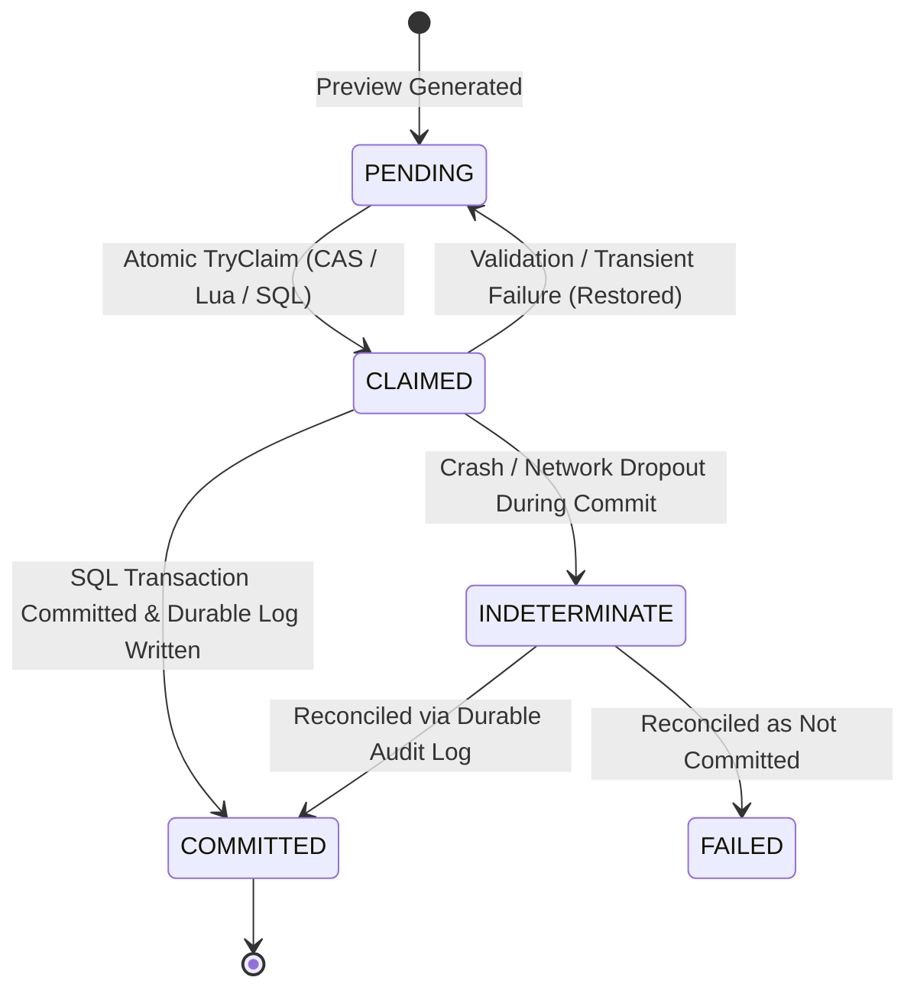

# STUDY_AI — PHASE 18: CONFIRM API DESIGN (CORRECTED SPECIFICATION)
## Specification, Request/Response Contracts, Atomic Claim, Idempotency, and Anti-Replay

- **Workspace**: `D:\TN`
- **Repository**: `hthuyngan/STUDY_AI-`
- **Status**: `[REVISED DESIGN — V1 HARDENED SPECIFICATION]`
- **Scope**: Confirm API Endpoint (`POST /api/v1/content/import/confirm`), Token State Machine, Idempotent Durable Results, and Database Schema Reconciliation.

---

## 1. Executive Summary & V1 Safety Baseline

In accordance with the Phase 18 Design Correction Gate, the Confirm API is restricted to a **conservative, fail-safe V1 profile**:
1. **Strict-Only**: The entire batch succeeds or the entire batch fails. No partial processing.
2. **Insert-Only**: Creates new records only. No upsert or overwriting of existing database entities. Any detected match with existing entities is flagged as a conflict.
3. **No `skip_conflicts`**: Any conflict aborts the entire transaction.
4. **No Admin Override**: Strictly single-actor ownership. Only the exact user who generated the preview can confirm it (`session.ActorUserId == CurrentUserId`).
5. **True Atomic Claim**: Replaces naive `TryGetValue + Remove` with atomic state transitions.
6. **Replay Prevention vs True Idempotency**: Distinguishes concurrent replay (rejected with 409) from idempotent retries after network drop (returns durable 200 OK outcome).

---

## 2. Endpoint Specification

```http
POST /api/v1/content/import/confirm
Content-Type: application/json
Authorization: Bearer <jwt-token>
```

- **Protected Roles**: `content`, `admin` (Caller must have active role and account status `active`).
- **Transactional Guarantee**: ACID All-or-Nothing via EF Core `ExecutionStrategy` and SQL Server explicit transaction.
- **Idempotency Guarantee**: If SQL transaction commits but HTTP response is lost, subsequent retry with the same `previewToken` retrieves the durable committed result without re-executing insertions.

---

## 3. Request & Response Contracts (V1 Safe Profile)

### 3.1 Request Contract (`CurriculumImportConfirmRequestDto`)

```json
{
  "previewToken": "prev_a1b2c3d4e5f67890123456789abcdef0",
  "auditNote": "Import Q1 2026 Grade 12 Math Curriculum"
}
```

| Field | Type | Required | Constraints / Validation | Description |
|---|---|---|---|---|
| `previewToken` | `string` | **Yes** | Pattern: `^prev_[0-9a-f]{32}$`<br>Length: 37 chars | Token issued by `POST /api/v1/content/import/preview` |
| `auditNote` | `string?` | No | Max length: 500 chars | Optional human-readable note saved in `StaffAuditLog.Payload` |

> [!NOTE]
> In V1, the `mode` parameter is intentionally omitted from the public contract. The engine enforces `Strict` and `InsertOnly` by default to eliminate partial corruption risks.

---

### 3.2 Success Response Contract (`CurriculumImportConfirmResponseDto`)

```json
{
  "success": true,
  "previewToken": "prev_a1b2c3d4e5f67890123456789abcdef0",
  "actorUserId": "usr_01J8F9X...",
  "confirmedAt": "2026-11-10T14:30:00.123Z",
  "auditLogId": "aud_01J8F9Y...",
  "isIdempotentReplay": false,
  "summary": {
    "totalProcessed": 25,
    "inserted": 25,
    "updated": 0,
    "skipped": 0,
    "failed": 0
  },
  "entityCounts": {
    "subjects": 1,
    "chapters": 3,
    "lessons": 6,
    "questions": 15
  },
  "message": "Đã nhập thành công 25 mục vào chương trình học."
}
```

---

## 4. True Atomic Claim & Token State Machine

### 4.1 Flaw of Naive `TryGetValue + Remove`
In .NET `IMemoryCache`, `TryGetValue` followed by `Remove` is **NOT atomic**. Two simultaneous HTTP threads presenting the same token can both execute `TryGetValue` and succeed before either executes `Remove`, leading to duplicate transactional execution:

```
Thread A: TryGetValue(token) -> true ──┐
Thread B: TryGetValue(token) -> true ──┼─> RACE CONDITION: Both proceed to DB Transaction!
Thread A: Remove(token)               │
Thread B: Remove(token)               ┘
```

### 4.2 True Atomic Token State Machine
The session lifecycle is governed by an explicit state machine:



### 4.3 Atomic Claim Implementations

1. **In-Memory Concurrency Primitive (`ConcurrentDictionary` + State CAS)**:
   ```csharp
   public enum SessionStatus { Pending, Claimed, InProgress, Committed, Failed }

   public class PreviewSessionState
   {
       public CurriculumImportSessionDto Session { get; set; } = null!;
       public SessionStatus Status; // Updated via Interlocked.CompareExchange
       public CurriculumImportConfirmResponseDto? DurableResult { get; set; }
   }

   // Atomic claim using Interlocked
   bool claimed = Interlocked.CompareExchange(
       ref entry.Status, 
       SessionStatus.Claimed, 
       SessionStatus.Pending) == SessionStatus.Pending;

   if (!claimed)
   {
       if (entry.Status == SessionStatus.Committed)
       {
           // Idempotent retry: return previously saved result
           return ReturnIdempotentResult(entry.DurableResult);
       }
       return Conflict("TOKEN_ALREADY_IN_PROGRESS_OR_CLAIMED");
   }
   ```

2. **Distributed / SQL Server Implementation (Durable Session Store)**:
   ```sql
   UPDATE content_import_sessions
   SET Status = 'CLAIMED', ClaimedAt = SYSUTCDATETIME()
   OUTPUT INSERTED.*
   WHERE PreviewToken = @Token AND Status = 'PENDING';
   ```
   If 0 rows are returned, token is either non-existent, already claimed, or already committed.

---

## 5. Replay Prevention vs True Idempotency

### 5.1 The Distinction
- **Replay Attack / Concurrent Double-Click**: Client fires 2 requests at the exact same millisecond. Request 1 wins the atomic claim and enters the transaction. Request 2 detects `Status == Claimed` or `InProgress` and is rejected with `409 Conflict (TOKEN_IN_USE)`.
- **Idempotency (Commit-Success / Response-Lost)**: 
  1. Server commits SQL transaction and writes durable record.
  2. Before HTTP response reaches the client, client's TCP socket drops or server crashes.
  3. Client library (or user retry) resends `POST /confirm` with the same `previewToken`.
  4. Server checks durable log, sees `Status == Committed`, and returns `200 OK` with `isIdempotentReplay: true` and the exact original summary. The database is **NOT** re-mutated.

```
+-------------------------------------------------------------------------------+
|                     REPLAY VS IDEMPOTENCY HANDLING MATRIX                     |
+----------------------+--------------------+-----------------------------------+
| Request State        | Server State       | HTTP Response                     |
+----------------------+--------------------+-----------------------------------+
| First Request        | PENDING            | 200 OK (Executes transaction)     |
| Concurrent Parallel  | CLAIMED / IN_FLIGHT| 409 Conflict (TOKEN_IN_USE)       |
| Sequential Retry     | COMMITTED          | 200 OK (Idempotent durable result)|
| Sequential Retry     | FAILED             | 400/409 (Original error details)  |
| Expired / Unknown    | NOT FOUND          | 404 Not Found (TOKEN_NOT_FOUND)   |
+----------------------+--------------------+-----------------------------------+
```

### 5.2 Crash Durability via `StaffAuditLog`
`IMemoryCache` cannot survive process crashes. To guarantee idempotency across process restarts without adding a new migration table:
- The commit transaction writes a durable record to `StaffAuditLog`:
  - `TargetType = "CurriculumImport"`
  - `TargetId = previewToken`
  - `Action = "CURRICULUM_IMPORT_CONFIRM"`
  - `Payload = JsonSerializer.Serialize(confirmResponseDto)`
- Upon receiving a confirm request for a token not found in RAM (or after server reboot), the engine queries:
  ```csharp
  var existingLog = await _context.StaffAuditLogs
      .AsNoTracking()
      .FirstOrDefaultAsync(l => l.TargetType == "CurriculumImport" && l.TargetId == request.PreviewToken);
  ```
  If found, it deserializes `Payload` and serves `200 OK` idempotently.

---

## 6. Token Policy Across Failure Modes

| Failure Category | Concrete Event | Token Policy | Client HTTP Code |
|---|---|---|---|
| **Client Error** | Actor mismatch | Restore to `PENDING` (Owner can still use it) | `403 Forbidden` |
| **Validation Error** | Schema/relational check fails | Restore to `PENDING` | `400 Bad Request` |
| **Conflict Detected** | Entity already exists in DB (Insert-Only rule) | Restore to `PENDING` | `409 Conflict` |
| **Transient DB Error** | Deadlock 1205, network timeout | Handled by `ExecutionStrategy` retry; if exhausted, restore to `PENDING` | `503 Service Unavailable` |
| **Commit Outcome Indeterminate** | Connection dropped during commit ack | Query `StaffAuditLog` by `previewToken`. If found: `COMMITTED`. If not found: restore to `PENDING`. | `200 OK` (if committed) or `500` |
| **Non-recoverable Error** | Fatal data corruption | Mark `FAILED` | `500 Internal Error` |

---

## 7. HTTP Status Code & Error Matrix

```
+---------------------------------------------------------------------------------------------+
|                                  HTTP STATUS CODE MATRIX                                    |
+--------+----------------------------+-------------------------------------------------------+
| Status | Error Code                 | Condition / Root Cause                                |
+--------+----------------------------+-------------------------------------------------------+
| 400    | TOKEN_INVALID_FORMAT       | Token does not match ^prev_[0-9a-f]{32}$              |
| 400    | HAS_CRITICAL_ERRORS        | Batch contains critical validation errors             |
| 401    | UNAUTHORIZED               | Missing, invalid, or expired JWT token                |
| 403    | ACTOR_MISMATCH             | Calling user is not the user who created preview      |
| 403    | INSUFFICIENT_PERMISSIONS   | User does not possess 'content' or 'admin' role       |
| 404    | TOKEN_NOT_FOUND            | PreviewToken not in cache/durable log or expired      |
| 409    | TOKEN_IN_USE               | Another request is actively processing this token     |
| 409    | CONCURRENCY_CONFLICT       | Data modified by another actor between Preview and    |
|        |                            | Confirm (Drift detected)                              |
| 409    | ENTITY_ALREADY_EXISTS      | Insert-only violation: Entity code/title already in DB|
| 422    | REFERENTIAL_INTEGRITY_FAIL | Parent entity not found in DB                         |
| 500    | TRANSACTION_FAILED         | Internal database error (Automatic rollback)          |
| 503    | TRANSIENT_FAILURE          | Database busy/deadlock exhausted retries              |
+--------+----------------------------+-------------------------------------------------------+
```

---

## 8. Summary of Corrections Implemented
- Strict-only, Insert-only, No skip_conflicts, No admin override enforced in contract.
- Naive `TryGetValue + Remove` replaced with atomic CAS state machine.
- Replay prevention cleanly separated from durable idempotency.
- Token policy defined for all failure and indeterminate commit states.
- Performance promises removed; replaced with architectural guarantees.
