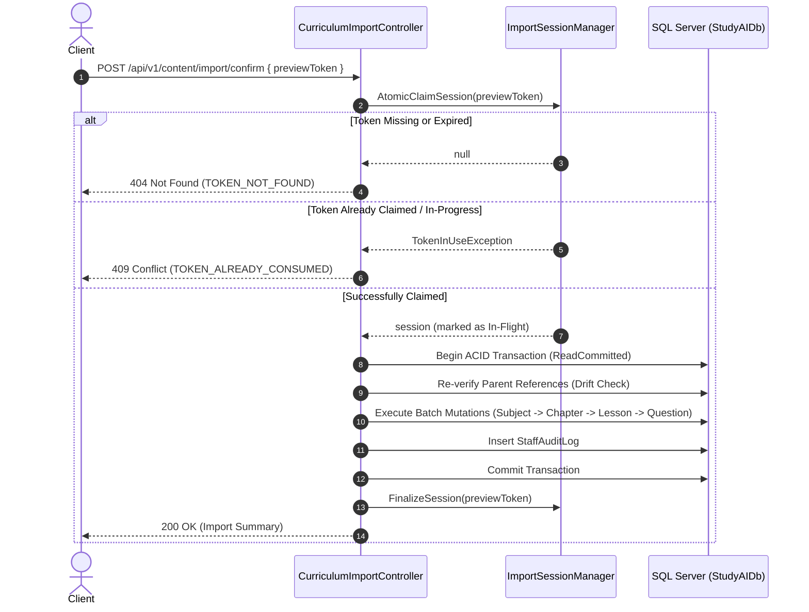

# STUDY_AI — PHASE 18: CONFIRM API DESIGN
## Specification, Request/Response Contracts, Status Codes, Idempotency, and Anti-Replay

- **Workspace**: `D:\TN`
- **Repository**: `hthuyngan/STUDY_AI-`
- **Status**: `[PROPOSED DESIGN — AWAITING USER APPROVAL PRIOR TO IMPLEMENTATION]`
- **Design Target**: Confirm API Endpoint for Curriculum & Question Bank Import.

---

## 1. Endpoint Overview

The Confirm API accepts a previously issued `previewToken`, validates actor identity and prerequisites, executes a single ACID database transaction, and persists curriculum entities into SQL Server.

```http
POST /api/v1/content/import/confirm
Content-Type: application/json
Authorization: Bearer <jwt-token>
```

- **Protected Roles**: `content`, `admin`
- **Transactional Guarantee**: Strict ACID (All-or-Nothing). No partial records are retained if an error occurs.
- **Idempotency Guarantee**: Single-use token consumption. Replays return `409 Conflict`.

---

## 2. Request & Response Contracts

### 2.1 Request Contract (`CurriculumImportConfirmRequestDto`)

```json
{
  "previewToken": "prev_a1b2c3d4e5f67890123456789abcdef0",
  "mode": "strict",
  "auditNote": "Batch import for Q1 2026 Grade 12 Calculus curriculum"
}
```

#### Field Specifications:

| Field | Type | Required | Constraints / Validation | Description |
|---|---|---|---|---|
| `previewToken` | `string` | **Yes** | Pattern: `^prev_[0-9a-f]{32}$`<br>Length: 37 chars | Token issued by `POST /api/v1/content/import/preview` |
| `mode` | `string` | No (default: `"strict"`) | Allowed: `"strict"`, `"skip_conflicts"`, `"upsert"` | Processing strategy for duplicate or conflicting items |
| `auditNote` | `string?` | No | Max length: 500 chars | Human-readable remark saved to `staff_audit_logs` |

#### Mode Semantics:
1. `"strict"` (Default, Recommended): Fails the entire transaction if any item in the batch has conflicts or unresolvable references.
2. `"skip_conflicts"`: Bypasses items marked as `Conflict` or `Skip`, inserting only pristine `Insert` items. Fails if referential integrity is violated.
3. `"upsert"`: Updates existing records where entity code exists and caller has update permissions, inserts new records.

---

### 2.2 Success Response Contract (`CurriculumImportConfirmResponseDto`)

```json
{
  "success": true,
  "previewToken": "prev_a1b2c3d4e5f67890123456789abcdef0",
  "actorEmail": "content@studyai.internal",
  "confirmedAt": "2026-11-10T14:30:00.123Z",
  "durationMs": 412,
  "auditLogId": "aud_01J8F9X...",
  "summary": {
    "totalProcessed": 128,
    "inserted": 120,
    "updated": 8,
    "skipped": 0,
    "failed": 0
  },
  "entityCounts": {
    "subjects": 1,
    "chapters": 4,
    "lessons": 12,
    "questions": 111
  },
  "message": "Đã nhập thành công 128 mục vào chương trình học."
}
```

---

## 3. Error Responses & HTTP Status Code Matrix

The Confirm endpoint adheres to standard REST and RFC 7807 Problem Details:

```
+-----------------------------------------------------------------------------------------+
|                               CONFIRM API ERROR MATRIX                                  |
+--------+----------------------------+---------------------------------------------------+
| Status | Error Code                 | Condition / Root Cause                            |
+--------+----------------------------+---------------------------------------------------+
| 400    | TOKEN_INVALID_FORMAT       | Token does not match ^prev_[0-9a-f]{32}$          |
| 400    | HAS_CRITICAL_ERRORS        | Batch contains critical validation errors in      |
|        |                            | 'strict' mode                                     |
| 400    | UNSUPPORTED_MODE           | Mode value not in [strict, skip_conflicts, upsert]|
| 401    | UNAUTHORIZED               | Missing, invalid, or expired JWT token            |
| 403    | ACTOR_MISMATCH             | Calling user is not the user who created preview  |
| 403    | FORBIDDEN                  | User does not have 'content' or 'admin' role      |
| 404    | TOKEN_NOT_FOUND            | PreviewToken not in cache or already expired      |
| 409    | TOKEN_ALREADY_CONSUMED     | Token was already confirmed (replay attack)       |
| 409    | CONCURRENCY_CONFLICT       | Data modified by another actor between Preview    |
|        |                            | and Confirm (Drift detected)                      |
| 422    | REFERENTIAL_INTEGRITY_FAIL | Parent entity was deleted or code collision       |
| 500    | TRANSACTION_FAILED         | Internal database error (Automatic rollback)      |
+--------+----------------------------+---------------------------------------------------+
```

### Example Problem Details Payload (409 Conflict):
```json
{
  "errorCode": "DATA_DRIFT_DETECTED",
  "message": "Dữ liệu cơ sở dữ liệu đã thay đổi kể từ khi tạo Preview. Môn học 'MATH12' đã bị sửa đổi bởi người dùng khác. Vui lòng tạo Preview mới để đối soát lại.",
  "timestamp": "2026-11-10T14:32:00.000Z"
}
```

---

## 4. Anti-Replay & Idempotency Architecture

To prevent duplicate submission and race conditions:



### 4.1 Single-Use Token Consumption (Token Burn)
1. **Atomic Retrieval**:
   When `Confirm` begins, the session is removed from active cache:
   ```csharp
   if (!_cache.TryGetValue(cacheKey, out CurriculumImportSessionDto? session) || session == null)
   {
       return NotFound(new { errorCode = "TOKEN_NOT_FOUND", message = "Mã Preview không tồn tại hoặc đã hết hạn." });
   }
   
   // Atomic burn: immediately remove or mark as consumed
   _cache.Remove(cacheKey);
   ```
2. **Replay Protection**:
   If a duplicate request arrives concurrently, it receives `404 Not Found` or `409 Conflict (TOKEN_ALREADY_CONSUMED)`.

### 4.2 Actor Binding Verification
```csharp
if (!string.Equals(session.ActorId, CurrentUserId, StringComparison.Ordinal) && !User.IsInRole("admin"))
{
    // Re-insert token so owner can still use it
    _cache.Set(cacheKey, session, session.ExpiresAt);
    return StatusCode(StatusCodes.Status403Forbidden, new
    {
        errorCode = "ACTOR_MISMATCH",
        message = "Bạn không có quyền xác nhận bản xem trước do tài khoản khác tạo ra."
    });
}
```

---

## 5. Summary & Verification

This design ensures:
1. **Zero Data Corruption**: Database state is strictly validated inside the transaction.
2. **Zero Replay Danger**: Tokens are destroyed on first consumption.
3. **Audited Actions**: Every confirm writes an audit log linking the caller, token, file hash, and record counts.
