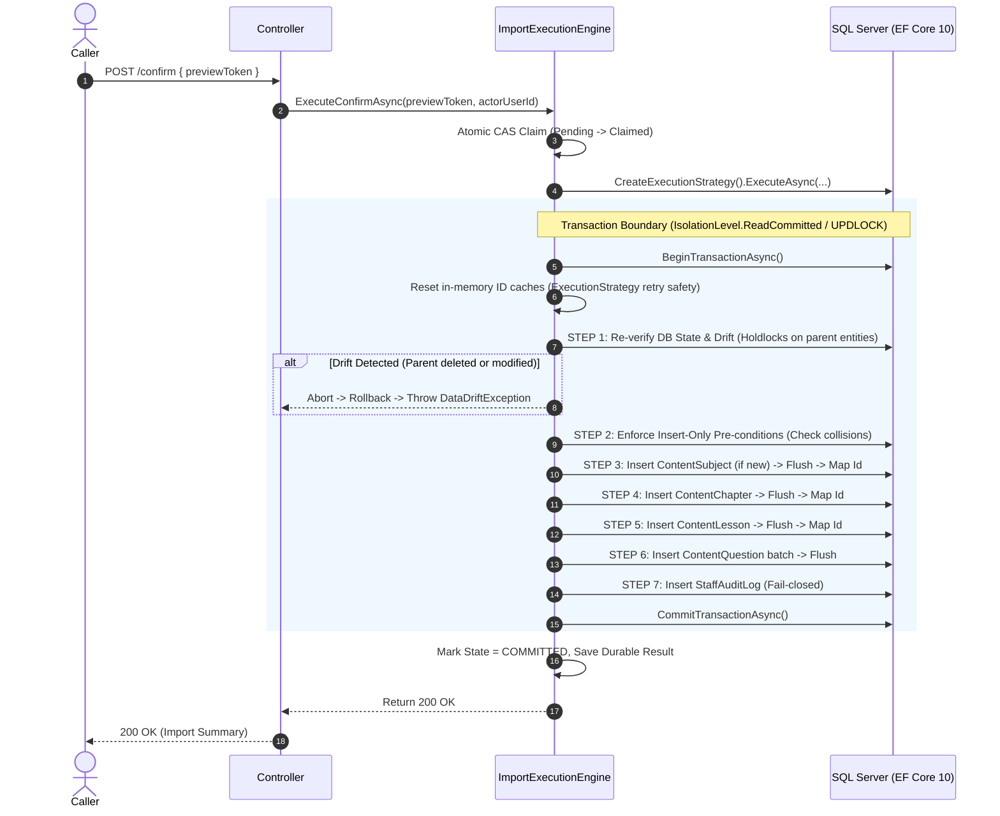

# STUDY_AI — PHASE 18: TRANSACTION & ROLLBACK DESIGN (CORRECTED SPECIFICATION)
## In-Transaction Drift Revalidation, Schema Alignment, ExecutionStrategy Retries, and Rollback Mechanics

- **Workspace**: `D:\TN`
- **Repository**: `hthuyngan/STUDY_AI-`
- **Status**: `[REVISED DESIGN — V1 HARDENED SPECIFICATION]`
- **Scope**: EF Core 10 Transaction Pipeline, Entity Schema Reconciliation, Business Key Resolution, and Failure Recovery.

---

## 1. Executive Summary & Critical Schema Realities

A primary defect in earlier designs was assuming entities had uniform `Code` properties and relying on pre-transaction validation outside the transaction boundary. 

Source code inspection of `backend/src/StudyAI.Domain/Entities/ContentEntities.cs`, `StaffAuditLog.cs`, and `StudyAIDbContext.cs` reveals the **actual schema realities**:

```
+---------------------------------------------------------------------------------------------------+
|                                   ACTUAL ENTITY SCHEMA RECONCILIATION                             |
+------------------+-----------------------+------------------------+-------------------------------+
| Entity           | Primary Key           | Business Key Candidate | Database Uniqueness Constraint|
+------------------+-----------------------+------------------------+-------------------------------+
| ContentSubject   | Id (string 64)        | Code (string 32)       | YES: IX_content_subjects_Code |
| ContentChapter   | Id (string 64)        | (SubjectId, Title)     | NO: No unique constraint      |
| ContentLesson    | Id (string 64)        | (ChapterId, Slug)      | NO: Non-unique IX on Slug     |
| ContentQuestion  | Id (string 64)        | None in Schema         | NO: Prompt is nvarchar(max)   |
| StaffAuditLog    | Id (string 64)        | ActorUserId, Action    | Indices on Actor, Action, Date|
+------------------+-----------------------+------------------------+-------------------------------+
```

### Critical Findings:
1. **`ContentSubject`** is the **only** entity with a `Code` column and a unique constraint in SQL Server.
2. **`ContentChapter`** has **NO `Code` column**. It only has `Id`, `SubjectId`, `Title`, `Description`, `OrderIndex`, `IsActive`.
3. **`ContentLesson`** has **NO `Code` column**. It has `Slug` and `Title`, but `Slug` is **not unique** across chapters or subjects. Requires `AuthorId` (FK to `users`).
4. **`ContentQuestion`** has **NO `Code` column** and **NO `Fingerprint` column**. `Prompt` is `nvarchar(max)`. SQL Server does not support B-tree unique indexes on `nvarchar(max)`.
5. **`StaffAuditLog`** properties are strictly: `Id`, `ActorUserId`, `Action`, `TargetType`, `TargetId`, `Payload`, `CreatedAt`. (There are no `ActorId`, `ActorEmail`, `ClientIp`, or `Entity` properties).

---

## 2. Business Key Mapping Without Schema Migration

To comply with the strict **Zero Production Migration** policy of Phase 18:

### 2.1 Mapping Hierarchy Strategy

```mermaid
flowchart TD
    subgraph Import Batch (File)
        ImpSub["Subject (Code: MATH12)"]
        ImpCh["Chapter (Code: CH01, Title: Giải tích)"]
        ImpLes["Lesson (Code: LES01, Slug: tinh-don-dieu)"]
        ImpQ["Question (Prompt: Cho hàm số...)"]
    end

    subgraph Production SQL Server Schema
        DbSub["ContentSubject (Code == 'MATH12') [UNIQUE]"]
        DbCh["ContentChapter (SubjectId + Title) [NON-UNIQUE IN DB]"]
        DbLes["ContentLesson (ChapterId + Slug) [NON-UNIQUE IN DB]"]
        DbQ["ContentQuestion (LessonId + Prompt) [NO UNIQUE INDEX]"]
    end

    ImpSub -->|Match by Code| DbSub
    ImpCh -->|Match by SubjectId + Title| DbCh
    ImpLes -->|Match by ChapterId + Slug| DbLes
    ImpQ -->|Insert-Only / Match in Batch| DbQ
```

1. **Subject Resolution**:
   - Query: `_context.ContentSubjects.FirstOrDefaultAsync(s => s.Code == item.SubjectCode)`
   - Status: **FULL SUPPORT**. Database enforces uniqueness.
2. **Chapter Resolution**:
   - Query: `_context.ContentChapters.FirstOrDefaultAsync(c => c.SubjectId == resolvedSubjectId && c.Title == item.Title)`
   - Status: **CONDITIONAL (Application-Enforced)**. Since there is no unique index on `(SubjectId, Title)`, the transaction must use `HOLDLOCK` / `UPDLOCK` or `Serializable` isolation to prevent concurrent duplicate creation.
3. **Lesson Resolution**:
   - Query: `_context.ContentLessons.FirstOrDefaultAsync(l => l.ChapterId == resolvedChapterId && l.Slug == item.Slug)`
   - `AuthorId` assignment: Set to current `ActorUserId`.
   - Status: **CONDITIONAL (Application-Enforced)**.
4. **Question Persistence**:
   - Status: **BLOCKED FOR CODE-BASED LOOKUP / INSERT-ONLY SUPPORTED**.
   - Because `content_questions` has no `Code` or `Fingerprint` column, question codes in the import file cannot be persisted into standard columns.
   - For V1, the system operates as **Strict Insert-Only**: New questions are inserted directly under their parent `LessonId`. Deduplication across historical imports via `Code` is impossible without schema modification.

---

## 3. The In-Transaction Execution Pipeline (Revised)

In this revised design, **all drift revalidation, lock acquisition, and key mappings take place inside the transaction boundary**.



### Detailed Pipeline Steps:

#### Step 1: In-Transaction Drift Revalidation
Once the transaction begins, the engine re-queries the database for all parent references required by the batch:
```csharp
// Execute inside transaction with UPDLOCK to prevent concurrent modifications
var existingSubject = await _context.ContentSubjects
    .FromSqlInterpolated($"SELECT * FROM content_subjects WITH (UPDLOCK, ROWLOCK) WHERE Code = {batch.SubjectCode}")
    .FirstOrDefaultAsync(cancellationToken);

if (existingSubject == null && batch.RequiresExistingSubject)
{
    throw new DataDriftException($"Môn học '{batch.SubjectCode}' đã bị xóa hoặc không tồn tại.");
}
```

#### Step 2: Insert-Only Conflict Check
Under the V1 safe profile, if any entity already exists:
- If a Subject with `Code` already exists $\rightarrow$ Conflict (`409 ENTITY_ALREADY_EXISTS`).
- If a Chapter with `(SubjectId, Title)` already exists $\rightarrow$ Conflict.
- If a Lesson with `(ChapterId, Slug)` already exists $\rightarrow$ Conflict.
- The transaction throws `ConflictException` and rolls back immediately.

#### Step 3-6: Cascading Entity Persistence & Key Propagation
1. Generate GUID strings for new entities: `Id = Guid.NewGuid().ToString("N")`.
2. Assign foreign keys:
   - `Chapter.SubjectId = subject.Id`
   - `Lesson.ChapterId = chapter.Id`
   - `Lesson.AuthorId = actorUserId`
   - `Question.LessonId = lesson.Id`
   - `Question.SubjectId = subject.Id`
3. Intermediate flushes: Call `await _context.SaveChangesAsync(cancellationToken)` between hierarchy levels to ensure foreign key constraints are validated by SQL Server.

#### Step 7: Fail-Closed Staff Audit Logging
Using the exact schema properties of `StaffAuditLog`:
```csharp
var auditLog = new StaffAuditLog
{
    Id = Guid.NewGuid().ToString("N"),
    ActorUserId = actorUserId,
    Action = "CURRICULUM_IMPORT_CONFIRM",
    TargetType = "CurriculumImport",
    TargetId = previewToken,
    Payload = JsonSerializer.Serialize(new
    {
        fileHash = session.FileHashSha256,
        fileName = session.FileName,
        entityCounts = summaryCounts,
        auditNote = request.AuditNote,
        confirmedAt = DateTimeOffset.UtcNow
    }),
    CreatedAt = DateTimeOffset.UtcNow
};

_context.StaffAuditLogs.Add(auditLog);
await _context.SaveChangesAsync(cancellationToken);
```
**Fail-Closed Invariant**: If `SaveChangesAsync()` throws during audit logging, the catch block triggers `transaction.RollbackAsync()`. No import may be committed without its accompanying audit log.

---

## 4. ExecutionStrategy Retry & Deadlock Handling

SQL Server transient errors (e.g. error code 1205 for deadlock victim, network blips) trigger automatic retry under `SqlServerRetryingExecutionStrategy`.

### Retry Safety Rules:
1. **Clear ChangeTracker on Retry**:
   If an exception occurs during attempt 1, EF Core's ChangeTracker retains dirty entities. The retry block MUST call:
   ```csharp
   _context.ChangeTracker.Clear();
   ```
2. **Reset In-Memory Dictionaries**:
   Any resolved GUID mappings (`Dictionary<string, string> resolvedSubjectIds`) must be instantiated fresh at the start of the retry lambda.
3. **Idempotence Inside Retry**:
   The code within the execution strategy lambda must have no external side-effects (e.g. sending emails or modifying static variables) before `CommitTransactionAsync()` completes.

---

## 5. Rollback Scenarios & Guarantees

| Failure Scenario | Root Cause | System Behavior & Guarantee |
|---|---|---|
| **Foreign Key Violation** | Parent entity deleted before commit | Rollback. 0 rows inserted in all tables. |
| **Duplicate Code in Batch** | Batch attempts to insert identical code twice | Caught by DB unique constraint or pre-check. Rollback. |
| **Audit Log Failure** | Disk full or table lock on `staff_audit_logs` | Fail-closed rollback. Entire import aborted. |
| **Timeout / Cancellation** | Client disconnects, `cancellationToken` fired | `OperationCanceledException` causes automatic DB rollback. |
| **Crash Mid-Transaction** | Backend process terminated by OS | SQL Server engine aborts transaction and rolls back uncommitted pages. |

---

## 6. Architectural Status & Blocking Items

- **Ready**: Subject, Chapter, Lesson insert-only hierarchy mapping.
- **Ready**: In-transaction drift detection and fail-closed audit logging.
- **BLOCKED**: Question deduplication by `Code` at the database level. Since `content_questions` lacks a `Code` or `Fingerprint` column, questions can only be ingested as **Insert-Only without persistent business code tracking** unless a future schema migration is authorized.
