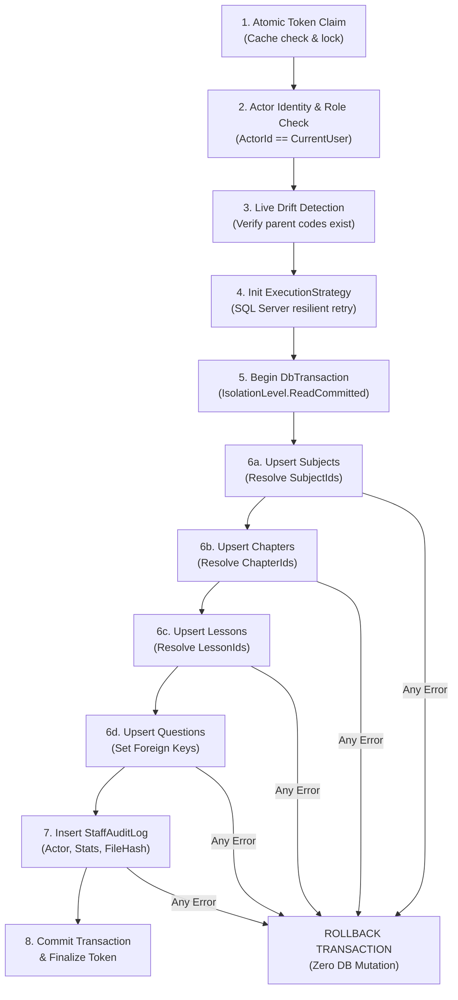

# STUDY_AI — PHASE 18: TRANSACTION & ROLLBACK DESIGN
## 8-Step EF Core ACID Pipeline, Isolation Levels, Concurrency Controls, and Failure Scenarios

- **Workspace**: `D:\TN`
- **Repository**: `hthuyngan/STUDY_AI-`
- **Status**: `[PROPOSED DESIGN — AWAITING USER APPROVAL PRIOR TO IMPLEMENTATION]`
- **Target**: Safe Execution Pipeline for Persisting Curriculum Hierarchy and Questions.

---

## 1. Executive Summary

Importing educational content involves multi-tier relational data: `ContentSubject` $\rightarrow$ `ContentChapter` $\rightarrow$ `ContentLesson` $\rightarrow$ `ContentAssessment` $\rightarrow$ `ContentQuestion`. Partial imports (e.g., inserting a subject and chapter, but crashing before inserting lessons or questions) leave the database in an orphaned, corrupted state that disrupts learner portals and staff CMS.

This document details the **8-step transactional pipeline** leveraging EF Core 10 `ExecutionStrategy` and SQL Server explicit transactions to guarantee absolute **All-or-Nothing (ACID)** semantics.

```
+-------------------------------------------------------------------------------+
|                       8-STEP TRANSACTION PIPELINE OVERVIEW                    |
+------+-------------------------------+----------------------------------------+
| Step | Action                        | Failure Behavior                       |
+------+-------------------------------+----------------------------------------+
| 1    | Atomic Token Claim & Load     | Abort 404/409 (No DB touch)            |
| 2    | Actor Binding Verification    | Restore Token, Abort 403               |
| 3    | Live Drift & Reference Check  | Restore Token, Abort 409 (Drift)       |
| 4    | Begin EF Core ExecutionStrategy| Fail-safe Retry Policy Initialization |
| 5    | Begin DbTransaction           | IsolationLevel.ReadCommitted           |
| 6    | Hierarchical Batch Persistence| Throw -> Rollback entire transaction   |
| 7    | Staff Audit Logging           | Throw -> Rollback entire transaction   |
| 8    | Commit & Invalidate Token     | Commit complete, return 200 OK         |
+------+-------------------------------+----------------------------------------+
```

---

## 2. The 8-Step Transactional Execution Pipeline



### Step 1: Atomic Token Claim & Session Retrieval
- In-memory or distributed cache retrieval.
- Prevents concurrent calls from claiming the same token simultaneously.
- If token missing or expired: Abort immediately (`404 Not Found`).

### Step 2: Actor Binding & Authorization Verification
- Verify `CurrentUserId == session.ActorId`.
- If mismatch and caller is not an `admin`: Abort (`403 Forbidden`).
- Verify caller's account status (`IsActive = true`, role has not been revoked).

### Step 3: Live Pre-transaction Revalidation & Drift Detection
- Query SQL Server (`AsNoTracking`) to verify:
  1. All parent codes (e.g. `SubjectCode`, `ChapterCode`) referenced by lessons or questions still exist and have not been soft-deleted or renamed since the preview was generated.
  2. No duplicate entity codes have been committed by another staff member in the interim.
- If drift is detected: Abort with `409 Conflict (DATA_DRIFT_DETECTED)` and advise the user to regenerate the preview.

### Step 4: EF Core `ExecutionStrategy` Integration
- SQL Server transient failure retry policies require wrapping transactions inside `CreateExecutionStrategy().ExecuteAsync`:
```csharp
var strategy = _context.Database.CreateExecutionStrategy();
await strategy.ExecuteAsync(async () =>
{
    using var transaction = await _context.Database.BeginTransactionAsync(
        IsolationLevel.ReadCommitted, cancellationToken);
    try
    {
        // Steps 5, 6, 7
        await transaction.CommitAsync(cancellationToken);
    }
    catch
    {
        await transaction.RollbackAsync(cancellationToken);
        throw;
    }
});
```

### Step 5: Hierarchical Key Resolution & Batch Persistence
Because child entities require the generated foreign keys of their parents, persistence must follow an ordered cascade:

1. **Subjects Tier**:
   - Query existing subjects by code.
   - For `Insert`: Instantiate `ContentSubject`, add to context.
   - For `Update`: Update properties on tracked entity.
   - Execute `SaveChangesAsync()`. Map `Subject.Code` $\rightarrow$ `Subject.Id` (GUID string).
2. **Chapters Tier**:
   - For each chapter in batch, assign `SubjectId = subjectIdMap[ch.SubjectCode]`.
   - Add/Update chapters.
   - Execute `SaveChangesAsync()`. Map `Chapter.Code` $\rightarrow$ `Chapter.Id`.
3. **Lessons Tier**:
   - For each lesson in batch, assign `ChapterId = chapterIdMap[les.ChapterCode]`.
   - Add/Update lessons.
   - Execute `SaveChangesAsync()`. Map `Lesson.Code` $\rightarrow$ `Lesson.Id`.
4. **Questions Tier**:
   - For flat or nested questions:
     - Assign `LessonId = lessonIdMap[q.LessonCode]`.
     - Assign `SubjectId = subjectIdMap[q.SubjectCode]`.
   - Bulk add question entities.
   - Execute `SaveChangesAsync()`.

### Step 7: Fail-Closed Staff Audit Logging
- An immutable entry is written to `staff_audit_logs`:
  - `ActorId`, `ActorEmail`, `ClientIp`
  - `Action = "CURRICULUM_IMPORT_CONFIRM"`
  - `Entity = "Curriculum"`
  - `Payload = { PreviewToken, FileHash, EntityCounts, DurationMs }`
- **Fail-Closed Rule**: If the audit record fails to save for any reason, the entire transaction is aborted and rolled back. No un-audited bulk changes may enter the system.

### Step 8: Transaction Commit & Token Invalidation
- `transaction.CommitAsync()` flushes all writes to disk.
- Preview token is permanently invalidated in cache.
- Telemetry & metrics recorded.

---

## 3. Rollback & Failure Scenarios Analysis

| Failure Scenario | Trigger Cause | Rollback Guarantee | Resulting State |
|---|---|---|---|
| **Unique Code Violation** | Concurrent insert of identical code | EF Core throws `DbUpdateException` | Full rollback. 0 rows inserted. |
| **Malformed Formula / Text** | Field exceeds column varchar length | SQL Server error 8152 (string truncation) | Full rollback. 0 rows inserted. |
| **Deadlock Victim** | High concurrency lock contention | SQL Server error 1205 | Caught by `ExecutionStrategy`, retried or rolled back. |
| **Client Abort (Cancel)** | User closes browser, `CancellationToken` cancelled | `OperationCanceledException` | Automatic rollback by EF Core. |
| **Process Crash / Outage** | Server crash mid-transaction | SQL Server Engine | Transaction left uncommitted; SQL Server auto-rolls back. |

---

## 4. Performance & Scalability (5,000 Item Limit)

1. **Change Tracker Overhead**:
   - Tracking 5,000 entities in EF Core simultaneously can consume significant memory.
   - **Recommended Pattern**:
     - Persist in chunks of 500 questions inside the single transaction:
       `_context.ChangeTracker.Clear()` after intermediate flushes, while keeping the ambient `DbTransaction` open.
2. **Execution Timing Budget**:
   - Expected duration for 5,000 entities: < 2.5 seconds on local SQL Server.
   - Transaction timeout: Configured to 30 seconds.

---

## 5. Architectural Recommendations

1. `[PROPOSED DESIGN]` Implement `ICurriculumImportConfirmService` encapsulating the 8-step pipeline in `StudyAI.Application`.
2. `[PROPOSED DESIGN]` Inject `IDateTimeProvider` and `IStaffAuditLogService` to guarantee testability in integration tests.
3. `[SAFETY DIRECTIVE]` Integration tests for this pipeline must execute **strictly** against `StudyAIDb_E2E`, verified by `DatabaseSafetyGuard`.
