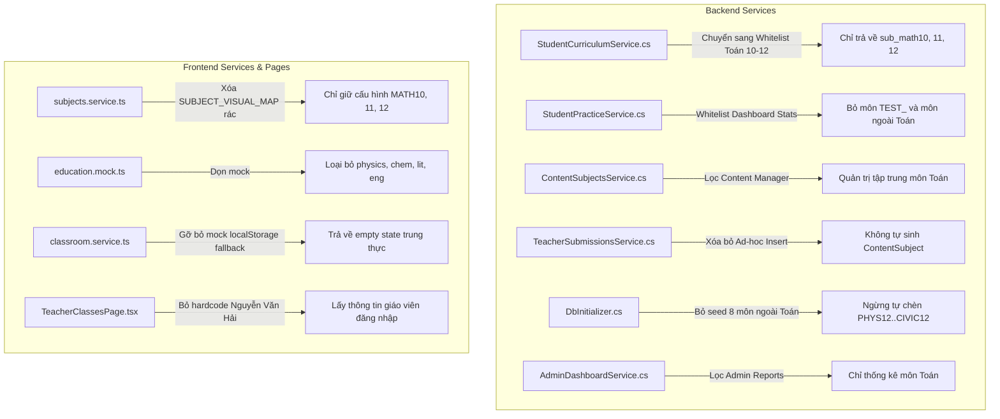
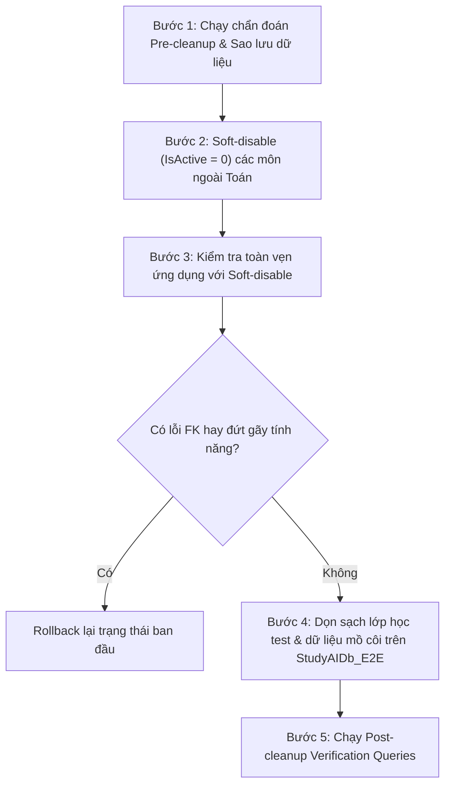
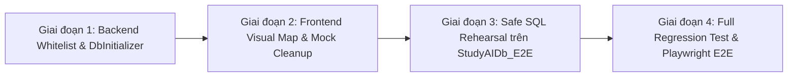

# STUDY_AI — MATH 10–12 ONLY: KẾ HOẠCH DỌN DẸP DỮ LIỆU CHƯƠNG TRÌNH & LỚP HỌC

**Tài liệu:** Kế hoạch Kỹ thuật & Quy trình Dọn dẹp Dữ liệu Toàn diện  
**Trạng thái:** AUDIT & PLAN ONLY (Chưa chỉnh sửa source code hoặc database)  
**Nhánh cơ sở:** `feature/backend-redesign-modular-monolith`  
**Nhánh kế hoạch:** `audit/math-only-cleanup-plan-20261123`  
**Mục tiêu cốt lõi:** Chuẩn hóa dữ liệu học tập chỉ phục vụ **Toán lớp 10, 11, 12**; loại bỏ hoàn toàn các môn rác/môn ngoài phạm vi và làm sạch lớp học mock/test mà không ảnh hưởng tới dữ liệu thật.

---

## 1. NGUYÊN TẮC THIẾT KẾ VÀ RÀNG BUỘC THỰC THI

### 1.1. Nguyên tắc An toàn Dữ liệu (Database Safety Invariants)
1. **Bảo vệ tuyệt đối `StudyAIDb`:**
   - `StudyAIDb` là database production được bảo vệ nghiêm ngặt.
   - Mọi thao tác chạy thử nghiệm (dry-run), tập dượt (rehearsal), migration hoặc dọn dẹp dữ liệu chỉ được phép thực hiện trên **`StudyAIDb_E2E`** hoặc instance SQL Server cô lập cục bộ.
   - Kết nối cơ sở dữ liệu phải có cơ chế ngắt tự động (fail-closed guard) nếu tên cơ sở dữ liệu là `StudyAIDb`.
2. **Quy tắc Whitelist thay thế Blacklist:**
   - Thay vì tiếp tục sử dụng logic loại trừ thủ công (blacklist) nhiều lỗ hổng như:
     `!s.Code.StartsWith("TEST_") && !s.Code.StartsWith("PHYS12_") ...`
   - Chuyển toàn bộ hệ thống sang cơ chế **Whitelist định danh dương (Positive Whitelist)**: Chỉ chấp nhận 3 môn học hợp lệ:
     * `sub_math10` / `MATH10`
     * `sub_math11` / `MATH11`
     * `sub_math12` / `MATH12`
3. **Bảo vệ Lớp học Mới Tạo của Giáo viên Thật:**
   - Một lớp học mới tạo bởi giáo viên thật (`TeacherId` hợp lệ) luôn bắt đầu với trạng thái `StudentCount == 0` và `AssignmentCount == 0`.
   - **Nghiêm cấm dùng điều kiện `StudentCount == 0` để xóa lớp học.**
   - Lớp học kiểm thử chỉ được dọn dẹp khi có dấu hiệu test rõ ràng (`TeacherId` thuộc tài khoản test hoặc mã lớp test định trước).

---

## 2. KẾ HOẠCH ĐIỀU CHỈNH MÃ NGUỒN (SOURCE CODE REMEDIATION SPECIFICATIONS)

Kế hoạch điều chỉnh được thiết kế theo nguyên tắc tối giản (minimal intervention), chạm đúng vị trí gây rò rỉ hoặc tự sinh dữ liệu rác:



### 2.1. Chi tiết các File & Hàm Backend cần chỉnh sửa

#### 1. `backend/src/StudyAI.Api/Features/Student/StudentCurriculumService.cs`
- **Hàm:** `GetSubjectsAsync(string? grade = null, string? search = null, CancellationToken ct = default)` (dòng 50-55).
- **Hiện trạng:**
  ```csharp
  var query = _db.ContentSubjects
      .Where(s => s.IsActive && !s.Code.StartsWith("TEST_") && !s.Code.StartsWith("SEC_") && !s.Code.StartsWith("PHYS12_") && !s.Code.StartsWith("SUB_") && !s.Code.StartsWith("VID-") && !s.Code.StartsWith("PERF_") && !s.Name.Contains("kiểm thử"))
  ```
- **Điều chỉnh:** Thay thế blacklist bằng Whitelist 3 môn Toán:
  ```csharp
  var canonicalMathIds = new[] { "sub_math10", "sub_math11", "sub_math12" };
  var canonicalMathCodes = new[] { "MATH10", "MATH11", "MATH12" };

  var query = _db.ContentSubjects
      .Where(s => s.IsActive && (canonicalMathIds.Contains(s.Id) || canonicalMathCodes.Contains(s.Code)))
      .Include(s => s.Chapters)
          .ThenInclude(c => c.Lessons)
      .AsNoTracking()
      .AsQueryable();
  ```
- **Tác động:** Triệt tiêu hoàn toàn rò rỉ môn học kiểm thử hoặc môn khác vào giao diện học sinh.

#### 2. `backend/src/StudyAI.Api/Features/Student/StudentPracticeService.cs`
- **Hàm:** `GetDashboardStatsAsync(string userId, CancellationToken cancellationToken)` (dòng 1005-1008).
- **Hiện trạng:**
  ```csharp
  var subjects = await _db.ContentSubjects.AsNoTracking()
      .Where(s => s.IsActive && !s.Name.StartsWith("TEST_"))
      .OrderBy(s => s.OrderIndex)
      .ToListAsync(cancellationToken);
  ```
- **Điều chỉnh:** Áp dụng whitelist Toán 10–12:
  ```csharp
  var canonicalMathIds = new[] { "sub_math10", "sub_math11", "sub_math12" };
  var canonicalMathCodes = new[] { "MATH10", "MATH11", "MATH12" };

  var subjects = await _db.ContentSubjects.AsNoTracking()
      .Where(s => s.IsActive && (canonicalMathIds.Contains(s.Id) || canonicalMathCodes.Contains(s.Code)))
      .OrderBy(s => s.OrderIndex)
      .ToListAsync(cancellationToken);
  ```
- **Tác động:** Khối "Tiến độ theo môn học" trên Dashboard học sinh chỉ hiển thị đúng 3 môn Toán 10, 11, 12.

#### 3. `backend/src/StudyAI.Api/Features/Content/ContentSubjectsService.cs`
- **Hàm:** `ListSubjectsAsync` (dòng 28-31).
- **Điều chỉnh:** Bổ sung bộ lọc mặc định chỉ quản trị các môn thuộc phạm vi Toán học (các môn có `Code` bắt đầu bằng `MATH` hoặc `Id` trong danh sách chuẩn), trừ trường hợp admin truyền tham số truy vấn đặc thù.
- **Tác động:** Màn hình Content Management không bị phân tán bởi các môn rác do test tạo ra.

#### 4. `backend/src/StudyAI.Api/Features/Teacher/TeacherSubmissionsService.cs`
- **Hàm:** `GradeSubmissionAsync` (dòng 336-351).
- **Hiện trạng:**
  ```csharp
  var subjectExists = await _db.ContentSubjects.AnyAsync(s => s.Id == resolvedSubjectId, cancellationToken);
  if (!subjectExists && resolvedSubjectId.StartsWith("sub_math"))
  {
      string g = resolvedSubjectId.Replace("sub_math", "");
      _db.ContentSubjects.Add(new ContentSubject { ... });
      await _db.SaveChangesAsync(cancellationToken);
  }
  ```
- **Điều chỉnh:**
  - Xóa bỏ hoàn toàn khối `_db.ContentSubjects.Add(...)`.
  - Nếu `subjectExists == false`, ghi warning log và gán vào môn chuẩn theo khối lớp của học sinh/lớp học (`sub_math10/11/12`), tuyệt đối không tạo môn học mới trong quá trình giáo viên chấm bài.

#### 5. `backend/src/StudyAI.Api/Data/DbInitializer.cs`
- **Hàm:** `InitializeAsync` (dòng 320-350).
- **Hiện trạng:**
  - Tự động nạp 8 môn không thuộc Toán vào DB mỗi khi khởi tạo: `sub_phys12`, `sub_chem12`, `sub_bio12`, `sub_lit12`, `sub_eng12`, `sub_hist12`, `sub_geo12`, `sub_civic12`.
- **Điều chỉnh:**
  - Vô hiệu hóa (comment out hoặc loại bỏ) mảng `standardSubjects` này trong `DbInitializer.cs`.
  - Đảm bảo `DbInitializer` chỉ khởi tạo duy nhất dữ liệu cho `sub_math10`, `sub_math11`, và `sub_math12`.

#### 6. `backend/src/StudyAI.Api/Features/Admin/AdminDashboardService.cs`
- **Hàm:** `GetSystemAnalyticsAsync` (dòng 296).
- **Điều chỉnh:** Lọc danh sách `subjects` theo whitelist Toán 10–12 để báo cáo phân tích toàn hệ thống phản ánh đúng môn trọng tâm.

---

### 2.2. Chi tiết các File Frontend cần chỉnh sửa

#### 1. `frontend/src/services/subjects.service.ts`
- **Vị trí 1:** `SUBJECT_VISUAL_MAP` (dòng 13-91).
  - Loại bỏ các key không phải Toán: `PHYS12`, `CHEM12`, `BIO12`, `LIT12`, `ENG12`, `HIST12`, `GEO12`, `CIVIC12`.
  - Giữ lại duy nhất `MATH10`, `MATH11`, `MATH12`.
- **Vị trí 2:** `getSubjects()` (dòng 154-161).
  - Thay thế bộ lọc cũ (`s.id === 'math' || s.name.includes('toán')...`) bằng whitelist chặt chẽ:
    ```typescript
    return summaries.filter((s) =>
      s.id === 'sub_math10' || s.id === 'sub_math11' || s.id === 'sub_math12'
    )
    ```

#### 2. `frontend/src/services/education.service.ts` & `frontend/src/data/mock/education.mock.ts`
- Loại bỏ các môn mock ngoài Toán (`physics`, `chemistry`, `literature`, `english`).
- Đảm bảo fallback chỉ chứa cấu trúc môn Toán nếu chạy trong chế độ mock.

#### 3. `frontend/src/services/classroom.service.ts`
- **Vị trí:** Dòng 594:
  ```typescript
  return loadFromStorage<AdminClassItem[]>(STORAGE_KEYS.CLASSES, INITIAL_CLASSES)
  ```
- **Điều chỉnh:**
  - Khi người dùng đã đăng nhập (`getAccessToken()` có giá trị), nếu API trả về danh sách rỗng (giáo viên chưa tạo lớp nào), trả về mảng rỗng `[]`.
  - Không fallback về 4 lớp học mock của giáo viên "Nguyễn Văn Hải" (`cls-12a1..10c1`).

#### 4. `frontend/src/pages/Teacher/TeacherClassesPage.tsx` & `AdminClassesPage.tsx`
- **Vị trí:** `TeacherClassesPage.tsx:41, 128` và `AdminClassesPage.tsx:37, 110`.
- **Điều chỉnh:**
  - Thay thế giá trị hardcode `homeroomTeacherName: 'ThS. Nguyễn Văn Hải'` bằng tên người dùng hiện tại lấy từ authentication state (`user?.displayName || 'Giáo viên'`).
- **Xóa file dead code:** `frontend/src/data/staff/teacher.mock.ts`.

---

## 3. KẾ HOẠCH DỌN DẸP DỮ LIỆU SQL AN TOÀN (SAFE SQL REHEARSAL & CLEANUP PLAN)

> [!IMPORTANT]
> Toàn bộ các bước dưới đây được thiết kế để chạy thử nghiệm trên cơ sở dữ liệu kiểm thử **`StudyAIDb_E2E`**.  
> Tuyệt đối không chạy trực tiếp trên cơ sở dữ liệu `StudyAIDb`.

### 3.1. Kịch bản Truy vấn Chẩn đoán Trước Dọn dẹp (Pre-Cleanup Diagnostic Queries)

```sql
-- ============================================================================
-- SCRIPT 1: KIỂM TRA MÔN HỌC & RÀNG BUỘC PHỤ THUỘC (CHẠY TRÊN StudyAIDb_E2E)
-- ============================================================================
-- 1. Liệt kê các môn học không phải Toán 10-12
SELECT Id, Code, Name, Grade, IsActive, CreatedAt
FROM content_subjects
WHERE Id NOT IN ('sub_math10', 'sub_math11', 'sub_math12')
  AND Code NOT IN ('MATH10', 'MATH11', 'MATH12');

-- 2. Kiểm tra bản ghi phụ thuộc của các môn ngoài Toán
SELECT 
    s.Id AS SubjectId,
    s.Code,
    s.Name,
    (SELECT COUNT(*) FROM content_chapters c WHERE c.SubjectId = s.Id) AS ChapterCount,
    (SELECT COUNT(*) FROM content_questions q WHERE q.SubjectId = s.Id) AS QuestionCount,
    (SELECT COUNT(*) FROM lesson_progress lp WHERE lp.SubjectId = s.Id) AS ProgressCount,
    (SELECT COUNT(*) FROM assessment_attempts a WHERE a.SubjectId = s.Id) AS AttemptCount,
    (SELECT COUNT(*) FROM student_topic_masteries stm WHERE stm.SubjectId = s.Id) AS MasteryCount
FROM content_subjects s
WHERE s.Id NOT IN ('sub_math10', 'sub_math11', 'sub_math12')
  AND s.Code NOT IN ('MATH10', 'MATH11', 'MATH12');

-- ============================================================================
-- SCRIPT 2: KIỂM TRA LỚP HỌC (CHẠY TRÊN StudyAIDb_E2E)
-- ============================================================================
-- 1. Thống kê toàn bộ lớp học: Phân biệt lớp thật vs lớp test
SELECT 
    c.Id,
    c.Name,
    c.Code,
    c.Grade,
    c.Subject,
    c.TeacherId,
    u.DisplayName AS TeacherDisplayName,
    u.Role AS TeacherRole,
    (SELECT COUNT(*) FROM classroom_students cs WHERE cs.ClassroomId = c.Id) AS StudentCount,
    (SELECT COUNT(*) FROM assignments a WHERE a.ClassroomId = c.Id) AS AssignmentCount,
    c.CreatedAt
FROM classrooms c
LEFT JOIN users u ON c.TeacherId = u.Id;

-- 2. Đếm số lượng lớp thật mới tạo (0 học sinh) - BẮT BUỘC BẢO VỆ
SELECT COUNT(*) AS RealEmptyClassesCount
FROM classrooms c
JOIN users u ON c.TeacherId = u.Id
WHERE (SELECT COUNT(*) FROM classroom_students cs WHERE cs.ClassroomId = c.Id) = 0
  AND u.Role IN ('teacher', 'admin')
  AND c.Id NOT LIKE 'cls_test_%'
  AND c.Id NOT IN ('cls_A', 'cls_B');
```

---

### 3.2. Quy trình 2 Bước Dọn dẹp Dữ liệu An toàn



#### Bước 1: Vô hiệu hóa mềm (Soft-Disable Phase)
Thay vì xóa vật lý ngay lập tức, bước đầu tiên là cập nhật `IsActive = 0` cho toàn bộ các môn học không thuộc Toán 10–12. Cách tiếp cận này loại bỏ môn học khỏi mọi API công khai mà không vi phạm ràng buộc khóa ngoại `student_topic_masteries`.

```sql
BEGIN TRANSACTION;

-- Vô hiệu hóa mềm toàn bộ môn ngoài Toán 10, 11, 12
UPDATE content_subjects
SET IsActive = 0,
    UpdatedAt = SYSDATETIMEOFFSET()
WHERE Id NOT IN ('sub_math10', 'sub_math11', 'sub_math12')
  AND Code NOT IN ('MATH10', 'MATH11', 'MATH12');

PRINT 'Đã vô hiệu hóa mềm các môn học không thuộc Toán 10-12.';

COMMIT TRANSACTION;
```

#### Bước 2: Dọn dẹp Lớp học Test (Test Classrooms Cleanup)
Chỉ xóa các lớp học được tạo ra bởi integration test runner hoặc các lớp có mã test định trước:

```sql
BEGIN TRANSACTION;

-- 1. Xóa các lớp kiểm thử rõ ràng trên StudyAIDb_E2E
DELETE FROM classrooms
WHERE Id IN ('cls_A', 'cls_B')
   OR Id LIKE 'cls-test-%'
   OR Id LIKE 'cls_perf_%'
   OR TeacherId IN (SELECT Id FROM users WHERE Email LIKE '%@test.local' OR Id LIKE 'usr_test_%');

-- Cảnh báo kiểm tra: Đảm bảo không xóa bất kỳ lớp nào của giáo viên thật
-- (Lớp do giáo viên thật tạo luôn có Id theo định dạng cls-{Guid:N}[..12] và TeacherId là giáo viên hợp lệ)

COMMIT TRANSACTION;
```

---

### 3.3. Script Phục hồi / Hoàn tác (Rollback Template)

```sql
-- ============================================================================
-- SCRIPT ROLLBACK HOÀN TÁC (CHỈ DÙNG KHI CẦN KHÔI PHỤC)
-- ============================================================================
BEGIN TRANSACTION;

-- Khôi phục kích hoạt lại các môn standard seed nếu cần
UPDATE content_subjects
SET IsActive = 1,
    UpdatedAt = SYSDATETIMEOFFSET()
WHERE Code IN ('PHYS12', 'CHEM12', 'BIO12', 'LIT12', 'ENG12', 'HIST12', 'GEO12', 'CIVIC12');

PRINT 'Đã hoàn tác kích hoạt lại các môn học tiêu chuẩn.';

COMMIT TRANSACTION;
```

---

## 4. MA TRẬN PHỤ THUỘC & THỨ TỰ THỰC HIỆN (DEPENDENCY & EXECUTION ORDER)



1. **Giai đoạn 1: Backend Whitelist & Khóa Ad-hoc Insert**
   - Sửa `DbInitializer.cs` để ngăn chặn chèn thêm môn rác.
   - Sửa `StudentCurriculumService.cs` và `StudentPracticeService.cs` sang whitelist.
   - Gỡ bỏ logic auto-create `ContentSubject` trong `TeacherSubmissionsService.cs`.
2. **Giai đoạn 2: Frontend Visual Map & Gỡ bỏ Fallback Mock**
   - Làm sạch `subjects.service.ts` và `education.service.ts`.
   - Chỉnh sửa `classroom.service.ts` để hiển thị empty state thay vì nạp mock `INITIAL_CLASSES`.
   - Sửa `TeacherClassesPage.tsx` để không hardcode tên giáo viên.
3. **Giai đoạn 3: Thực thi Safe SQL Rehearsal trên `StudyAIDb_E2E`**
   - Chạy chẩn đoán pre-cleanup.
   - Thực thi soft-disable và dọn lớp test.
   - Xác minh toàn vẹn dữ liệu.
4. **Giai đoạn 4: Kiểm thử hồi quy toàn diện (Verification Gates)**

---

## 5. KẾ HOẠCH KIỂM THỬ HỒI QUY TOÀN DIỆN (REGRESSION TEST PLAN)

### 5.1. Backend Unit & Integration Tests
1. **Kiểm tra Môn học Toán 10–12:**
   - Test: `StudentCurriculumIntegrationTests`: Gọi `GET /api/v1/curriculum/subjects`, xác nhận danh sách trả về chỉ chứa đúng 3 phần tử có mã `MATH10`, `MATH11`, `MATH12`.
   - Test: `SubjectGradeResolverTests`: Xác minh học sinh lớp 10, 11, 12 tự động map chính xác về `sub_math10`, `sub_math11`, `sub_math12` mà không bao giờ fallback nhầm về Grade 12 hoặc môn khác.
2. **Kiểm tra Dashboard & Practice Stats:**
   - Test: `StudentPracticeControllerTests`: Gọi `GET /api/v1/practice/dashboard-stats`, xác nhận `subjectProgressList` có độ dài tối đa là 3 và không chứa bất kỳ môn test nào.
3. **Kiểm tra Chấm điểm Giáo viên:**
   - Test: `TeacherSubmissionsIntegrationTests`: Giáo viên chấm bài không sinh ra thêm bất kỳ bản ghi nào trong bảng `content_subjects`.
4. **Kiểm tra Lớp học Giáo viên:**
   - Test: Tạo lớp học mới, xác nhận lớp có `studentCount = 0` vẫn tồn tại, truy vấn danh sách lớp trả về đúng lớp đó mà không bị bộ lọc nào xóa bỏ.

### 5.2. Frontend Automated Tests (`bun run test`)
1. `subjects.service.test.ts`: Xác nhận `getSubjects()` chỉ trả về 3 môn Toán.
2. `classroom.service.test.ts`: Xác minh khi có token và API trả về `[]`, service trả về `[]` chứ không nạp `INITIAL_CLASSES`.
3. `TeacherClassesPage.test.tsx`: Xác nhận form tạo lớp hiển thị tên của giáo viên đăng nhập, không phải "ThS. Nguyễn Văn Hải".

### 5.3. Playwright E2E UI Tests
1. **Học sinh (Student Flow):**
   - Đăng nhập tài khoản học sinh.
   - Màn hình Lộ trình học / Danh sách môn: Chỉ thấy Toán 10, Toán 11, Toán 12. Không thấy Vật lý, Hóa học hay môn kiểm thử.
   - Màn hình Dashboard: Khối tiến độ hiển thị đúng 3 môn Toán.
2. **Giáo viên (Teacher Flow):**
   - Đăng nhập tài khoản giáo viên mới.
   - Truy cập trang Quản lý lớp học: Thấy empty state "Chưa có lớp học nào".
   - Bấm "Tạo lớp học mới": Tên GVCN tự điền đúng tên tài khoản. Tạo xong thấy lớp mới với 0 học sinh. F5 tải lại trang lớp vẫn còn nguyên vẹn.
3. **Gia sư AI (AI Tutor Flow):**
   - Đặt câu hỏi Toán 10, AI nhận diện đúng ngữ cảnh `sub_math10`.

---

## 6. TIÊU CHÍ NGHIỆM THU HOÀN THÀNH (DEFINITION OF DONE)

- [ ] **DoD-1:** API `GET /api/v1/curriculum/subjects` và `GET /api/v1/practice/dashboard-stats` chỉ trả về đúng Toán 10, Toán 11, Toán 12.
- [ ] **DoD-2:** Loại bỏ hoàn toàn blacklist tiêu cực 7 tiền tố test trong `StudentCurriculumService.cs`; thay thế bằng positive whitelist.
- [ ] **DoD-3:** Loại bỏ triệt để hành vi tự động chèn `ContentSubject` trong `TeacherSubmissionsService.cs:340-350`.
- [ ] **DoD-4:** `DbInitializer.cs` không còn seed 8 môn học ngoài phạm vi Toán (`sub_phys12..sub_civic12`).
- [ ] **DoD-5:** Frontend không còn bất kỳ màn hình nào hiển thị môn học ngoài Toán 10–12.
- [ ] **DoD-6:** Toàn bộ lớp học mock (`cls-12a1..10c1`) và tên cứng "ThS. Nguyễn Văn Hải" bị gỡ bỏ khỏi runtime.
- [ ] **DoD-7:** Lớp học thật mới tạo của giáo viên (0 học sinh) được bảo vệ tuyệt đối 100%.
- [ ] **DoD-8:** Cơ sở dữ liệu production `StudyAIDb` không bị bất kỳ tác động ghi/xóa nào trong suốt quá trình.
- [ ] **DoD-9:** Toàn bộ test suite Backend (Unit + Integration) và Frontend (`bun run test`, `bun run lint`) đạt 100% PASS trên môi trường cô lập.
