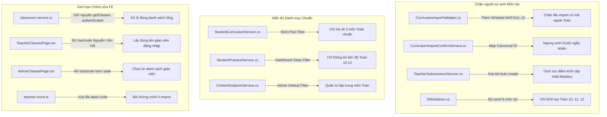
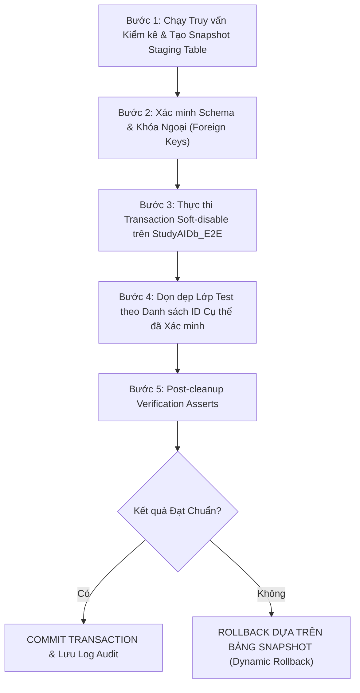

# STUDY_AI — MATH 10–12 ONLY: KẾ HOẠCH DỌN DẸP DỮ LIỆU CHƯƠNG TRÌNH & LỚP HỌC (REVISED)

**Tài liệu:** Kế hoạch Kỹ thuật & Quy trình Dọn dẹp Dữ liệu Toàn diện (Bản Hiệu đính)  
**Trạng thái:** AUDIT & PLAN ONLY (Chưa chỉnh sửa source code hoặc database)  
**Nhánh cơ sở:** `feature/backend-redesign-modular-monolith`  
**Nhánh kế hoạch:** `audit/math-only-cleanup-plan-20261123` (Draft PR #23)  
**Reference Baseline Commit:** `16593c049d5bf1e4b373eaef9ee2c2a0d7830cb3`  

---

## 1. NGUYÊN TẮC THIẾT KẾ & RÀNG BUỘC THỰC THI

### 1.1. Nguyên tắc An toàn Dữ liệu (Database Safety Invariants)
1. **Bảo vệ tuyệt đối cơ sở dữ liệu `StudyAIDb`:**
   - `StudyAIDb` là database sản xuất được bảo vệ nghiêm ngặt.
   - Tuyệt đối không chạy bất kỳ lệnh ghi, xóa, drop, truncate hoặc migration nào trên `StudyAIDb`.
   - Toàn bộ các bước diễn tập dọn dẹp dữ liệu (SQL rehearsal) chỉ được phép chạy trên cơ sở dữ liệu cô lập **`StudyAIDb_E2E`**.
2. **Quy tắc Whitelist Cặp đôi Bắt buộc (Strict Canonical Pair Whitelist):**
   - Không áp dụng logic `ID hợp lệ OR Code hợp lệ` vì có nguy cơ lọt các bản ghi có Code đúng nhưng ID sai (hoặc ngược lại).
   - Chỉ chấp nhận 3 cặp định danh chính thức:
     * `(Id == "sub_math10" && Code == "MATH10" && Grade == "10")`
     * `(Id == "sub_math11" && Code == "MATH11" && Grade == "11")`
     * `(Id == "sub_math12" && Code == "MATH12" && Grade == "12")`
3. **Phân biệt rành mạch 3 mục tiêu:**
   - *Mục tiêu 1:* Chỉ hiển thị 3 môn Toán trong danh mục (Curriculum & Practice Presentation).
   - *Mục tiêu 2:* Chặn hệ thống tự tạo thêm môn ngoài phạm vi (Mutation & Ingress Prevention).
   - *Mục tiêu 3:* Dọn dẹp dữ liệu đã tồn tại sau khi xác minh phụ thuộc (E2E SQL Cleanup).
   - **Tuyệt đối không nhầm việc ẩn dữ liệu trên FE/API với việc đã dọn sạch SQL.**
4. **Nghiêm cấm Wildcard Delete đối với Lớp học:**
   - **Tuyệt đối không dùng câu lệnh `DELETE ... WHERE Id LIKE 'cls-test%'` hoặc `WHERE TeacherId LIKE '%test%'`.**
   - Chỉ lập kế hoạch xóa theo **Danh sách ID cụ thể đã được xác minh bằng chứng** (Explicit Verified ID List) trên môi trường E2E.
   - Các lớp học do giáo viên thật tạo dù chưa có học sinh (`StudentCount == 0`) phải được bảo vệ nguyên vẹn.

---

## 2. KẾ HOẠCH ĐIỀU CHỈNH MÃ NGUỒN (SOURCE CODE REMEDIATION SPECIFICATIONS)



---

### 2.1. Chi tiết Điều chỉnh Backend

#### 1. `backend/src/StudyAI.Api/Features/Content/CurriculumImportValidator.cs`
- **Vị trí:** Hàm `ValidateSubject` (dòng 190-245).
- **Hiện trạng:** Chỉ kiểm tra `string.IsNullOrWhiteSpace(sub.Code)` và trùng lặp trong file; không kiểm tra phạm vi môn học được phép.
- **Điều chỉnh đề xuất:**
  - Bổ sung bộ kiểm tra danh mục cho phép:
    ```csharp
    private static readonly HashSet<string> AllowedSubjectCodes = new(StringComparer.OrdinalIgnoreCase)
    {
        "MATH10", "MATH11", "MATH12"
    };

    if (!AllowedSubjectCodes.Contains(sub.Code.Trim()))
    {
        errors.Add(new ImportValidationErrorDto
        {
            Row = row,
            Field = "Subject.Code",
            ErrorCode = "UNSUPPORTED_SUBJECT_SCOPE",
            Message = $"Mã môn học '{sub.Code}' không nằm trong phạm vi hỗ trợ (Hệ thống chỉ hỗ trợ MATH10, MATH11, MATH12).",
            RejectedValue = sub.Code
        });
    }
    ```
- **Lý do:** Chặn ngay từ bước tải lên/xác thực file import, không để các file chứa `PHYS12`, `CHEM12` hoặc mã tự chế lọt vào hệ thống.
- **Rủi ro & Kiểm soát:** Không có rủi ro với file giáo trình Toán; có test suite xác thực từ chối file ngoài Toán.

#### 2. `backend/src/StudyAI.Api/Features/Content/CurriculumImportConfirmService.cs`
- **Vị trí:** Vòng lặp xử lý môn học (dòng 143-178).
- **Hiện trạng:** Nếu môn chưa tồn tại trong DB, code tự sinh `Id = Guid.NewGuid().ToString("N")` và chèn vào `ContentSubjects`.
- **Điều chỉnh đề xuất:**
  - Ánh xạ mã code chuẩn sang ID chuẩn cố định:
    ```csharp
    var canonicalMap = new Dictionary<string, (string CanonicalId, string Grade)>
    {
        ["MATH10"] = ("sub_math10", "10"),
        ["MATH11"] = ("sub_math11", "11"),
        ["MATH12"] = ("sub_math12", "12")
    };

    var normalizedCode = sub.Code.Trim().ToUpperInvariant();
    if (!canonicalMap.TryGetValue(normalizedCode, out var canonicalMeta))
    {
        await transaction.RollbackAsync(cancellationToken);
        return CurriculumImportConfirmResult.Fail(
            422,
            "UNSUPPORTED_SUBJECT_SCOPE",
            $"Mã môn học '{sub.Code}' không được phép import.");
    }

    var existingSub = await _context.ContentSubjects
        .FirstOrDefaultAsync(s => s.Id == canonicalMeta.CanonicalId || s.Code == normalizedCode, cancellationToken);

    if (existingSub != null)
    {
        subjectIdMap[sub.Code] = existingSub.Id;
    }
    else
    {
        var newSub = new ContentSubject
        {
            Id = canonicalMeta.CanonicalId, // Tuyệt đối không dùng Guid.NewGuid()
            Code = normalizedCode,
            Name = sub.Name,
            Grade = canonicalMeta.Grade,
            Description = sub.Description,
            OrderIndex = sub.OrderIndex,
            IsActive = true,
            CreatedAt = DateTimeOffset.UtcNow,
            UpdatedAt = DateTimeOffset.UtcNow
        };
        _context.ContentSubjects.Add(newSub);
        subjectIdMap[sub.Code] = newSub.Id;
        insertedSubjects++;
    }
    ```
- **Lý do:** Đảm bảo khi import môn học Toán, ID luôn là `sub_math10`, `sub_math11`, hoặc `sub_math12`, không bao giờ sinh ra các bản ghi duplicate với ID dạng GUID.

#### 3. `backend/src/StudyAI.Api/Features/Teacher/TeacherSubmissionsService.cs`
- **Vị trí:** Hàm `GradeSubmissionAsync` (dòng 280-365).
- **Hiện trạng:**
  - Suy đoán môn học từ tiêu đề bài tập ("toán", "vật", "lí", "hóa", "sinh", "anh").
  - Mặc định gán `sub_math10` khi thiếu thông tin.
  - Tự động chèn `ContentSubject` mới nếu `resolvedSubjectId` chưa có trong DB (dòng 336-351).
- **Điều chỉnh đề xuất:**
  - **Tách rời 2 nghiệp vụ:** Lưu điểm bài nộp (Grading) và Cập nhật năng lực chủ đề (Mastery Calculation).
  - Điểm bài tập của học sinh (`submission.Score`, `submission.Feedback`, `Status = "graded"`) luôn được cập nhật thành công mà không phụ thuộc vào mastery.
  - Bỏ hoàn toàn khối code đoán môn ("vật", "lí", "hóa",...) và **xóa bỏ hoàn toàn đoạn `_db.ContentSubjects.Add(...)`**.
  - Chỉ cập nhật `StudentTopicMasteries` khi và chỉ khi:
    1. Xác định được lớp học thuộc môn Toán chuẩn (`sub_math10`, `sub_math11`, `sub_math12`).
    2. Xác định được chủ đề khớp với một `ContentTopic` đã tồn tại trong DB.
  - Nếu không xác minh được chủ đề hoặc môn học: Ghi warning log và **bỏ qua bước cập nhật Topic Mastery**, bài nộp vẫn được lưu điểm bình thường.

#### 4. `backend/src/StudyAI.Api/Data/DbInitializer.cs`
- **Vị trí:** Hàm `InitializeAsync` (dòng 320-350).
- **Hiện trạng:** Tự động chèn 8 môn chuẩn THPT ngoài Toán (`sub_phys12`..`sub_civic12`) vào DB mỗi khi khởi tạo.
- **Điều chỉnh đề xuất:** Xóa bỏ hoàn toàn mảng `standardSubjects` và vòng lặp chèn 8 môn này. Chỉ khởi tạo duy nhất `sub_math10`, `sub_math11`, `sub_math12`.

#### 5. `backend/src/StudyAI.Api/Features/Student/StudentCurriculumService.cs`
- **Vị trí:** Hàm `GetSubjectsAsync` (dòng 50-55).
- **Hiện trạng:** Sử dụng negative blacklist 7 tiền tố (`TEST_`, `SEC_`, `PHYS12_`,...).
- **Điều chỉnh đề xuất:** Áp dụng Strict Canonical Pair Whitelist:
  ```csharp
  var query = _db.ContentSubjects
      .Where(s => s.IsActive && (
          (s.Id == "sub_math10" && s.Code == "MATH10") ||
          (s.Id == "sub_math11" && s.Code == "MATH11") ||
          (s.Id == "sub_math12" && s.Code == "MATH12")
      ))
      .Include(s => s.Chapters)
          .ThenInclude(c => c.Lessons)
      .AsNoTracking()
      .AsQueryable();
  ```

#### 6. `backend/src/StudyAI.Api/Features/Student/StudentPracticeService.cs`
- **Vị trí:** Hàm `GetDashboardStatsAsync` (dòng 1005-1008).
- **Hiện trạng:** Chỉ lọc `!s.Name.StartsWith("TEST_")`.
- **Điều chỉnh đề xuất:** Áp dụng Strict Canonical Pair Whitelist tương tự như `StudentCurriculumService`.

---

### 2.2. Chi tiết Điều chỉnh Frontend (Targeted Frontend Polish)

#### 1. `frontend/src/services/classroom.service.ts`
- **Hiện trạng kiểm tra:**
  - Nhánh authenticated (`getAccessToken()` có giá trị, dòng 570-593) đã gọi `apiClient.get<ClassroomDto[]>('/api/v1/classrooms')` và trả về `[]` khi giáo viên chưa có lớp. Nhánh này hoạt động chính xác.
  - Fallback `loadFromStorage(..., INITIAL_CLASSES)` chỉ chạy khi `!getAccessToken()` (chế độ demo offline).
- **Điều chỉnh đề xuất:** Giữ nguyên hàm `getClasses()` đối với authenticated mode. Chỉ đảm bảo không nạp dữ liệu mock vào authenticated context.

#### 2. `frontend/src/pages/Teacher/TeacherClassesPage.tsx`
- **Vị trí:** Dòng 41 (initial form state) và Dòng 128 (`handleOpenCreate`).
- **Hiện trạng:** Hardcode `homeroomTeacherName: 'ThS. Nguyễn Văn Hải'`.
- **Điều chỉnh đề xuất:**
  - Thay thế giá trị hardcode bằng thông tin của giáo viên đang đăng nhập:
    ```typescript
    homeroomTeacherName: user?.displayName || user?.email || 'Giáo viên'
    ```
  - Xóa bỏ bộ lọc demo giáo viên không cần thiết đối với role Teacher (giáo viên chỉ quản lý các lớp của chính mình).

#### 3. `frontend/src/pages/Admin/AdminClassesPage.tsx`
- **Vị trí:** Dòng 37 và Dòng 110.
- **Hiện trạng:** Hardcode `homeroomTeacherName: 'ThS. Nguyễn Văn Hải'`.
- **Điều chỉnh đề xuất:** Cho phép Admin chọn giáo viên từ danh sách giáo viên thật đã nạp từ API `/api/v1/admin/users?role=teacher`, không để mặc định một giáo viên duy nhất.

#### 4. `frontend/src/services/subjects.service.ts`
- **Vị trí:** `SUBJECT_VISUAL_MAP` (dòng 13-91) và `getSubjects()` (dòng 154-161).
- **Điều chỉnh đề xuất:**
  - Xóa 8 môn ngoài Toán khỏi `SUBJECT_VISUAL_MAP`.
  - Hàm `getSubjects()` lọc chuẩn: `s.id === 'sub_math10' || s.id === 'sub_math11' || s.id === 'sub_math12'`.

#### 5. `frontend/src/data/staff/teacher.mock.ts`
- **Xác minh độc lập:** Đã quét toàn bộ dự án (`git grep`), chứng minh 100% không có file nào import `INITIAL_MOCK_CLASSES`, `TeacherRecentSubmission`, hay `TeacherAttentionStudent` từ file này.
- **Điều chỉnh:** Xóa file dead code này để làm sạch dự án.

---

## 3. KẾ HOẠCH DỌN DẸP DỮ LIỆU SQL AN TOÀN (STATEFUL SNAPSHOT & REHEARSAL PLAN)

> [!IMPORTANT]
> **Toàn bộ kịch bản SQL dưới đây được thiết kế và chỉ được phép diễn tập trên `StudyAIDb_E2E`.**  
> Tuyệt đối không chạy trên `StudyAIDb`.  
> Không tuyên bố đã dọn dữ liệu SQL nếu mới chỉ thay đổi bộ lọc trên API hay Frontend.



### 3.1. Kịch bản Kiểm kê Toàn diện & Tạo Bảng Snapshot Trạng thái Thực tế

```sql
-- ============================================================================
-- SCRIPT 1: SNAPSHOT TRẠNG THÁI TRƯỚC THAY ĐỔI (CHẠY TRÊN StudyAIDb_E2E)
-- ============================================================================
-- Fail-closed guard: Dừng ngay lập tức nếu vô tình chạy trên production
IF DB_NAME() = 'StudyAIDb'
BEGIN
    RAISERROR('FATAL: Nghiêm cấm thực thi trên database sản xuất StudyAIDb!', 20, 1) WITH LOG;
END;

-- 1. Tạo bảng snapshot trạng thái môn học thực tế
IF OBJECT_ID('tempdb..#PreCleanupSubjectAudit') IS NOT NULL DROP TABLE #PreCleanupSubjectAudit;

SELECT 
    s.Id,
    s.Code,
    s.Name,
    s.Grade,
    s.IsActive,
    s.UpdatedAt,
    (SELECT COUNT(*) FROM content_chapters c WHERE c.SubjectId = s.Id) AS ChapterCount,
    (SELECT COUNT(*) FROM content_questions q WHERE q.SubjectId = s.Id) AS QuestionCount,
    (SELECT COUNT(*) FROM lesson_progress lp WHERE lp.SubjectId = s.Id) AS ProgressCount,
    (SELECT COUNT(*) FROM assessment_attempts a WHERE a.SubjectId = s.Id) AS AttemptCount,
    (SELECT COUNT(*) FROM student_topic_masteries stm WHERE stm.SubjectId = s.Id) AS MasteryCount
INTO #PreCleanupSubjectAudit
FROM content_subjects s;

SELECT * FROM #PreCleanupSubjectAudit;
```

---

### 3.2. Kịch bản Kiểm kê Lớp học Đầy đủ Ràng buộc Phụ thuộc

```sql
-- ============================================================================
-- SCRIPT 2: KIỂM KÊ TOÀN DIỆN LỚP HỌC (EVIDENCE-BASED AUDIT)
-- ============================================================================
SELECT 
    c.Id AS ClassroomId,
    c.Name AS ClassroomName,
    c.Code AS ClassroomCode,
    c.Grade,
    c.Subject,
    c.TeacherId,
    u.Email AS TeacherEmail,
    u.DisplayName AS TeacherName,
    u.Role AS TeacherRole,
    (SELECT COUNT(*) FROM classroom_students cs WHERE cs.ClassroomId = c.Id) AS StudentCount,
    (SELECT COUNT(*) FROM assignments a WHERE a.ClassroomId = c.Id) AS AssignmentCount,
    (SELECT COUNT(*) FROM assignment_submissions sub 
     JOIN assignments a ON sub.AssignmentId = a.Id 
     WHERE a.ClassroomId = c.Id) AS SubmissionCount,
    (SELECT COUNT(*) FROM assignment_submissions sub 
     JOIN assignments a ON sub.AssignmentId = a.Id 
     WHERE a.ClassroomId = c.Id AND sub.Score IS NOT NULL) AS GradedSubmissionCount,
    (SELECT COUNT(*) FROM classroom_alerts ca WHERE ca.ClassroomId = c.Id) AS AlertCount,
    c.CreatedAt
FROM classrooms c
LEFT JOIN users u ON c.TeacherId = u.Id
ORDER BY c.CreatedAt DESC;
```

---

### 3.3. Kịch bản Soft-Disable & Dọn Lớp Test bằng Explicit IDs (Có Transaction Kiểm soát)

```sql
-- ============================================================================
-- SCRIPT 3: THỰC THI SOFT-DISABLE VÀ DỌN LỚP TEST ĐÃ XÁC MINH (StudyAIDb_E2E)
-- ============================================================================
BEGIN TRANSACTION;

-- 1. Soft-disable các môn học không thuộc Canonical Pair
UPDATE content_subjects
SET IsActive = 0,
    UpdatedAt = SYSDATETIMEOFFSET()
WHERE NOT (
    (Id = 'sub_math10' AND Code = 'MATH10') OR
    (Id = 'sub_math11' AND Code = 'MATH11') OR
    (Id = 'sub_math12' AND Code = 'MATH12')
);

-- 2. Dọn dẹp lớp học test: CHỈ XÓA THEO DANH SÁCH ID ĐÃ ĐƯỢC XÁC MINH BẰNG CHỨNG
-- Tuyệt đối không dùng wildcard LIKE 'cls-test%'
-- Các ID dưới đây là ví dụ fixture test đã được xác nhận không có học sinh thật:
DECLARE @VerifiedTestClassIds TABLE (Id NVARCHAR(64));
INSERT INTO @VerifiedTestClassIds (Id)
VALUES ('cls_A'), ('cls_B'); -- Chỉ các ID fixture cụ thể đã kiểm chứng

DELETE FROM classrooms
WHERE Id IN (SELECT Id FROM @VerifiedTestClassIds);

-- 3. Post-verification assert: Đảm bảo không có bất kỳ lớp học của giáo viên thật nào bị xóa
DECLARE @RealClassesCount INT;
SELECT @RealClassesCount = COUNT(*) 
FROM classrooms c
JOIN users u ON c.TeacherId = u.Id
WHERE u.Role IN ('teacher', 'admin') AND u.Email NOT LIKE '%@test.local';

IF @RealClassesCount = 0
BEGIN
    RAISERROR('Lỗi nghiêm trọng: Phát hiện mất toàn bộ lớp học của giáo viên thật! Đang rollback...', 16, 1);
    ROLLBACK TRANSACTION;
    RETURN;
END;

PRINT 'Diễn tập dọn dẹp dữ liệu trên StudyAIDb_E2E hoàn tất thành công.';
COMMIT TRANSACTION;
```

---

### 3.4. Kịch bản Rollback Động từ Bảng Snapshot Thực tế (Dynamic State Rollback)

> [!TIP]
> Script rollback không dùng danh sách ID hardcode mà **khôi phục chính xác từ bảng snapshot `#PreCleanupSubjectAudit`** đã lưu trước đó:

```sql
-- ============================================================================
-- SCRIPT 4: DYNAMIC ROLLBACK TỪ SNAPSHOT THỰC TẾ
-- ============================================================================
BEGIN TRANSACTION;

UPDATE target
SET target.IsActive = snap.IsActive,
    target.UpdatedAt = snap.UpdatedAt
FROM content_subjects target
INNER JOIN #PreCleanupSubjectAudit snap ON target.Id = snap.Id;

PRINT 'Đã khôi phục trạng thái môn học chính xác 100% từ snapshot.';

COMMIT TRANSACTION;
```

---

## 4. KẾ HOẠCH BỔ SUNG 11 BỘ KIỂM THỬ HỒI QUY (REGRESSION TEST SPECIFICATIONS)

Kế hoạch yêu cầu triển khai đầy đủ 11 bài kiểm thử tự động trên Backend và Frontend:

| Mã Test | Tên Bài Kiểm thử | Phân hệ | Mục tiêu Kiểm tra | Kết quả Mong đợi (Pass Criteria) |
| :---: | :--- | :--- | :--- | :--- |
| **REG-01** | `GetSubjects_Returns_Exactly_Three_Canonical_Math_Subjects` | `StudentCurriculum` | Gọi `GET /api/v1/curriculum/subjects`. | Trả về chính xác 3 môn: `sub_math10`, `sub_math11`, `sub_math12`. Không lọt bất kỳ môn nào khác. |
| **REG-02** | `GetSubjects_Rejects_Duplicate_Code_Or_Mismatched_Id_Subjects` | `StudentCurriculum` | Chèn giả định bản ghi `Code = "MATH10"` nhưng `Id = "sub_math10_dup"` vào DB test. | API bỏ qua bản ghi lỗi, chỉ trả về đúng cặp `(sub_math10, MATH10)`. |
| **REG-03** | `CurriculumImport_Rejects_NonMath_Subject_Codes` | `CurriculumImport` | Upload file import chứa môn `PHYS12` hoặc `CHEM12`. | Trả về `400 Bad Request` hoặc `422 Unprocessable Entity` với mã lỗi `UNSUPPORTED_SUBJECT_SCOPE`. |
| **REG-04** | `CurriculumImport_Maps_To_Canonical_Ids_Without_Creating_Guid_Subjects` | `CurriculumImport` | Import file giáo trình Toán 10 chuẩn. | Hệ thống tái sử dụng `sub_math10`, không sinh thêm subject ID ngẫu nhiên dạng GUID. |
| **REG-05** | `TeacherGrading_Does_Not_Auto_Create_ContentSubject` | `TeacherSubmissions` | Giáo viên chấm bài tập có tiêu đề chứa từ khóa lạ. | Số lượng bản ghi trong `content_subjects` trước và sau khi chấm giữ nguyên 100%. |
| **REG-06** | `TeacherGrading_Saves_Score_Even_When_Topic_Mastery_Unresolvable` | `TeacherSubmissions` | Chấm bài tập không có liên kết chủ đề hợp lệ. | Điểm số bài nộp được lưu thành công (`Status = "graded"`); hệ thống log warning và bỏ qua mastery an toàn. |
| **REG-07** | `TeacherGrading_Attributes_Mastery_Only_To_Verified_Canonical_Topic` | `TeacherSubmissions` | Chấm bài tập có chủ đề chuẩn của lớp Toán 12. | Điểm mastery trong `StudentTopicMastery` được cập nhật chính xác cho `sub_math12` và topic tương ứng. |
| **REG-08** | `Real_Empty_Classroom_Preserved_In_All_Queries` | `TeacherClassrooms` | Tạo lớp học mới của giáo viên thật (0 học sinh). | Lớp học hiển thị bình thường trong danh sách; script dọn dẹp không bao giờ xóa lớp này. |
| **REG-09** | `Authenticated_Teacher_Sees_No_Mock_Classes_And_Has_Truthful_Empty_State` | Frontend UI / E2E | Đăng nhập tài khoản giáo viên mới chưa có lớp. | Giao diện hiển thị empty state trung thực "Chưa có lớp học nào", không nạp 4 lớp mock (`cls-12a1..10c1`). |
| **REG-10** | `End_To_End_Classroom_Lifecycle_With_Teacher_Identity` | Teacher Module | Tạo lớp → thêm học sinh → giao bài → nộp bài → chấm điểm. | Tên GVCN lấy đúng từ giáo viên đăng nhập; toàn bộ luồng hoạt động mượt mà không lỗi FK. |
| **REG-11** | `Stateful_Sql_Rollback_Restores_Exact_Pre_Cleanup_State` | Database Rehearsal | Chạy soft-disable rồi thực thi script rollback từ snapshot. | Toàn bộ các trường `IsActive` và `UpdatedAt` khôi phục khớp 100% với snapshot ban đầu. |

---

## 5. TIÊU CHÍ NGHIỆM THU HOÀN THÀNH (DEFINITION OF DONE)

- [ ] **DoD-1:** Whitelist 3 môn Toán áp dụng Strict Canonical Pair Matching `(Id && Code && Grade)`.
- [ ] **DoD-2:** `CurriculumImportValidator` và `ConfirmService` chặn hoàn toàn mã môn ngoài `MATH10, 11, 12` và không tạo ID GUID.
- [ ] **DoD-3:** `TeacherSubmissionsService` tách rời việc lưu điểm bài tập khỏi cập nhật mastery; xóa bỏ triệt để đoạn tự tạo `ContentSubject`.
- [ ] **DoD-4:** `DbInitializer.cs` không còn seed 8 môn học ngoài phạm vi Toán.
- [ ] **DoD-5:** Không viết lại `classroomService.getClasses()` authenticated; loại bỏ hoàn toàn tên cứng "ThS. Nguyễn Văn Hải" khỏi các form tạo lớp.
- [ ] **DoD-6:** Toàn bộ kịch bản dọn dẹp SQL không dùng wildcard delete; chỉ dọn theo danh sách ID xác minh trên `StudyAIDb_E2E`.
- [ ] **DoD-7:** Script rollback hoạt động động dựa trên bảng snapshot `#PreCleanupSubjectAudit`.
- [ ] **DoD-8:** 11 bộ test hồi quy được định nghĩa chi tiết và sẵn sàng thực thi khi bước vào pha code.
- [ ] **DoD-9:** Cơ sở dữ liệu production `StudyAIDb` tuyệt đối không bị tác động.
