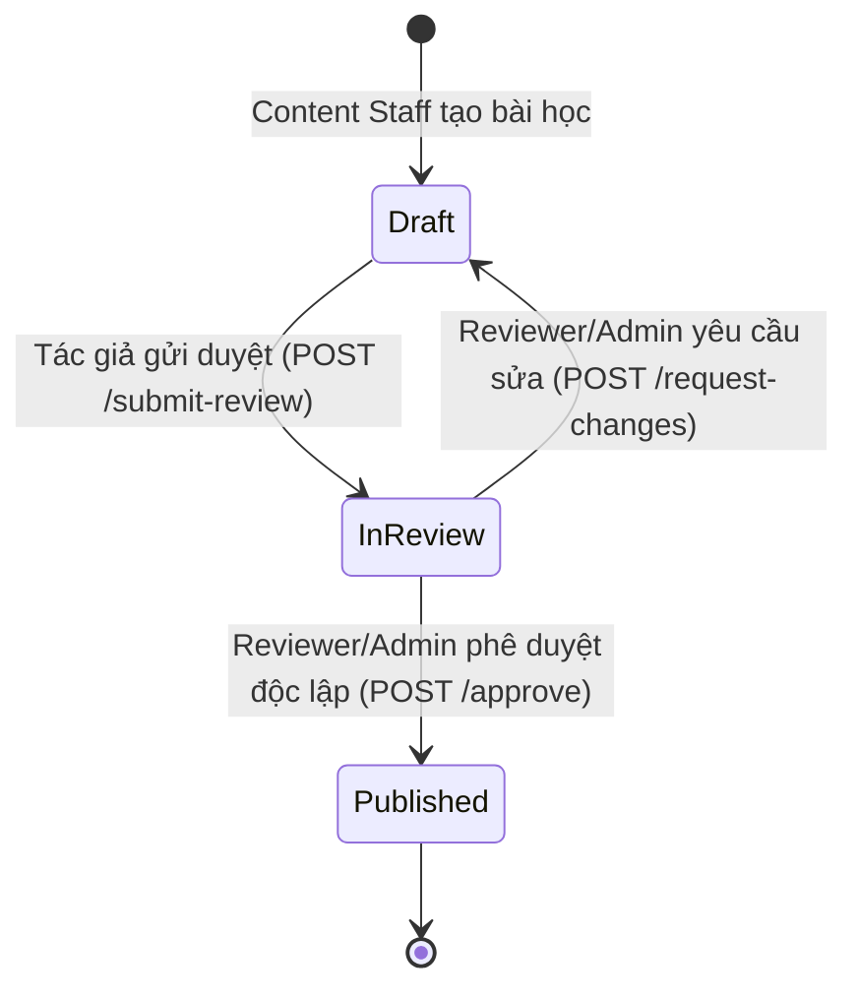

# Chính sách Bảo mật & Kiểm duyệt Nội dung (Content Moderation & Security)

## 1. Nguyên tắc Zero-Leak Security

Trong môi trường học tập trực tuyến ứng dụng AI, việc đảm bảo tính chính trực của học sinh khi làm bài luyện tập và đánh giá năng lực là tối quan trọng.

1. **Tuyệt đối không rò rỉ Đáp án trước giờ làm bài (No Early Leak)**:
   - DTO `LearnerQuestionDto` được tách biệt hoàn toàn với thực thể `ContentQuestion`.
   - Thuộc tính `CorrectAnswer` và `Explanation` bị loại bỏ hoàn toàn khỏi Serialization của API `GET /api/v1/curriculum/lessons/{lessonId}/questions`.
   - Ngay cả khi học sinh kiểm tra Source Code hay mở DevTools Network Tab, họ không thể đọc được đáp án.
2. **Server-Side Grading & Verification**:
   - Việc chấm điểm diễn ra hoàn toàn tại Backend ASP.NET Core API (`CheckQuestionAnswer`).
   - Kết quả trả về gồm điểm số (`scoreEarned`), trạng thái đúng/sai (`isCorrect`), đáp án chuẩn và lời giải chi tiết bằng KaTeX.

---

## 2. Cơ chế Kiểm duyệt Độc lập & Phân quyền Duyệt 4 Mắt (Independent Moderation & Dual Control)

Nhằm đảm bảo chất lượng sư phạm và tính khách quan của học liệu, hệ thống áp dụng quy trình kiểm duyệt bắt buộc:

### Quy tắc Bảo mật Kiểm duyệt:
1. **Kiểm duyệt Độc lập (No Self-Approval)**:
   - Tác giả bài học (`AuthorId == CurrentUserId`) **tuyệt đối không thể tự phê duyệt** bài học của chính mình.
   - Nếu tác giả gọi `POST /api/v1/content/lessons/{lessonId}/approve`, hệ thống ngay lập tức chặn và trả về `HTTP 403 Forbidden` với thông báo: *"Tác giả không được tự phê duyệt bài học của chính mình. Yêu cầu kiểm duyệt độc lập từ biên tập viên khác hoặc Quản trị viên."*
2. **Phân quyền Kiểm duyệt (Reviewer Authorization)**:
   - Chỉ tài khoản có role `admin`, `reviewer`, claim `permission = content.approve` hoặc `reviewer = true` mới có quyền phê duyệt hoặc yêu cầu sửa đổi.
   - Nhân viên `content` thông thường hoặc học viên `learner` gọi duyệt sẽ bị chặn với `HTTP 403 Forbidden`.
3. **Lưu trữ Người duyệt & Nhật ký (Auditing)**:
   - Mọi quyết định duyệt đều cập nhật trường `ReviewedBy` vào thực thể bài học và ghi `StaffAuditLog` chi tiết (chứa cả `authorId` và `reviewerId`).

---

## 3. Bảo vệ Question API & Cơ chế Chống Scraping / Brute-Force

Để bảo vệ ngân hàng đề thi khỏi các công cụ tự động thu thập (scraping bots) hoặc đoán mò đáp án (brute-force):

1. **Giới hạn số lần thử sai (Failed Attempts Rate Limiting)**:
   - Hệ thống sử dụng `IMemoryCache` theo dõi số lần nộp sai liên tiếp của mỗi client/phiên đăng nhập trên từng câu hỏi.
   - Nếu một client nộp sai liên tục 3 lần, lần thử thứ 4 trở đi sẽ bị khóa tạm thời với mã lỗi `HTTP 429 Too Many Requests` (kèm header `retryAfterSeconds = 120`).
   - Khi học viên trả lời đúng, bộ đếm thử sai sẽ được làm mới ngay lập tức.
2. **Ghi nhận Nhật ký Làm bài (Attempt Audit Trail)**:
   - Mọi lượt chấm điểm đều được ghi lại vào bảng nhật ký để phục vụ phân tích hành vi học tập và phát hiện sớm hành vi bất thường (crawl).
3. **Ranh giới Danh mục Khả dụng (Active Scope Enforcement)**:
   - Câu hỏi chỉ được phép truy vấn khi và chỉ khi:
     - Bài học sở hữu ở trạng thái `published`.
     - Chương học sở hữu đang kích hoạt (`IsActive == true`).
     - Môn học sở hữu đang kích hoạt (`IsActive == true`).

---

## 4. Nhật ký Kiểm toán Chuyên môn (Staff Audit Logs)

Mọi hoạt động tác động tới chương trình học đều được ghi nhận tự động vào bảng `staff_audit_logs`:
- `ActorUserId`: Định danh người dùng thực hiện hành động.
- `Action`: Loại hành động (`subject_created`, `chapter_created`, `lesson_created`, `lesson_submitted_for_review`, `lesson_approved`, `lesson_changes_requested`, `question_created`, `question_attempt_checked`).
- `TargetType`: `content_subject`, `content_chapter`, `content_lesson`, `content_question`.
- `TargetId`: ID của tài nguyên bị tác động.
- `Payload`: Dữ liệu tóm tắt dạng JSON.
- `CreatedAt`: Thời điểm ghi nhận bằng giờ chuẩn quốc tế UTC (`DateTimeOffset.UtcNow`).
