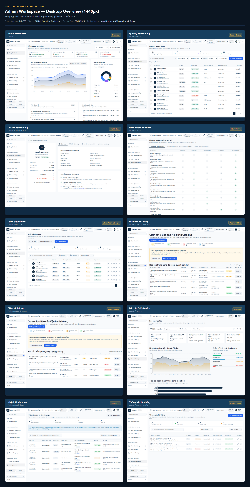
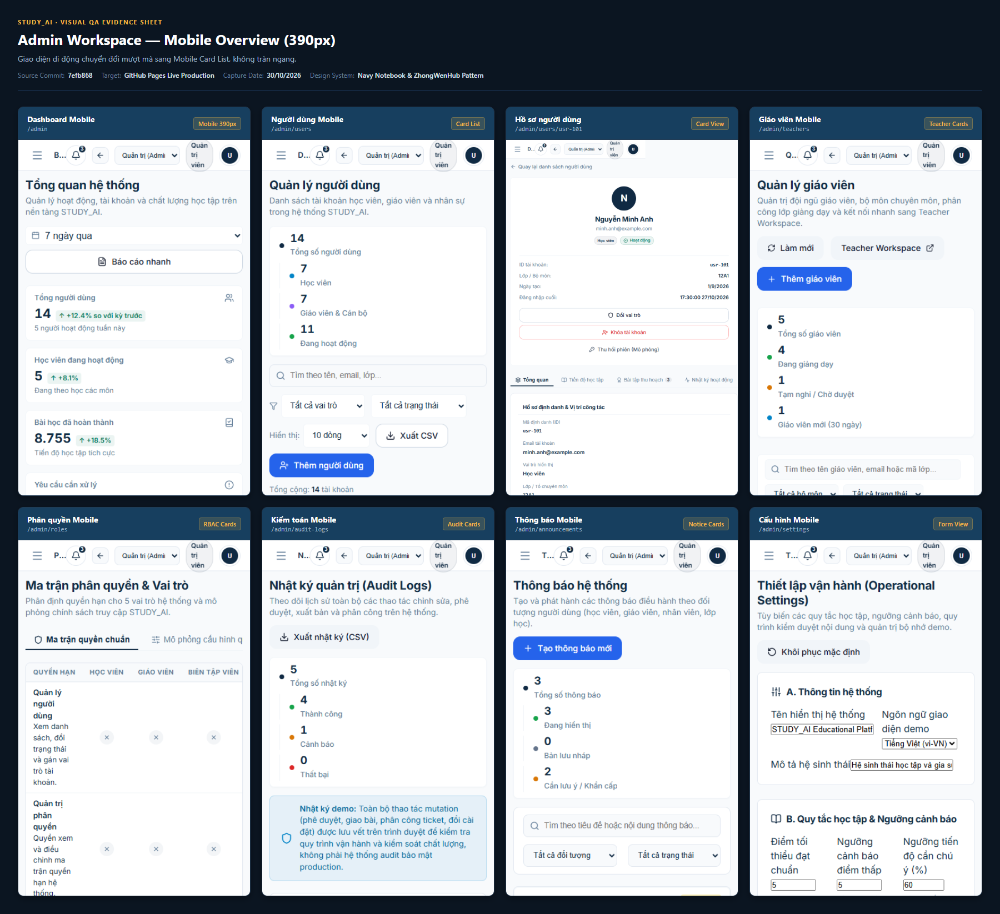
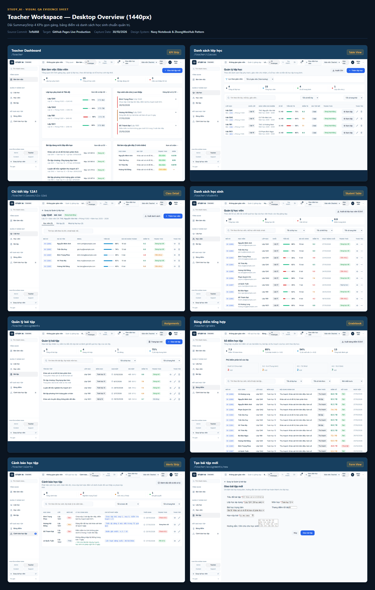
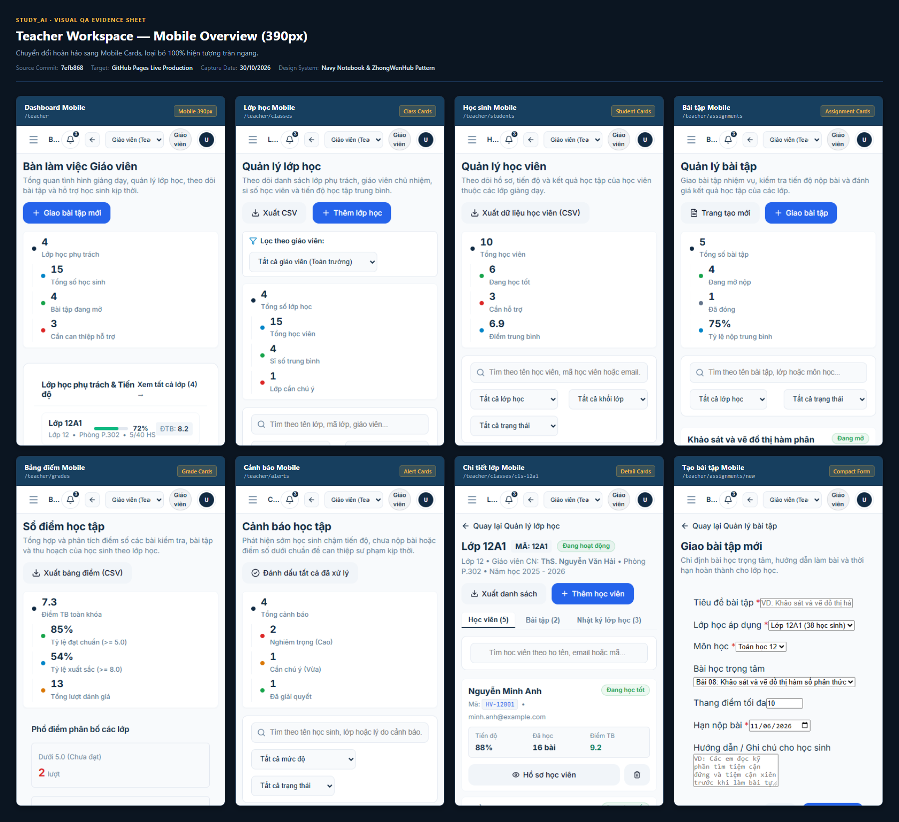
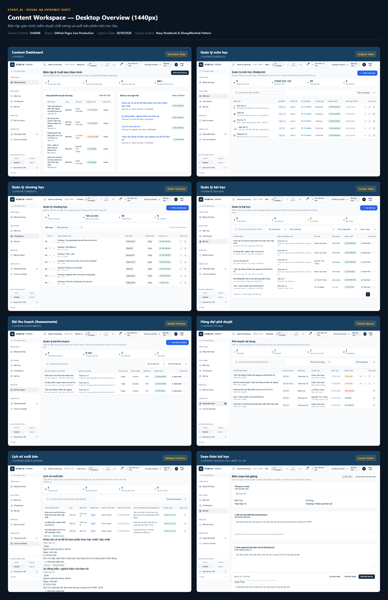
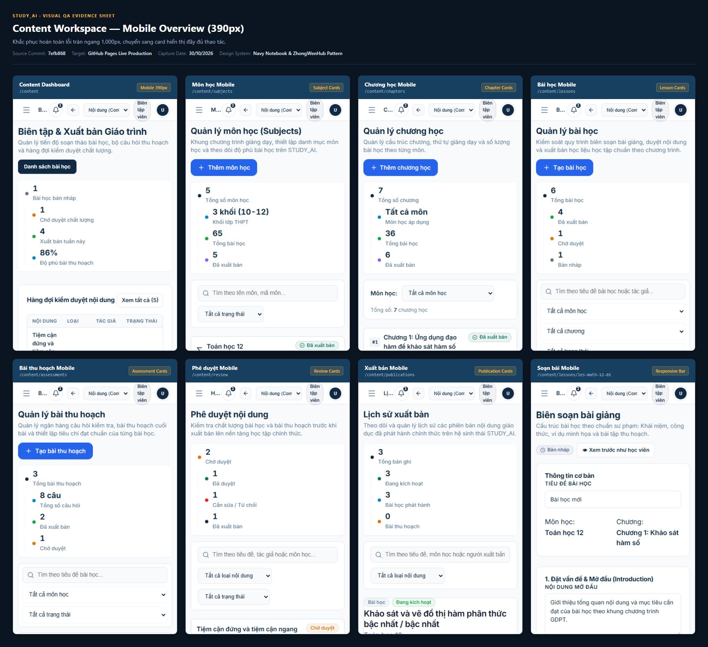
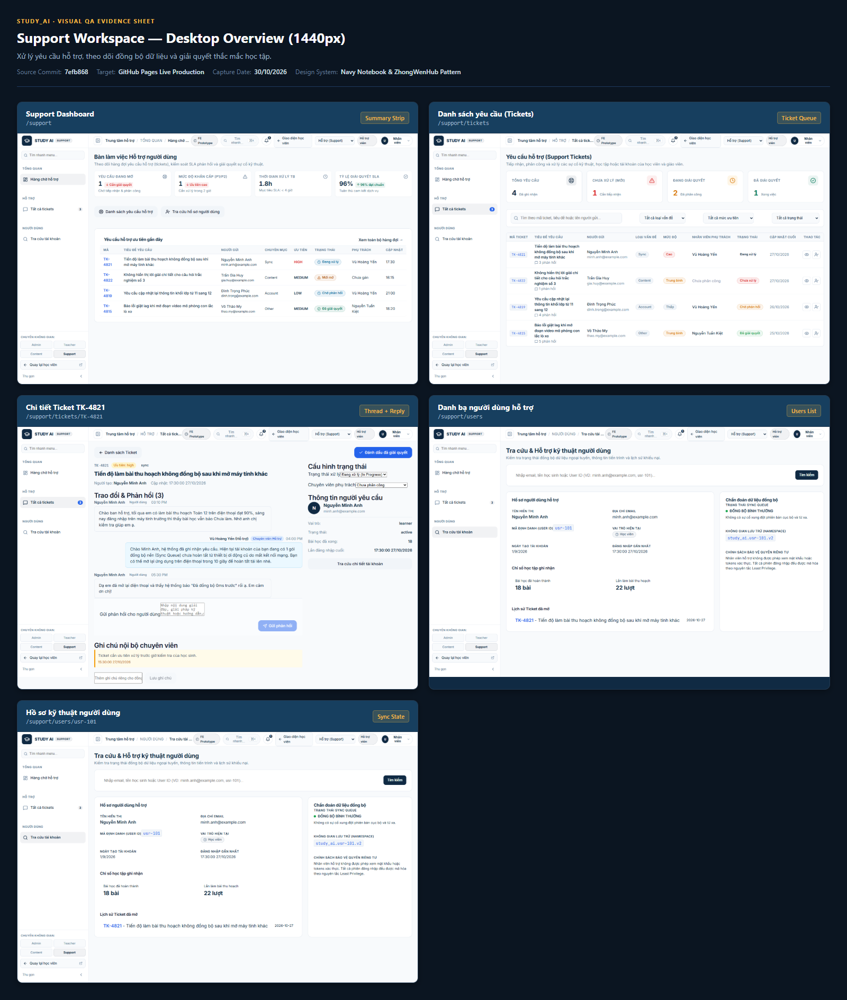
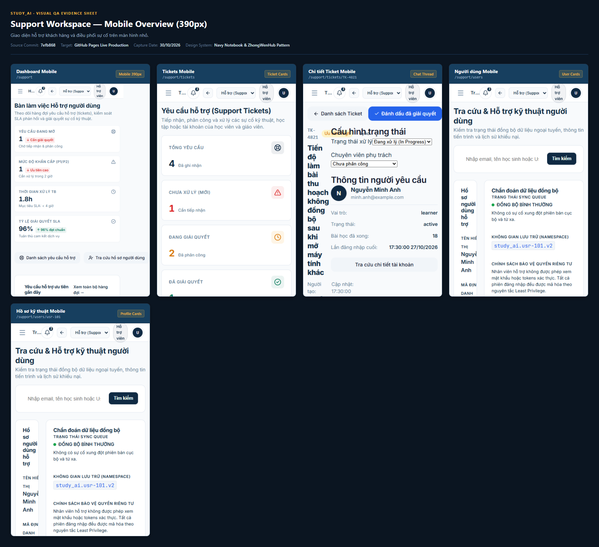
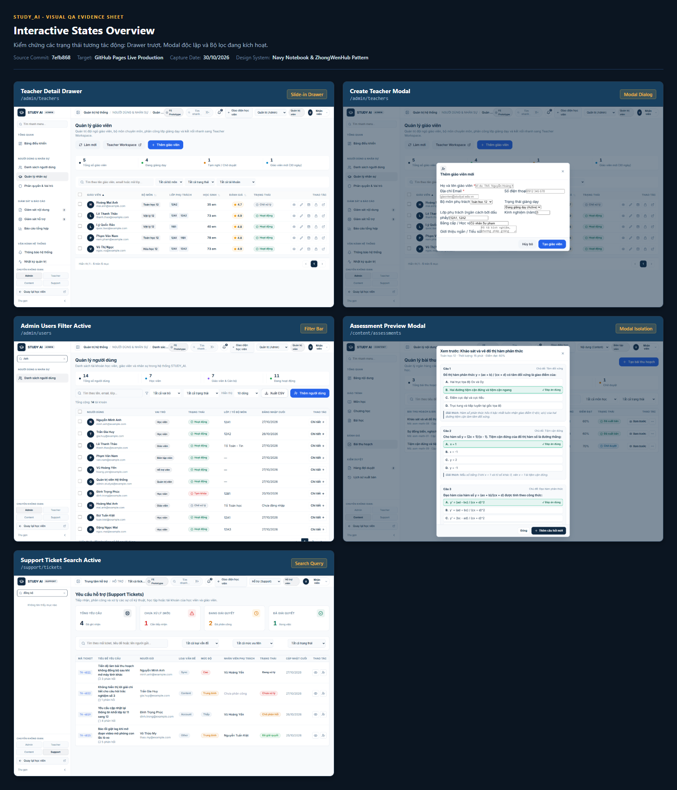
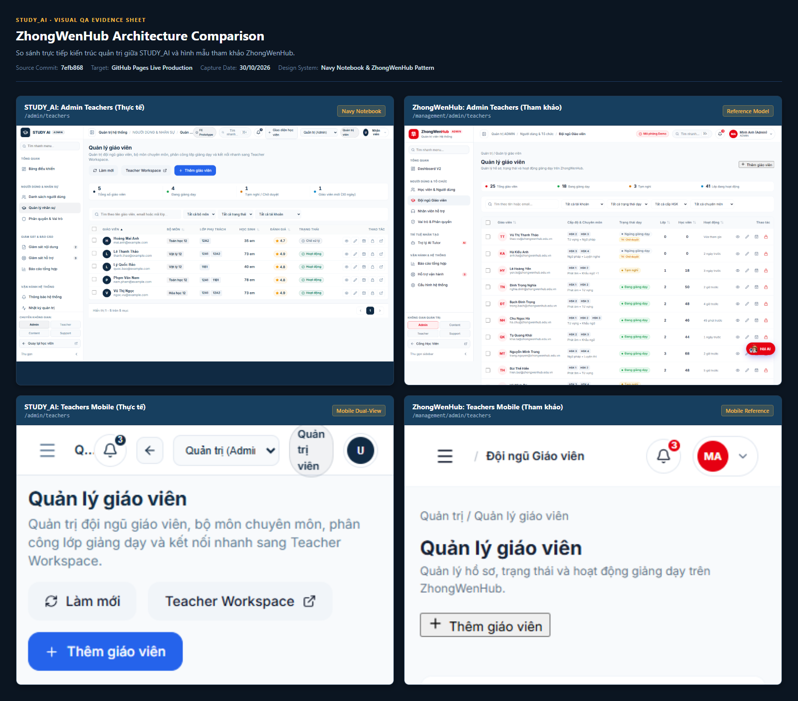

# STUDY_AI — BỘ BẰNG CHỨNG KIỂM CHỨNG THỊ GIÁC UI/UX (VISUAL QA EVIDENCE)

> **Dành cho ChatGPT & Đội ngũ Phát triển**: Tài liệu này lưu trữ đầy đủ bằng chứng kiểm chứng giao diện thực tế của toàn bộ hệ thống quản trị STUDY_AI từ môi trường Production thực tế. ChatGPT có thể truy cập trực tiếp các ảnh PNG thông qua GitHub mà không cần người dùng chụp ảnh hay gửi file thủ công.

---

## 1. THÔNG TIN HỆ THỐNG & PHIÊN BẢN

* **Môi trường thẩm định**: [GitHub Pages Production Live](https://hthuyngan.github.io/STUDY_AI-/)
* **Repository GitHub**: [https://github.com/hthuyngan/STUDY_AI-](https://github.com/hthuyngan/STUDY_AI-)
* **Mã commit giao diện (`sourceCommit`)**: [`7efb868`](https://github.com/hthuyngan/STUDY_AI-/commit/7efb868)
* **Thời gian chụp bằng chứng**: 30/10/2026
* **Hệ thống thiết kế**: Navy Notebook (`#102A43`, `#F4B942`, `#FFF9EA`) kết hợp chuẩn quản trị ZhongWenHub & evondevKit.
* **Báo cáo thẩm định chi tiết**: [Xem Báo cáo UI/UX Audit đầy đủ](reports/UI_UX_VISUAL_AUDIT.md)
* **Chỉ mục dữ liệu JSON**: [manifest.json](manifest.json) (Chứa thông số kỹ thuật 119 bản ghi ảnh)

---

## 2. ẢNH TỔNG HỢP (CONTACT SHEETS / OVERVIEWS)

Dưới đây là các tấm ảnh tổng hợp độ phân giải cao, hiển thị trực quan toàn bộ các màn hình theo từng nhóm vai trò và kích thước thiết bị:

### 2.1. Admin Workspace

#### Desktop Viewport (1440 × 900 px)


#### Mobile Viewport (390 × 844 px)


---

### 2.2. Teacher Workspace

#### Desktop Viewport (1440 × 900 px)


#### Mobile Viewport (390 × 844 px)


---

### 2.3. Content Workspace

#### Desktop Viewport (1440 × 900 px)


#### Mobile Viewport (390 × 844 px)


---

### 2.4. Support Workspace

#### Desktop Viewport (1440 × 900 px)


#### Mobile Viewport (390 × 844 px)


---

### 2.5. Trạng thái Tương tác Động (Interactions)


---

### 2.6. So sánh với Hình mẫu Kiến trúc ZhongWenHub


---

## 3. CẤU TRÚC THƯ MỤC VÀ LIÊN KẾT ẢNH GỐC

```text
docs/visual-qa/
├── README.md                              # Tài liệu mục lục & hiển thị ảnh inline (file này)
├── manifest.json                          # Metadata kỹ thuật cho 119 ảnh (route, viewport, status, timestamp)
├── reports/
│   └── UI_UX_VISUAL_AUDIT.md              # Báo cáo đánh giá chi tiết 12 tiêu chí UI/UX bằng tiếng Việt
├── overviews/                             # 10 tấm ảnh tổng hợp contact sheets
│   ├── ADMIN_DESKTOP.png
│   ├── ADMIN_MOBILE.png
│   ├── TEACHER_DESKTOP.png
│   ├── TEACHER_MOBILE.png
│   ├── CONTENT_DESKTOP.png
│   ├── CONTENT_MOBILE.png
│   ├── SUPPORT_DESKTOP.png
│   ├── SUPPORT_MOBILE.png
│   ├── INTERACTIONS.png
│   └── ZHONGWENHUB_COMPARISON.png
├── interactions/                          # Ảnh chụp các trạng thái động (Drawer, Modal, Filter)
│   ├── admin_teachers_drawer_open.png
│   ├── admin_teachers_create_modal.png
│   ├── admin_users_filter_active.png
│   ├── content_assessment_preview_modal.png
│   └── support_tickets_filter_active.png
└── screenshots/                           # 104 ảnh chụp fullpage các route đơn lẻ
    ├── admin/                             # 32 ảnh Admin routes (Desktop, Mobile, Laptop, Tablet)
    ├── teacher/                           # 28 ảnh Teacher routes
    ├── content/                           # 26 ảnh Content routes
    ├── support/                           # 16 ảnh Support routes
    └── reference/                         # 2 ảnh tham khảo gốc từ ZhongWenHub
```

---

## 4. HƯỚNG DẪN KIỂM CHỨNG DÀNH CHO CHATGPT

Khi thẩm định chất lượng UI/UX của STUDY_AI, ChatGPT có thể kiểm tra trực tiếp qua các bước sau:

1. **Xem tổng quan từng Workspace**: Bấm vào các ảnh trong mục **2. ẢNH TỔNG HỢP** bên trên để đánh giá bố cục chung, khoảng cách lề (spacing), dải KPI `SummaryStrip` và cách chuyển đổi sang thẻ Mobile Cards.
2. **Xem chi tiết trang đơn lẻ**: Duyệt vào thư mục [screenshots/](screenshots/) để mở ảnh fullpage của từng route cụ thể.
3. **Kiểm tra trạng thái Modal/Drawer**: Duyệt vào thư mục [interactions/](interactions/) để xác nhận rằng các modal (ví dụ: Assessment Preview Modal) được mở dạng dialog độc lập có backdrop, không bị rơi xuống dưới bảng.
4. **Kiểm tra đối chiếu chuẩn thiết kế**: Mở file [overviews/ZHONGWENHUB_COMPARISON.png](overviews/ZHONGWENHUB_COMPARISON.png) để so sánh trực quan với hình mẫu quản trị của ZhongWenHub.
5. **Đọc báo cáo kỹ thuật**: Mở file [reports/UI_UX_VISUAL_AUDIT.md](reports/UI_UX_VISUAL_AUDIT.md) để xem phân tích chi tiết theo 12 tiêu chí của evondevKit.
